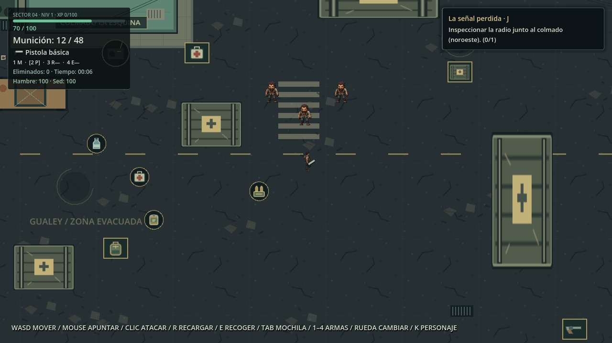
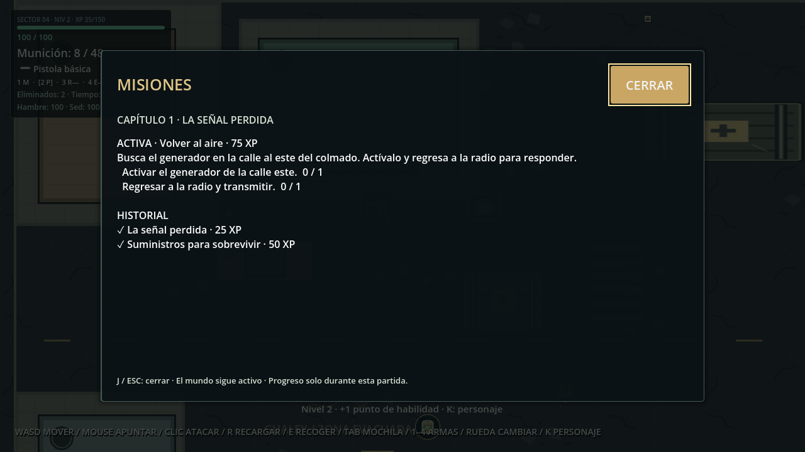
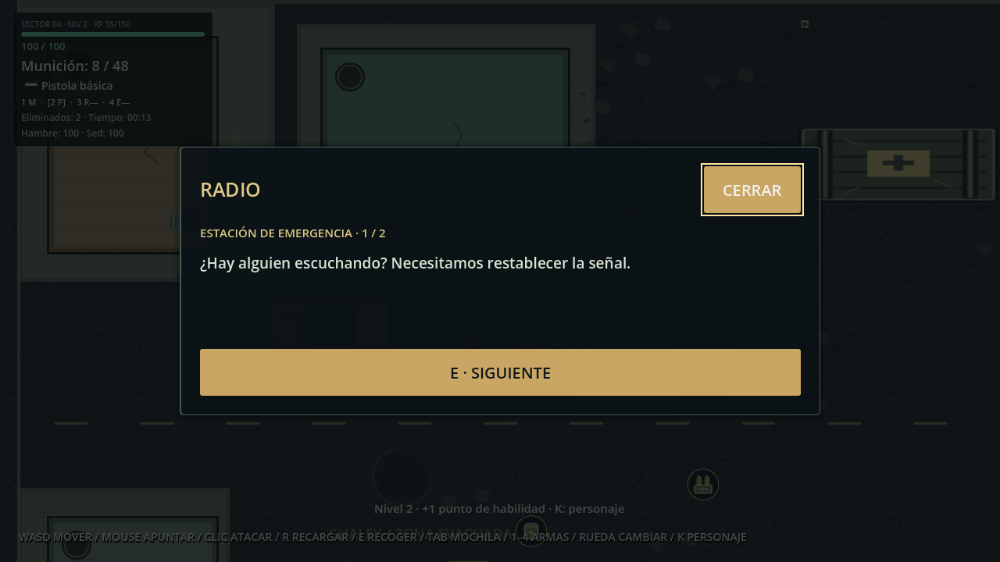
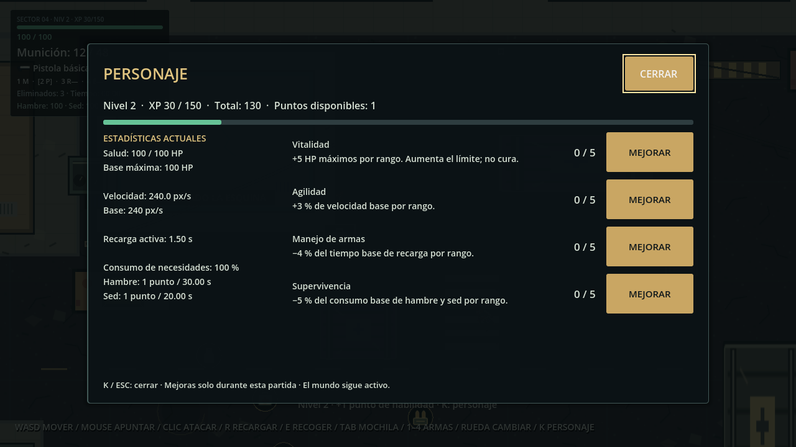
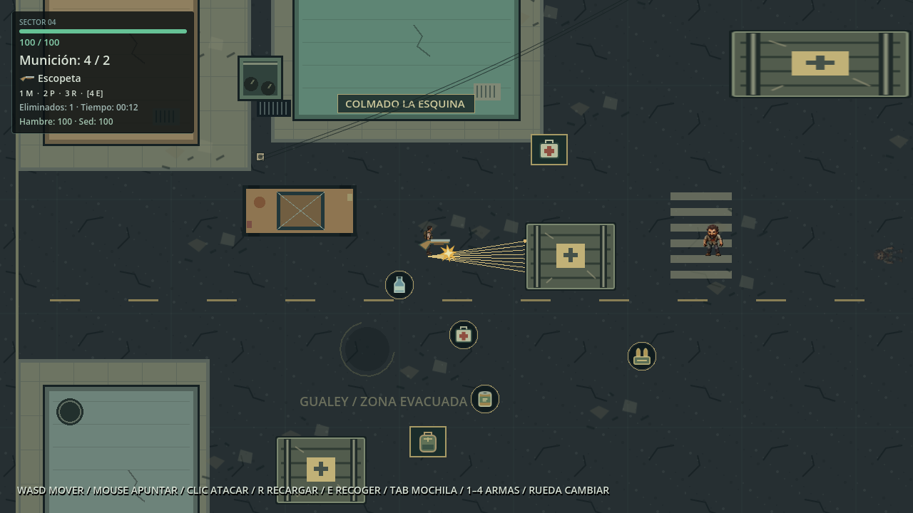

# Última Frecuencia: Gualey

Supervivencia zombi 2D con vista cenital, ambientada en un barrio urbano devastado. Explora el perímetro, enfrenta a los infectados y administra tu munición: cada disparo cuenta.

**Motor:** Godot 4.7.2 Stable · **Lenguaje:** GDScript · **Género:** Supervivencia zombi 2D

**Estado:** Desarrollo activo · **Plataforma inicial:** Windows

Un prototipo jugable con movimiento, navegación de enemigos, combate, salud, recarga, inventario, suministros, hambre, sed, progresión de personaje, misiones encadenadas, radio textual y reinicio. La integración visual funciona; el arte y varias animaciones todavía son provisionales. No hay una portada oficial incluida: esta presentación utiliza capturas reales del juego.

## Galería del juego

**Escenario, protagonista, zombis y HUD.** Primera zona urbana de Gualey, con colmado, aceras y obstáculos sólidos.


**Combate.** Disparo e impacto, feedback de daño y salud actualizada.


**Game Over.** Panel de muerte y botón Reintentar para restaurar la partida.


Capturas principales renovadas el **14 de noviembre de 2026** ejecutando el proyecto en Godot, mediante su prueba visual de integración. Las posiciones y acciones se preparan automáticamente en esa prueba; no son imágenes conceptuales. [Origen de las imágenes](docs/images/README.md).

## Zona urbana de Gualey

La fase 4.5 compone un barrio cenital ficticio inspirado en Gualey: viviendas con techos de concreto y tanques de agua, colmado, botica, ferretería, taller, carros abandonados, contenedores con bolsas, barricadas y postes con cables. El asfalto deteriorado, las aceras, el cruce peatonal y los escombros delimitan calles y pasos transitables. Una modulación ambiental suave conserva visibles los personajes y el HUD.


Vista técnica capturada en el motor con zoom reducido y HUD oculto únicamente en la prueba. La cámara de juego conserva su configuración original. Los 23 sólidos nuevos se añaden a las cinco cajas existentes; la navegación deriva sus huellas de las colisiones reales.

**Presentación provisional:** se reutilizan el asfalto, los escombros y las cajas SVG existentes. Los edificios y props nuevos son dibujos geométricos sustituibles, sin imágenes realistas nuevas ni interiores accesibles. Faltan texturas y sprites urbanos finales; [arquitectura, sustituciones y pruebas de la fase 4.5](docs/urban_world_integration.md).

## Protagonista y animaciones

Idle, Walk, Shoot, Reload y Death están conectadas en las cuatro direcciones. La lámina muestra Idle, Shoot, Reload y Death hacia abajo y la caminata izquierda V2, compuestas exclusivamente con los PNG utilizados por el proyecto.


| Animación | Frames por dirección | Reproducción e integración |
| --- | ---: | --- |
| Idle | 4 | 4 FPS, en bucle |
| Walk | 8 | 8 FPS, en bucle; conserva la dirección al detenerse |
| Shoot | 4 | Solo con un tiro válido; duración ligada a la cadencia del arma activa (pistola: 0,3 s) |
| Reload | 6 | Sincronizada con la recarga real del arma activa (pistola: 1,5 s) |
| Death | 6 | Una sola reproducción; conserva el último fotograma |

**Estado del arte:** recursos de integración, no arte definitivo. Shoot, Reload y Death contienen aproximaciones técnicas de poses y movimiento corporal. Los zombis, el entorno y parte de la interfaz usan recursos provisionales. Algunas secuencias conservan retoques de bordes y continuidad pendientes.

Los nombres de varios PNG históricos no coinciden con la orientación que muestran. Sus asignaciones están corregidas en SpriteFrames; antes de reemplazarlos, consultar la [guía visual](assets/README.md), la [validación de walk_left V2](docs/walk_left_v2_validation.md) y la [integración final de Shoot](docs/shoot_final_integration.md). Las referencias descartadas de `draft/` no forman parte de esta galería.

## Progreso del desarrollo

Fase 8.1: **población finita de zombis e IA comprobada en ventana**. Se mantienen
hasta **6 vivos**, con **18 apariciones totales** por capítulo y una reposición
cada 10 segundos cuando quedan vacantes. Los nuevos enemigos aparecen fuera de
cámara, en puntos transitables, separados del jugador y de los puntos de misión.

La IA anterior funcionaba: al inicio el enemigo más cercano está a 400 px, fuera
de sus 250 px de detección. Las fixtures de misiones inmovilizaban enemigos para
aislación; el juego normal no lo hace. Se verificaron persecución simultánea,
ruta alrededor del colmado, Walk y ataques reales sin reescribir la IA.



Con toda la población, cinco contenedores y las misiones hay **790 XP posibles**:
nivel 5, 90/300 XP y cuatro puntos. Se conservan los premios de 30 XP por baja y
los demás valores. [Diagnóstico, límites y pruebas](docs/zombie_population.md).

Fase 8: **primer capítulo jugable, La señal perdida**. Una radio junto al
colmado recibe una petición de ayuda: recupera un botiquín y agua, elimina dos
zombis, activa el generador de la calle este y vuelve a transmitir.

**J** abre MISIONES con objetivos, progreso e historial. **E** inspecciona los
puntos cercanos y avanza la radio; Esc o CERRAR permiten volver al juego. Las
ventanas se coordinan con MOCHILA y PERSONAJE, sin pausar el mundo.





Las misiones conceden **25 + 50 + 75 XP**, una sola vez. Las recogidas reales y
bajas anteriores cuentan para preparar suministros; el inventario inicial no.
En la población original de fase 8, el capítulo añade 150 XP a los 190 existentes: **340 XP, nivel 3 y dos
puntos de habilidad**. Al terminar puedes seguir explorando y combatiendo.
No hay segundo capítulo, nuevo mapa, voces grabadas ni guardado persistente.
[Arquitectura, recorrido y pruebas](docs/missions_radio.md).

Fase 7: **experiencia, niveles y cuatro habilidades implementados**. Las bajas
otorgan 30 XP y la primera apertura de cada contenedor con suministros, 20 XP.
Se empieza en nivel 1, sin puntos; hacen falta 100 XP para nivel 2 y 50 más por
cada salto posterior. Máximo inicial: nivel 10; un punto por subida.



**K** abre PERSONAJE. Vitalidad añade +5 HP máximos por rango; Agilidad, +3 % de
velocidad base; Manejo reduce 4 % la recarga base; Supervivencia reduce 5 % el
consumo. Cada habilidad admite cinco rangos, sin acumulaciones por refrescar UI
ni cambios de recursos compartidos. No hay redistribución ni guardado.

El mapa actual ofrece **190 XP**: alcanza nivel 2 y un punto. Los niveles
superiores están preparados para contenido futuro; no se añade XP pasiva por
tiempo sin una tasa definida ni respawn. La fase 8 añade las misiones y XP descritas arriba. [Arquitectura y validación](docs/progression_skills.md).

Fase 6.1: **HUD compacto, mochila renombrada y audio base integrado**. El panel
persistente ocupa aproximadamente un 63 % menos de área y conserva todas las
estadísticas. La interfaz se titula «MOCHILA»; el nombre oficial sigue en la
ventana y el branding general. Se añaden 19 efectos sintéticos breves y un loop
ambiental tenue, todos provisionales. [Arquitectura, mezcla y validación](docs/hud_audio_polish.md).

Fase 6: **arsenal y equipamiento implementados**. Machete y pistola disponibles
al empezar; revólver y escopeta se encuentran explorando, se guardan en la mochila
y se incorporan al arsenal con su botón. Cada arma conserva su estado y munición.



| Arma | Daño | Alcance | Intervalo | Cargador | Recarga |
| --- | --- | --- | --- | --- | --- |
| Machete | 30 HP por enemigo frontal | 55 px entre centros, arco 90° | 0,65 s | Sin munición | No aplica |
| Pistola básica | 25 HP | 600 px | 0,3 s | 12 | 1,5 s |
| Revólver | 45 HP | 650 px | 0,55 s | 6 | 2,1 s |
| Escopeta | 8 HP × 8 perdigones | 360 px, abanico de 18° | 0,9 s | 6 | 2,4 s |

Valores iniciales configurables, sin balance definitivo. **1/2/3/4** seleccionan
machete/pistola/revólver/escopeta; la rueda recorre únicamente las armas poseídas.
La pistola sigue activa al iniciar. Cambiar cancela la recarga sin transferir
balas y conserva el cooldown. Las armas encontradas empiezan vacías; sus
municiones propias deben transferirse desde la mochila y cargarse con R.

Los nuevos dibujos de arma son SVG técnicos provisionales. Shoot/Reload reutilizan
los frames existentes; el machete añade un arco breve de feedback, sin inventar
sprites corporales definitivos. [Arquitectura, obtención y pruebas de fase 6](docs/arsenal_equipment.md).

Fase 5: **inventario y supervivencia implementados**. Mochila de 12 espacios,
objetos apilables, cuatro tipos de suministros, tres contenedores finitos y
necesidades conectadas a la salud existente.


**E** recoge o abre un contenedor cercano; **Tab** abre/cierra la mochila y
**Esc** la cierra. Selecciona un espacio y pulsa **UTILIZAR**. La munición usa
**PASAR A RESERVA** para transferir toda la pila al arma; el cargador sigue
llenándose con R. El mundo permanece activo: mientras la ventana está abierta,
se bloquean movimiento, apuntado, disparo, nueva recarga e interacción exterior.
Los zombis, las necesidades y una recarga ya iniciada continúan.

[Reglas, configuración y pruebas de inventario](docs/inventory_survival.md) ·
[Captura real de un contenedor](docs/images/loot-container.png).

Fase 4.4, zombi base: **integrada técnicamente** con 96 PNG provisionales y cuatro
direcciones por estado. [Resultados y limitaciones](docs/zombie_base_integration.md).


| Fase | Funcionalidad | Estado |
| --- | --- | --- |
| 1 | Movimiento y escenario | Completada |
| 2 | Inteligencia artificial y salud | Completada |
| 3 | Combate y armas | Completada |
| 4 | Integración visual inicial | Completada técnicamente |
| 4.1 | Identidad Última Frecuencia: Gualey | Completada |
| 4.2 | Animaciones Idle y Walk | Completada |
| 4.3 | Shoot, Reload y Death | Completada técnicamente |
| 4.4 | Zombi base: Idle, Walk, Attack y Death | Completada técnicamente |
| 4.5 | Primera zona urbana de Gualey | Completada técnicamente; arte provisional |
| 5 | Inventario, suministros, hambre y sed | Implementada y validada automáticamente |
| 6 | Arsenal, equipamiento y cambio de armas | Implementada y validada automáticamente |
| 6.1 | HUD, textos y audio base | Integrada técnicamente; audio provisional |
| 7 | Experiencia, niveles y habilidades | Implementada y validada automáticamente |
| 8 | Capítulo 1, misiones y transmisiones de radio | Implementada y validada automáticamente; presentación provisional |
| 8.1 | Movilidad comprobada y población limitada | 6 vivos / 18 totales; balance manual pendiente |

“Completada técnicamente” significa que la integración y sus pruebas funcionan; no implica arte final ni aprobación artística de todos los ciclos. La fase 5 funciona sin guardado persistente y mantiene revisiones manuales pendientes.

## Controles

| Entrada | Acción |
| --- | --- |
| WASD | Movimiento en ocho direcciones |
| Mouse | Apuntar |
| Clic izquierdo | Atacar/disparar; mantener pulsado respeta el intervalo del arma |
| R | Recargar arma activa |
| 1 / 2 / 3 / 4 | Machete / pistola / revólver / escopeta, si se poseen |
| Rueda del mouse | Recorrer armas disponibles; bloqueada con la mochila abierta |
| E | Recoger, abrir contenedor o activar radio/generador a 56 px sin paredes; avanzar transmisión |
| Tab | Abrir/cerrar inventario |
| K | Abrir/cerrar PERSONAJE; sustituye la mochila si está abierta |
| J | Abrir/cerrar MISIONES; sustituye la ventana anterior |
| Esc | Cerrar la ventana activa o la transmisión |

Al morir se bloquean las acciones y aparece **Reintentar**. El botón reinicia salud, munición, posiciones, zombis, bajas y tiempo.

## Funciones actuales

- Primer capítulo con tres misiones, historial, radio textual y 150 XP de recompensas únicas; completar permite seguir jugando.
- Progresión por partida: recompensas únicas, niveles hasta 10 y cuatro habilidades con estadísticas efectivas; Reintentar restaura sus bases.

- Escenario urbano de 2400 × 1600, 28 obstáculos y límites físicos; cámara con seguimiento.
- Movimiento normalizado: la diagonal no aumenta la velocidad.
- Hasta seis zombis vivos con estados IDLE, CHASE, ATTACK y DEAD; presupuesto de 18 por capítulo, rutas alrededor de obstáculos y reposición limitada.
- Salud compartida por componentes: 100 HP para el jugador, 50 HP para cada zombi.
- Pistola con cargador de 12, reserva inicial de 48, daño de 25 HP y alcance de 600 px.
- Machete frontal, revólver y escopeta con ocho rayos por descarga; configuración compartida y estado independiente por arma.
- La pistola resuelve un hitscan por disparo: los obstáculos bloquean impactos y dos aciertos eliminan un zombi.
- HUD con salud, munición, estado de recarga, bajas y tiempo de supervivencia.
- Game Over, reinicio completo y efectos visuales sin influencia sobre el daño.
- Mochila de 12 espacios: botiquín (+40 HP, pila 5), agua (+30 sed, pila 10), comida (+30 hambre, pila 10) y munición (pila 60).
- Cuatro recogibles y tres contenedores finitos; transferencias completas, sin perder contenido si no cabe.
- Dos puntos adicionales del arsenal reutilizan LootContainer: revólver con 12 balas y escopeta con 8 cartuchos, sin reposición durante la partida.
- Hambre y sed iniciales de 100: pierden un punto cada 30 y 20 segundos respectivamente. Si alguna llega a cero, una única penalización de 2 HP cada 5 segundos; todos los valores de ritmo/efecto son configurables.

Cada zombi detecta a 250 px y ataca a 35 px: 10 HP cada 1,5 s, con intervalo propio. Estos valores y la configuración de la pistola se editan en el inspector. [Detalles de arquitectura](AGENTS.md).

## Requisitos y ejecución

1. Disponer de **Godot 4.7.2 Stable estándar** para Windows, con soporte para GDScript. No requiere .NET.
2. Obtener o descomprimir el repositorio completo, manteniendo su estructura.
3. En el gestor de proyectos de Godot, elegir **Importar** y seleccionar `project.godot`.
4. Esperar a que termine la importación de recursos y pulsar **F5** para ejecutar el proyecto. La escena principal es `scenes/Main.tscn`.

También puede ejecutarse desde la raíz del repositorio:

```text
godot --path .
```

Sustituir `godot` por la ruta de su ejecutable si no está en PATH. El motor portable usado durante el desarrollo puede encontrarse en `.tools/godot/` en esta copia local; está excluido de Git y no se distribuye como parte del proyecto.

**Resolución base:** 1280 × 720 · **Escalado:** canvas_items · **Renderizador:** Compatibility (OpenGL).

No se necesitan plugins, paquetes externos ni Python para jugar. Los generadores de SVG y audio provisional son herramientas opcionales de desarrollo. Todavía no se entrega un ejecutable Windows independiente: se ejecuta con Godot.

## Estructura del repositorio

```text
project.godot
scenes/
  Main.tscn                 Composición de la partida
  player/Player.tscn        Jugador, cámara y nodos visuales
  enemies/Zombie.tscn       Enemigo reutilizable
  items/                   Recogibles y contenedores reutilizables
  world/                   Escenario y obstáculos
scripts/
  player/  enemies/        Comportamientos de personajes
  components/              Salud, inventario, supervivencia y progresión
  missions/  radio/        Objetivos, seguimiento, recompensas y transmisiones
  inventory/               Definiciones y uso de suministros
  weapons/  combat/        Munición, recarga e impactos
  visuals/  ui/            Presentación, animaciones y HUD
  world/  main.gd          Navegación, suelo y coordinación
interfaces/                HUD, Game Over, MOCHILA y PERSONAJE; diario/radio compuestos por sus vistas
assets/
  characters/              Recursos del protagonista y zombis
  environment/             Suelo, props y decals
  weapons/  effects/  ui/   Recursos visuales por módulo
  placeholders/            Arte provisional separado
resources/                 Configuración reutilizable de la pistola y los objetos
tests/                     Pruebas Godot, sin plugins
docs/                      Informes técnicos y capturas de presentación
tools/                     Generador opcional de SVG provisionales
```

Se versionan los metadatos de identidad/importación necesarios (`.uid`, `.import`). Las cachés `.godot/`, herramientas locales y resultados `test-results/` están excluidos de Git. Las imágenes seleccionadas para esta página se conservan en `docs/images/`.

## Pruebas automatizadas

Fase 8.1: **1.161 comprobaciones automáticas**, cero fallos (1.054 previas +
22 de movilidad con IA activa + 85 de población). En ventana aprobaron **25**
de movilidad con capturas y **85** de población/capítulo con IA activa. Las
fixtures históricas heredan Main con tres enemigos; las pruebas nuevas usan la
población normal. [Evidencia y rendimiento](docs/zombie_population.md).

La fase 8 conserva las 905 comprobaciones anteriores y añade 27 de seguimiento
de misiones y 122 del capítulo: **1.054 comprobaciones automáticas, cero fallos**.
Su recorrido gráfico aprueba **126**, completa las tres misiones y produce cuatro
capturas reales. [Alcance, acciones simuladas y pendientes](docs/missions_radio.md).

Desde la raíz del repositorio:

```text
godot --headless --path . --editor --import
godot --headless --path . --fixed-fps 60 --script res://tests/phase_one_test.gd
godot --headless --path . --fixed-fps 60 --script res://tests/phase_two_test.gd
godot --headless --path . --fixed-fps 60 --script res://tests/phase_three_test.gd
godot --headless --path . --fixed-fps 60 --script res://tests/phase_four_test.gd
godot --headless --path . --fixed-fps 60 --script res://tests/player_idle_down_test.gd
godot --headless --path . --fixed-fps 60 --script res://tests/player_walk_down_test.gd
godot --headless --path . --fixed-fps 60 --script res://tests/player_directions_test.gd
godot --headless --path . --fixed-fps 60 --script res://tests/player_actions_test.gd
godot --headless --path . --fixed-fps 60 --script res://tests/player_shoot_test.gd
godot --headless --path . --fixed-fps 60 --script res://tests/zombie_visual_test.gd
godot --headless --path . --fixed-fps 60 --script res://tests/urban_world_test.gd
godot --headless --path . --fixed-fps 60 --script res://tests/inventory_component_test.gd
godot --headless --path . --fixed-fps 60 --script res://tests/phase_five_test.gd
godot --headless --path . --fixed-fps 60 --script res://tests/phase_six_test.gd
godot --headless --path . --fixed-fps 60 --script res://tests/hud_audio_test.gd
godot --headless --path . --fixed-fps 60 --script res://tests/progression_component_test.gd
godot --headless --path . --fixed-fps 60 --script res://tests/phase_seven_test.gd
godot --headless --path . --fixed-fps 60 --script res://tests/mission_tracker_test.gd
godot --headless --path . --fixed-fps 60 --script res://tests/phase_eight_test.gd
godot --headless --path . --fixed-fps 60 --script res://tests/zombie_mobility_test.gd
godot --headless --path . --fixed-fps 60 --script res://tests/zombie_population_test.gd
```

La validación de fase 7 aprobó **905 comprobaciones**, con cero fallos: las 759 anteriores, 58 de componente y 88 de integración RPG. Se comprueban premios únicos, multinivel, límites, compras, modificadores, recargas/animaciones, UI y reinicio, conservando las regresiones previas. [Informe de progresión](docs/progression_skills.md), [HUD/audio](docs/hud_audio_polish.md), [fase 6](docs/arsenal_equipment.md), [fase 5](docs/inventory_survival.md), [zona urbana](docs/urban_world_integration.md), [zombi base](docs/zombie_base_integration.md) y [Shoot](docs/shoot_final_integration.md).

Para producir capturas actuales con renderizado real:

```text
godot --path . --fixed-fps 60 --script res://tests/phase_four_test.gd -- --capture
godot --path . --fixed-fps 60 --script res://tests/player_directions_test.gd -- --capture
godot --path . --fixed-fps 60 --script res://tests/player_actions_test.gd -- --capture
godot --path . --fixed-fps 60 --script res://tests/player_shoot_test.gd -- --capture
godot --path . --fixed-fps 60 --script res://tests/urban_world_test.gd -- --capture
godot --path . --fixed-fps 60 --script res://tests/phase_five_test.gd -- --capture
godot --path . --fixed-fps 60 --script res://tests/phase_six_test.gd -- --capture
godot --path . --fixed-fps 60 --script res://tests/hud_audio_test.gd -- --capture
godot --path . --fixed-fps 60 --script res://tests/phase_seven_test.gd -- --capture
godot --path . --fixed-fps 60 --script res://tests/phase_eight_test.gd -- --capture
godot --path . --fixed-fps 60 --script res://tests/zombie_mobility_test.gd -- --capture
```

Los resultados se guardan en `test-results/`. En fase 6.1 aprobaron las pruebas gráficas de HUD/audio (**99 comprobaciones**, dos PNG y mezcla WAV), la general (**39**), inventario (**80**) y arsenal (**107**). La galería muestra el HUD compacto y el título nuevo de mochila; el plano conserva su captura de fase 4.5. Las pruebas automáticas no sustituyen escucha manual, una sesión prolongada ni la inspección del panel gráfico del depurador.

En fase 7 aprobaron **90 comprobaciones gráficas** con dos capturas de PERSONAJE,
y se repitió la regresión gráfica general (**39**) con cinco capturas. El HUD
conserva su tamaño y añade NIV/XP a la línea discreta del sector. Son fixtures
reales del motor; no se declara validada una sesión manual prolongada.

## Limitaciones y próximos pasos

- Fabricación, segundo capítulo, guardado persistente, multiplayer, oleadas y aparición infinita no están implementados.
- La progresión dura solo la partida y el contenido finito con el capítulo y su población completa ofrece cuatro puntos de habilidad; ampliar contenido/balance queda pendiente.
- El inventario y los contenedores duran solo la partida; Reintentar restaura las existencias iniciales. La mochila no pausa a los zombis.
- La población mantiene hasta seis vivos y termina al agotar 18 apariciones. La dificultad con reposiciones aún requiere balance manual.
- Los personajes colisionan con el mundo, pero no se bloquean físicamente entre sí.
- El arte es reemplazable y todavía provisional en varios módulos; falta revisar fluidez, halos, posturas y coherencia de perspectiva.
- El audio es síntesis técnica provisional; falta revisión auditiva de mezcla/volumen y sonidos realistas finales. Ganancias y pausa ambiental son ajustables en la capa de audio.
- Game Over aparece inmediatamente: la animación de muerte se ejecuta detrás de su panel. Algunas capturas técnicas ocultan ese panel únicamente para inspección.
- La navegación deriva rectángulos de todos los sólidos y un perímetro fijo. Formas no rectangulares requieren adaptar su generación.
- Faltan una revisión manual completa del combate y transiciones, pruebas de exportación y una distribución independiente.

## Documentación técnica

- [Arquitectura y convenciones para agentes](AGENTS.md).
- [Recursos visuales y contratos de sustitución](assets/README.md).
- [Recursos del protagonista](assets/characters/player/README.md).
- [Integración de walk_left V2 y conservación de walk_right](docs/walk_left_v2_validation.md).
- [Reload y Death: sincronización, recursos y limitaciones](docs/phase_4_3_actions.md).
- [Shoot corregido: asignaciones y validación vigente](docs/shoot_final_integration.md).
- [Zona urbana: arquitectura, recursos y validación](docs/urban_world_integration.md).
- [Inventario, suministros y supervivencia: arquitectura y validación](docs/inventory_survival.md).
- [Arsenal y equipamiento: configuración, municiones y validación](docs/arsenal_equipment.md).
- [HUD compacto y audio: eventos, recursos y validación](docs/hud_audio_polish.md).
- [Progresión y habilidades: recompensas, modificadores, UI y pruebas](docs/progression_skills.md).
- [Misiones y radio: capítulo, recompensas, recorrido y pruebas](docs/missions_radio.md).
- [Movilidad real y población de zombis: diagnóstico, límites, XP y pruebas](docs/zombie_population.md).
- [Historial técnico completo de las fases anteriores](docs/development_history.md).

El historial conserva los detalles, problemas resueltos y resultados anteriores. Sus avisos de recursos pendientes describen el estado de cada momento; el estado vigente se resume en esta página y en los informes finales.
