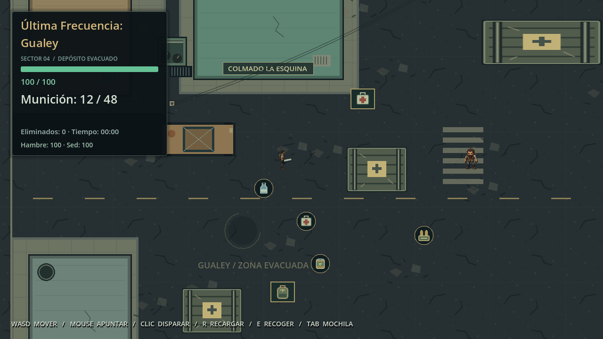
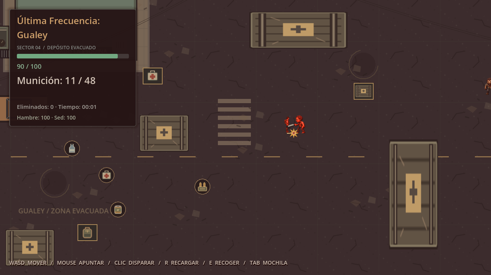
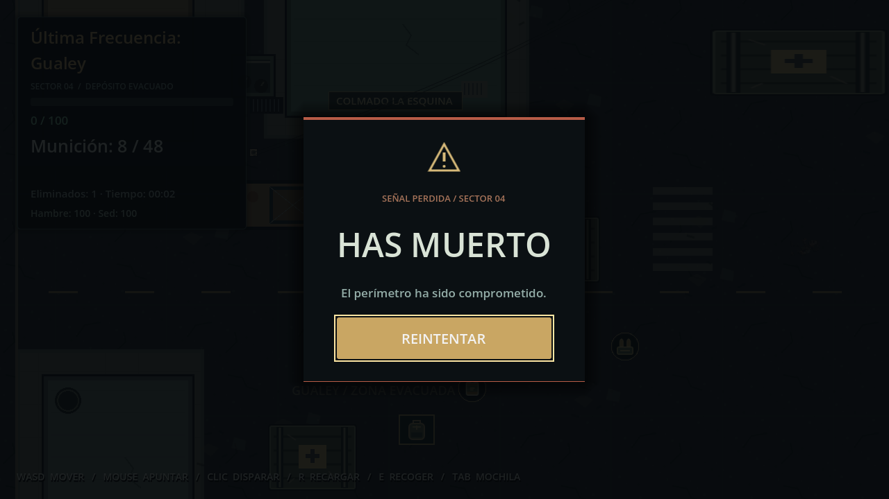
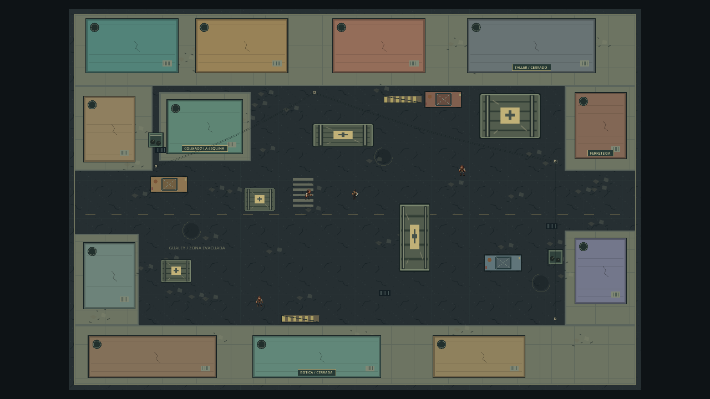
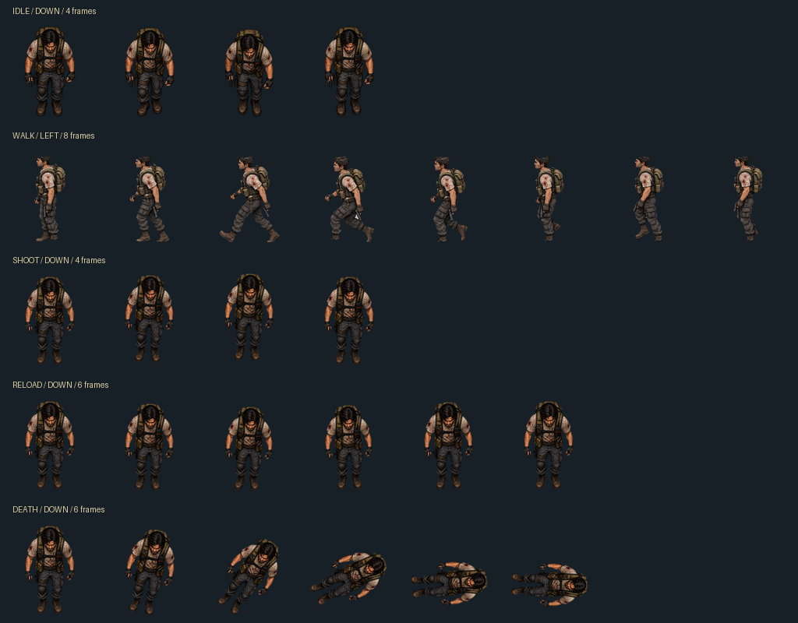
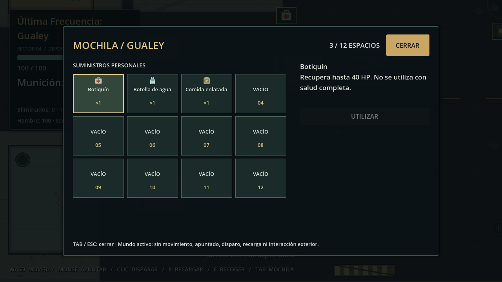
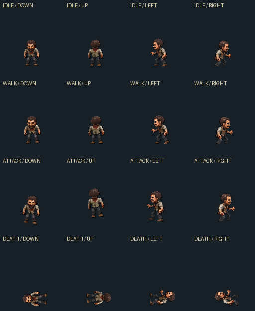

# Última Frecuencia: Gualey

Supervivencia zombi 2D con vista cenital, ambientada en un barrio urbano devastado. Explora el perímetro, enfrenta a los infectados y administra tu munición: cada disparo cuenta.

**Motor:** Godot 4.7.2 Stable · **Lenguaje:** GDScript · **Género:** Supervivencia zombi 2D

**Estado:** Desarrollo activo · **Plataforma inicial:** Windows

Un prototipo jugable con movimiento, navegación de enemigos, combate, salud, recarga, inventario, suministros, hambre, sed y reinicio. La integración visual funciona; el arte y varias animaciones todavía son provisionales. No hay una portada oficial incluida: esta presentación utiliza capturas reales del juego.

## Galería del juego

**Escenario, protagonista, zombis y HUD.** Primera zona urbana de Gualey, con colmado, aceras y obstáculos sólidos.



**Combate.** Disparo e impacto, feedback de daño y salud actualizada.



**Game Over.** Panel de muerte y botón Reintentar para restaurar la partida.



Capturas renovadas el **13 de noviembre de 2026** ejecutando el proyecto en Godot, mediante su prueba visual de integración. Las posiciones y acciones se preparan automáticamente en esa prueba; no son imágenes conceptuales. [Origen de las imágenes](docs/images/README.md).

## Zona urbana de Gualey

La fase 4.5 compone un barrio cenital ficticio inspirado en Gualey: viviendas con techos de concreto y tanques de agua, colmado, botica, ferretería, taller, carros abandonados, contenedores con bolsas, barricadas y postes con cables. El asfalto deteriorado, las aceras, el cruce peatonal y los escombros delimitan calles y pasos transitables. Una modulación ambiental suave conserva visibles los personajes y el HUD.



Vista técnica capturada en el motor con zoom reducido y HUD oculto únicamente en la prueba. La cámara de juego conserva su configuración original. Los 23 sólidos nuevos se añaden a las cinco cajas existentes; la navegación deriva sus huellas de las colisiones reales.

**Presentación provisional:** se reutilizan el asfalto, los escombros y las cajas SVG existentes. Los edificios y props nuevos son dibujos geométricos sustituibles, sin imágenes realistas nuevas ni interiores accesibles. Faltan texturas y sprites urbanos finales; [arquitectura, sustituciones y pruebas de la fase 4.5](docs/urban_world_integration.md).

## Protagonista y animaciones

Idle, Walk, Shoot, Reload y Death están conectadas en las cuatro direcciones. La lámina muestra Idle, Shoot, Reload y Death hacia abajo y la caminata izquierda V2, compuestas exclusivamente con los PNG utilizados por el proyecto.



| Animación | Frames por dirección | Reproducción e integración |
| --- | ---: | --- |
| Idle | 4 | 4 FPS, en bucle |
| Walk | 8 | 8 FPS, en bucle; conserva la dirección al detenerse |
| Shoot | 4 | Solo con un tiro válido; duración ligada a la cadencia real de 0,3 s |
| Reload | 6 | Sincronizada con los 1,5 s de recarga real |
| Death | 6 | Una sola reproducción; conserva el último fotograma |

**Estado del arte:** recursos de integración, no arte definitivo. Shoot, Reload y Death contienen aproximaciones técnicas de poses y movimiento corporal. Los zombis, el entorno y parte de la interfaz usan recursos provisionales. Algunas secuencias conservan retoques de bordes y continuidad pendientes.

Los nombres de varios PNG históricos no coinciden con la orientación que muestran. Sus asignaciones están corregidas en SpriteFrames; antes de reemplazarlos, consultar la [guía visual](assets/README.md), la [validación de walk_left V2](docs/walk_left_v2_validation.md) y la [integración final de Shoot](docs/shoot_final_integration.md). Las referencias descartadas de `draft/` no forman parte de esta galería.

## Progreso del desarrollo

Fase 5: **inventario y supervivencia implementados**. Mochila de 12 espacios,
objetos apilables, cuatro tipos de suministros, tres contenedores finitos y
necesidades conectadas a la salud existente.



**E** recoge o abre un contenedor cercano; **Tab** abre/cierra la mochila y
**Esc** la cierra. Selecciona un espacio y pulsa **UTILIZAR**. La munición usa
**PASAR A RESERVA** para transferir toda la pila al arma; el cargador sigue
llenándose con R. El mundo permanece activo: mientras la ventana está abierta,
se bloquean movimiento, apuntado, disparo, nueva recarga e interacción exterior.
Los zombis, las necesidades y una recarga ya iniciada continúan.

[Reglas, configuración y pruebas de inventario](docs/inventory_survival.md) ·
[Captura real de un contenedor](docs/images/loot-container.png).

Fase 4.4, zombi base: **integrada técnicamente** con 96 PNG provisionales y cuatro
direcciones por estado. [Resultados y limitaciones](docs/zombie_base_integration.md).



| Fase | Funcionalidad | Estado |
| --- | --- | --- |
| 1 | Movimiento y escenario | Completada |
| 2 | Inteligencia artificial y salud | Completada |
| 3 | Combate y armas | Completada |
| 4 | Integración visual inicial | Completada técnicamente |
| 4.1 | Identidad Última Frecuencia: Gualey | Completada |
| 4.2 | Animaciones Idle y Walk | Completada |
| 4.3 | Shoot, Reload y Death | Completada técnicamente |
| 4.4 | Zombi base: Idle, Walk, Attack y Death | Completada técnicamente |
| 4.5 | Primera zona urbana de Gualey | Completada técnicamente; arte provisional |
| 5 | Inventario, suministros, hambre y sed | Implementada y validada automáticamente |

“Completada técnicamente” significa que la integración y sus pruebas funcionan; no implica arte final ni aprobación artística de todos los ciclos. La fase 5 funciona sin guardado persistente y mantiene revisiones manuales pendientes.

## Controles

| Entrada | Acción |
| --- | --- |
| WASD | Movimiento en ocho direcciones |
| Mouse | Apuntar |
| Clic izquierdo | Disparar; mantener pulsado repite tiros respetando la cadencia |
| R | Recargar |
| E | Recoger o abrir contenedor a un máximo de 56 px, sin paredes entre ambos |
| Tab | Abrir/cerrar inventario |
| Esc | Cerrar inventario |

Al morir se bloquean las acciones y aparece **Reintentar**. El botón reinicia salud, munición, posiciones, zombis, bajas y tiempo.

## Funciones actuales

- Escenario urbano de 2400 × 1600, 28 obstáculos y límites físicos; cámara con seguimiento.
- Movimiento normalizado: la diagonal no aumenta la velocidad.
- Tres zombis con estados IDLE, CHASE, ATTACK y DEAD, y rutas alrededor de las cajas.
- Salud compartida por componentes: 100 HP para el jugador, 50 HP para cada zombi.
- Pistola con cargador de 12, reserva inicial de 48, daño de 25 HP y alcance de 600 px.
- Un hitscan por disparo: los obstáculos bloquean impactos; dos aciertos eliminan un zombi.
- HUD con salud, munición, estado de recarga, bajas y tiempo de supervivencia.
- Game Over, reinicio completo y efectos visuales sin influencia sobre el daño.
- Mochila de 12 espacios: botiquín (+40 HP, pila 5), agua (+30 sed, pila 10), comida (+30 hambre, pila 10) y munición (pila 60).
- Cuatro recogibles y tres contenedores finitos; transferencias completas, sin perder contenido si no cabe.
- Hambre y sed iniciales de 100: pierden un punto cada 30 y 20 segundos respectivamente. Si alguna llega a cero, una única penalización de 2 HP cada 5 segundos; todos los valores de ritmo/efecto son configurables.

Cada zombi detecta a 250 px y ataca a 35 px: 10 HP cada 1,5 s, con intervalo propio. Estos valores y la configuración de la pistola se editan en el inspector. [Detalles de arquitectura](AGENTS.md).

## Requisitos y ejecución

1. Disponer de **Godot 4.7.2 Stable estándar** para Windows, con soporte para GDScript. No requiere .NET.
2. Obtener o descomprimir el repositorio completo, manteniendo su estructura.
3. En el gestor de proyectos de Godot, elegir **Importar** y seleccionar `project.godot`.
4. Esperar a que termine la importación de recursos y pulsar **F5** para ejecutar el proyecto. La escena principal es `scenes/Main.tscn`.

También puede ejecutarse desde la raíz del repositorio:

```text
godot --path .
```

Sustituir `godot` por la ruta de su ejecutable si no está en PATH. El motor portable usado durante el desarrollo puede encontrarse en `.tools/godot/` en esta copia local; está excluido de Git y no se distribuye como parte del proyecto.

**Resolución base:** 1280 × 720 · **Escalado:** canvas_items · **Renderizador:** Compatibility (OpenGL).

No se necesitan plugins, paquetes externos ni Python para jugar. El generador Python de arte provisional es una herramienta opcional de desarrollo. Todavía no se entrega un ejecutable Windows independiente: se ejecuta con Godot.

## Estructura del repositorio

```text
project.godot
scenes/
  Main.tscn                 Composición de la partida
  player/Player.tscn        Jugador, cámara y nodos visuales
  enemies/Zombie.tscn       Enemigo reutilizable
  items/                   Recogibles y contenedores reutilizables
  world/                   Escenario y obstáculos
scripts/
  player/  enemies/        Comportamientos de personajes
  components/              Salud reutilizable
  inventory/               Definiciones y uso de suministros
  weapons/  combat/        Munición, recarga e impactos
  visuals/  ui/            Presentación, animaciones y HUD
  world/  main.gd          Navegación, suelo y coordinación
interfaces/                HUD y Game Over existentes
assets/
  characters/              Recursos del protagonista y zombis
  environment/             Suelo, props y decals
  weapons/  effects/  ui/   Recursos visuales por módulo
  placeholders/            Arte provisional separado
resources/                 Configuración reutilizable de la pistola y los objetos
tests/                     Pruebas Godot, sin plugins
docs/                      Informes técnicos y capturas de presentación
tools/                     Generador opcional de SVG provisionales
```

Se versionan los metadatos de identidad/importación necesarios (`.uid`, `.import`). Las cachés `.godot/`, herramientas locales y resultados `test-results/` están excluidos de Git. Las imágenes seleccionadas para esta página se conservan en `docs/images/`.

## Pruebas automatizadas

Desde la raíz del repositorio:

```text
godot --headless --path . --editor --import
godot --headless --path . --fixed-fps 60 --script res://tests/phase_one_test.gd
godot --headless --path . --fixed-fps 60 --script res://tests/phase_two_test.gd
godot --headless --path . --fixed-fps 60 --script res://tests/phase_three_test.gd
godot --headless --path . --fixed-fps 60 --script res://tests/phase_four_test.gd
godot --headless --path . --fixed-fps 60 --script res://tests/player_idle_down_test.gd
godot --headless --path . --fixed-fps 60 --script res://tests/player_walk_down_test.gd
godot --headless --path . --fixed-fps 60 --script res://tests/player_directions_test.gd
godot --headless --path . --fixed-fps 60 --script res://tests/player_actions_test.gd
godot --headless --path . --fixed-fps 60 --script res://tests/player_shoot_test.gd
godot --headless --path . --fixed-fps 60 --script res://tests/zombie_visual_test.gd
godot --headless --path . --fixed-fps 60 --script res://tests/urban_world_test.gd
godot --headless --path . --fixed-fps 60 --script res://tests/inventory_component_test.gd
godot --headless --path . --fixed-fps 60 --script res://tests/phase_five_test.gd
```

La validación funcional de la fase 5 aprobó **564 comprobaciones**, con cero fallos: las 456 anteriores, 32 del componente de inventario y 76 de integración de suministros/supervivencia. Incluye teclas y clics simulados, capacidad, consumo, transferencias finitas, munición, necesidades, Game Over y reinicio, además de todas las regresiones previas. [Informe de fase 5](docs/inventory_survival.md), [zona urbana](docs/urban_world_integration.md), [zombi base](docs/zombie_base_integration.md) y [Shoot](docs/shoot_final_integration.md).

Para producir capturas actuales con renderizado real:

```text
godot --path . --fixed-fps 60 --script res://tests/phase_four_test.gd -- --capture
godot --path . --fixed-fps 60 --script res://tests/player_directions_test.gd -- --capture
godot --path . --fixed-fps 60 --script res://tests/player_actions_test.gd -- --capture
godot --path . --fixed-fps 60 --script res://tests/player_shoot_test.gd -- --capture
godot --path . --fixed-fps 60 --script res://tests/urban_world_test.gd -- --capture
godot --path . --fixed-fps 60 --script res://tests/phase_five_test.gd -- --capture
```

Los PNG se guardan en `test-results/`. En fase 5 aprobaron la prueba visual general (**39 comprobaciones**, cinco capturas) y la de supervivencia (**80 comprobaciones**, cuatro capturas). La galería de juego y las capturas nuevas muestran el HUD actual. La vista de plano se conserva de fase 4.5. Las pruebas automatizadas no sustituyen una sesión manual ni la inspección del panel gráfico del depurador.

## Limitaciones y próximos pasos

- Fabricación, progresión RPG, misiones, guardado persistente, nuevas armas, oleadas y aparición infinita no están implementados.
- El inventario y los contenedores duran solo la partida; Reintentar restaura las existencias iniciales. La mochila no pausa a los zombis.
- El escenario conserva tres zombis iniciales; no hay reposición automática.
- Los personajes colisionan con el mundo, pero no se bloquean físicamente entre sí.
- El arte es reemplazable y todavía provisional en varios módulos; falta revisar fluidez, halos, posturas y coherencia de perspectiva.
- Game Over aparece inmediatamente: la animación de muerte se ejecuta detrás de su panel. Algunas capturas técnicas ocultan ese panel únicamente para inspección.
- La navegación deriva rectángulos de todos los sólidos y un perímetro fijo. Formas no rectangulares requieren adaptar su generación.
- Faltan una revisión manual completa del combate y transiciones, pruebas de exportación y una distribución independiente.

## Documentación técnica

- [Arquitectura y convenciones para agentes](AGENTS.md).
- [Recursos visuales y contratos de sustitución](assets/README.md).
- [Recursos del protagonista](assets/characters/player/README.md).
- [Integración de walk_left V2 y conservación de walk_right](docs/walk_left_v2_validation.md).
- [Reload y Death: sincronización, recursos y limitaciones](docs/phase_4_3_actions.md).
- [Shoot corregido: asignaciones y validación vigente](docs/shoot_final_integration.md).
- [Zona urbana: arquitectura, recursos y validación](docs/urban_world_integration.md).
- [Inventario, suministros y supervivencia: arquitectura y validación](docs/inventory_survival.md).
- [Historial técnico completo de las fases anteriores](docs/development_history.md).

El historial conserva los detalles, problemas resueltos y resultados anteriores. Sus avisos de recursos pendientes describen el estado de cada momento; el estado vigente se resume en esta página y en los informes finales.
