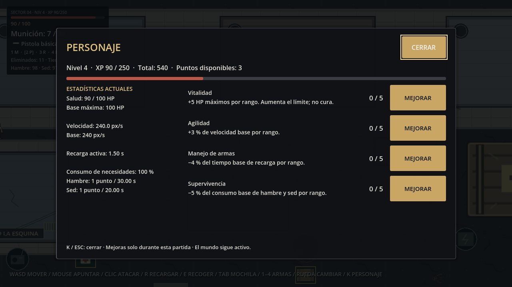
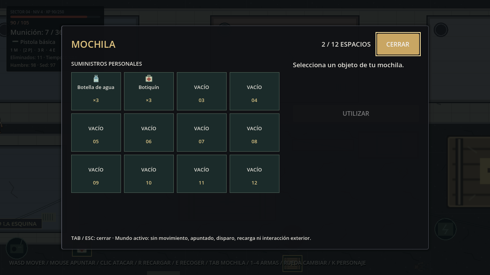
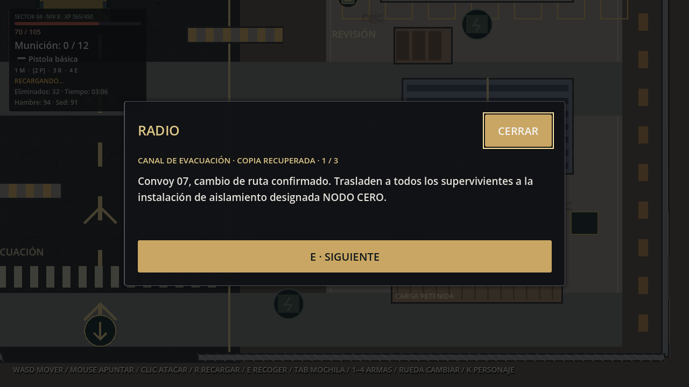

# Fase 17 — certificación de campaña y preparación Windows

Validación técnica local del 15 de noviembre de 2026, Godot 4.7.2 Stable,
Windows, GDScript, Compatibility, 1280 × 720. Se conservan cuatro capítulos,
quince misiones, cuatro zonas, tres arquetipos, cuatro armas y guardado v7.
No se añadió contenido, música, balance o interfaces.

**Alcance:** campaña funcional desde el proyecto y paquete PCK verificados.
**Cierre:** certificación técnica parcial, con exportación Windows pendiente.
Los resultados finales disponibles no muestran un fallo funcional que impida
este cierre limitado. No equivale a aprobar un ejecutable ni una partida humana.
**Límite:** no hay ejecutable Windows independiente certificado; faltan sus
plantillas exactas. La escucha musical subjetiva y la partida humana siguen
pendientes. La campaña automatizada no se presenta como una sesión humana.

## Recorrido principal sin preparación artificial

`tests/campaign_certification_test.gd` parte de TitleMenu, elige una ranura
aislada y crea una partida normal. Usa Input/move_and_slide y E para navegar
y activar elementos físicos, sin reposicionar al jugador o enemigos, asignar
salud/XP, inyectar misiones, llenar mochilas ni desactivar IA/población.
Las transiciones utilizan las salidas existentes. Los checkpoints guardan/cargan
la misma posición y comparan exactamente sus seis secciones de estado.

Un bot defensivo llama las mismas APIs de Weapon, ItemUse y Equipment empleadas
por el juego: daño físico real, munición finita, cadencia, recarga, consumibles y
cambio de arma válidos. No simula apuntado manual humano ni decide por un jugador.
Puede disparar preventivamente desde el alcance real del arma; esto no certifica
que el balance sea cómodo o justo para una persona.

Recorrido completado:

1. Inicio, ranura 1 y Gualey: La señal perdida, recogidas y bajas reales.
2. Arsenal recuperado de sus contenedores: enfrentamientos con machete, revólver,
   escopeta y pistola. Habilidad comprada con XP ganada.
3. Mercado: Ecos del Mercado, corredor/resistente, suministros y transmisión.
4. Estación: Voces en la oscuridad, dos bajas locales, registros, energía y radio.
5. Perímetro: El último convoy y transmisión final completa.
6. Quince premios únicos, cuatro capítulos y cuatro mundos persistidos; guardar
   y cargar el resultado sin terminar la exploración.

El recorrido mide **35.419,96 píxeles**, con IA activa durante todo el trayecto.
La pasada en ventana registró **78 ataques**, **9 recargas** y **6 usos de objetos**;
recibió daño real (100 → 70 HP finales; 90 HP al entrar al Perímetro) sin alterar
estadísticas. Hambre y sed avanzaron
por el reloj normal. La duración de juego registrada fue 186,83 s. Se ejecutó
con fixed-fps para regresión: esas cifras no se usan como benchmark de FPS.

## Pruebas y cobertura reutilizadas

Todos los resultados de esta tabla proceden de la ejecución anterior. En esta
continuación se revisaron sus registros completos, sin ejecutar de nuevo esas
pruebas. Los nombres permiten localizar la evidencia en test-results/phase-seventeen/.

| Prueba ejecutada | Resultado |
| --- | --- |
| Línea base previa completa, 63 procesos/modos | 3.105 comprobaciones, 0 fallos |
| Campaña continua con IA activa, headless | 198 comprobaciones, 0 fallos |
| Misma campaña en ventana, doce capturas | 210 comprobaciones, 0 fallos |
| Contrato de exportación: radios, misiones, zonas, botín y geometría | 48 comparaciones exactas, 0 diferencias finales |
| PCK aislado: inicio, ranuras, guardado/carga y partida de campaña | 32 headless / 34 en ventana, 0 fallos |
| Música nativa, music-native.txt | 62 comprobaciones, 0 fallos, sin ERROR/WARNING |
| HUD/efectos nativos, hud-audio-native.txt | 99 comprobaciones, 0 fallos, HUD 256 × 172, sin ERROR/WARNING |
| Menú/ranuras/configuración, title-native.txt | 51 comprobaciones, 0 fallos, sin ERROR/WARNING |
| Dos pasadas de estabilidad, stability-{1,2}.txt/.json | 28 + 28 comprobaciones, 0 fallos |

Son **3.895 comprobaciones aprobadas en las ejecuciones previas seleccionadas**,
incluida la base de 3.105. No son 3.895 casos únicos ni pruebas ejecutadas de nuevo.
Los tres registros que quedaron por revisar (música, HUD/audio y menú) están
completos y no contienen errores de scripts, advertencias ni resultados truncados.

Se contrastaron 245 archivos de scripts, escenas, recursos, interfaces y música
con before-files.json: ninguno cambió ni faltó. La configuración conserva
convert_text_resources_to_binary=false. Por ello los resultados siguen siendo
aplicables; esta continuación no altera el preset, las fuentes ni las pruebas.

Las filas son ejecuciones separadas y sus alcances se solapan; no representan
usuarios o sesiones humanas independientes. Los intentos fallidos se conservan
para diagnóstico y no se suman como comprobaciones aprobadas.

La línea base anterior ejecutó los tests funcionales de las fases anteriores:
IA/persecución/rutas/ataques/colisiones, muerte/bajas/XP, límites 6/18/10 s y
apariciones fuera de cámara, cuatro armas, recarga/cambio, inventario, hambre/sed,
habilidades, Game Over y Reintentar. Incluye tres ranuras, confirmación de
reemplazo, respaldo, recuperación entre procesos, v1–v6 migrados a v7, v7 nativo,
enemigos/suministros, cuatro zonas, diálogos pendientes y premios únicos.

Las pruebas unitarias y fixtures históricas permanecen separadas del recorrido
principal. Algunas preparan capítulos o estados agotados, congelan enemigos o
simulan condiciones extremas; no se presentan como juego real. Ninguna prueba
escribe en `user://saves/` ni guarda las preferencias normales del jugador.
La campaña usa `user://tests/phase-seventeen-campaign-*`; el PCK usa su propio
directorio de pruebas y lee el checkpoint de campaña, sin modificarlo.

## Interfaces y audio

Se capturan presentación, ranuras, configuración, HUD, MOCHILA, PERSONAJE,
MISIONES, RADIO, PAUSA y finales de capítulo a 1280 × 720. Las transiciones
mantienen el mismo jugador y la música. Se conserva la revisión visual previa de
ocho capturas de presentación/interfaces y se revisaron nuevamente los cuatro
finales de capítulo en esta continuación. No se detectaron cortes de texto o
superposiciones importantes en esas imágenes. El diario utiliza su scroll
existente; un HUD atenuado detrás de un modal no constituye otro panel activo.
No se rehace el diseño ni se extrapola a otras resoluciones.

El audio conserva Music → Master, Effects, Ambience e Interface, dos composiciones
y una voz musical. El PCK emite señal real tanto en menú como en gameplay.
Los registros nativos existentes cubren volumen, silencio, fundidos, radio/pausa
y comprobaciones técnicas de clipping. **La calidad musical subjetiva
sigue pendiente de escucha humana**, independientemente de los resultados técnicos.

## Defectos reproducidos y corrección mínima

1. **Dependencias omitidas al seleccionar recursos para exportación.** El PCK
   aislado no encontraba SVG usados por scripts. El preset final exporta los
   recursos del proyecto, excluyendo tests, documentación, herramientas y material
   de referencia identificado; no se cambió ningún asset.
2. **Pérdida de datos en conversión textual → binaria.** En el PCK desaparecían
   cantidades de contenedores y mensajes de radio. También se observaron huellas
   de obstáculos instanciados distintas de las fuentes en Gualey/Mercado; eso
   impedía cargar enemigos situados correctamente en el proyecto original.
   El contrato de datos y geometría reprodujo las diferencias fuera del directorio
   fuente. La única corrección final de configuración es
   `editor/export/convert_text_resources_to_binary=false` en project.godot.
   No se modifican cantidades, colisiones, scripts de gameplay o historia.

El caso de los arrays coincide con la
[incidencia reportada para Packed*Array en Godot 4.7.2](https://github.com/godotengine/godot/issues/124452).
La diferencia de geometría es un resultado local del contrato, sin atribuirle
una causa interna adicional no demostrada. El formato de exportación se controla
mediante la [opción oficial de ProjectSettings](https://docs.godotengine.org/en/stable/classes/class_projectsettings.html#class-projectsettings-property-editor-export-convert-text-resources-to-binary).
Tras conservar textos, las 48 comparaciones coinciden y la partida fuente carga
en el PCK. Se descartaron los cambios experimentales a inicializadores: sus dos
scripts quedaron idénticos a los que había al comenzar la fase.

Los primeros probes también detectaron un error metodológico: ejecutar el PCK
con `--path .` permitía resolver archivos del proyecto fuente. La prueba final
usa `--path builds/windows`, sin proyecto fuente allí, y exige que los tests estén
ausentes del paquete. Los probes son scripts externos y no se distribuyen.

## Exportación Windows

Se creó `export_presets.cfg`, preset **Windows Desktop**, arquitectura x86_64,
sin firma, salida local `builds/windows/UltimaFrecuenciaGualey.exe`. Sin credenciales
ni cambios de VSync. Excluye `tests/`, `docs/`, `tools/`, `.tools/`, resultados,
plantillas y referencias gráficas no usadas. Los guardados permanecen en user://;
ninguna partida personal forma parte del paquete.

El intento previo de exportación debug se detuvo por plantillas ausentes.
En esta continuación se comprobó que ambas rutas siguen sin existir, sin repetir
la exportación:

```text
C:/Users/carlo/AppData/Roaming/Godot/export_templates/4.7.2.stable/windows_debug_x86_64.exe
C:/Users/carlo/AppData/Roaming/Godot/export_templates/4.7.2.stable/windows_release_x86_64.exe
```

El directorio local export_templates/ tampoco contenía archivos aprovechables.
No se descargó ni instaló ningún componente. Hace falta instalar, con autorización,
las plantillas correspondientes exactamente a 4.7.2.stable y repetir exportación
debug/release, arranque, nueva partida, carga y audio desde el ejecutable final.
**Esas pruebas de ejecutable no se declaran realizadas.**

Se generó `builds/windows/UltimaFrecuenciaGualey.pck` y se probó con el motor
ya instalado, sin recursos fuente de respaldo. Esto valida contenido y lógica
empaquetada, **no sustituye una compilación Windows independiente**. El PCK y
todos los resultados están ignorados por Git; no se publicaron ni distribuyeron.

Artefacto conservado: **164.733.488 bytes** (157,1 MiB). SHA-256 verificado en
esta continuación:

```text
e0f06a9411cc9d0004f52e1c637641e706efa8c7dae974d9c3a075231ff46a23
```

Los registros del contrato y arranque/carga aislados son posteriores a la creación
de ese PCK. Sus 48 grupos incluyen las cantidades originales, las quince misiones,
mensajes, entradas/población de zonas y huellas de colisión de los cuatro mapas.
La prueba empaquetada también cargó el checkpoint v7 de los cuatro capítulos y
comparó player/world/zones/missions/story/stats. No se regeneró el paquete aquí.

## Reproducción

```powershell
godot --headless --path . --editor --import
godot --headless --path . --fixed-fps 60 --script res://tests/campaign_certification_test.gd
godot --path . --fixed-fps 60 --script res://tests/campaign_certification_test.gd -- --capture
godot --headless --path . --script res://tests/export_contract_probe.gd -- --write
godot --headless --path . --export-pack "Windows Desktop" builds/windows/UltimaFrecuenciaGualey.pck
$pack = (Resolve-Path builds/windows/UltimaFrecuenciaGualey.pck).Path
$contract = (Resolve-Path tests/export_contract_probe.gd).Path
$probe = (Resolve-Path tests/pack_certification_probe.gd).Path
godot --headless --path builds/windows --main-pack $pack --script $contract
godot --path builds/windows --main-pack $pack --script $probe
```

Generar primero el informe de campaña y contrato fuente. Las rutas de los probes
se resuelven desde su propia ubicación. La suite base completa y modos usados
están registrados en `test-results/phase-seventeen/baseline.txt`.

## Estabilidad y rendimiento

Se reutilizan dos pasadas aprobadas de perimeter_performance.gd y
su instrumento de reloj monotónico, con doce transiciones por pasada: **24 viajes**
en total por las cuatro zonas. Esta
preparación de rendimiento usa fixtures narrativas y curación de prueba para
sostener la carga; es independiente del recorrido principal sin simulaciones.
Las métricas de física son lecturas de máximos publicados por segundo, no tiempos
medios por paso. No se modifica VSync ni se mide con fixed-fps o capturas.

Mismo entorno registrado en ambas: Godot Debug 4.7.2 ed1daf0bf, Ryzen 5 5600G,
Radeon RX 580, 1280 × 720, **VSync=1 / max_fps=0**.

| Escenario | Media ms, pasada 1 / 2 | p95 ms, pasada 1 / 2 |
| --- | --- | --- |
| Estación de control | 13,900 / 13,908 | 14,230 / 14,254 |
| Perímetro en reposo | 13,906 / 13,905 | 14,209 / 14,221 |
| Perímetro con seis enemigos | 13,906 / 13,905 | 14,288 / 14,241 |

Cadencia observada cercana a 71,9 FPS. Perímetro mantiene **460 nodos**, 562
recursos, 27 reproductores del mundo, 39 nodos procesando, 21 conexiones a died
del jugador, una región y cero huérfanos. La voz musical global es adicional y
única. El control de Estación tiene 476 nodos/33 voces/45 procesos/23 conexiones
por su preparación con cadáveres; no se compara como si fuera la misma población.
En las visitas equivalentes no se acumularon nodos, recursos, voces o señales.

Memoria estática del escenario de seis: **56,235 / 56,234 MiB** entre pasadas;
incluye arrays retenidos por el instrumento, no toda la memoria privada del proceso.
No demuestra ausencia de fugas durante horas. Los cierres verbose del arranque
corto y de las dos pasadas registran **38 / 38 / 38 StringName** sin reclamar.
Se confirma la observación histórica, sin incremento reproducible en estas
muestras ni informe de ObjectDB retenido. No se declara una fuga por ese contador.

## Capturas y revisión humana

Se conservaron doce PNG reales del recorrido continuo, todos de 1280 × 720.
Cuatro se incorporan a documentación, optimizados sin pérdida y comparados píxel
a píxel con sus originales; no se generan capturas ficticias ni se alteran assets.








[Procedencia y preparación de imágenes](images/README.md). Las otras ocho capturas
permanecen en test-results/phase-seventeen/ para evitar duplicar la galería.

Quedan pendientes una partida humana completa, balance bajo presión, comodidad
del apuntado y hotkeys, claridad narrativa sin coordenadas, otras resoluciones,
escucha musical/mezcla en distintos dispositivos, sesiones largas de memoria,
revisión interactiva del panel del depurador y ejecutable Windows/exportación.
El arte y varios sonidos/animaciones siguen siendo provisionales.

## Trabajo previo conservado y archivos de esta continuación

Se preservó íntegramente el trabajo anterior. La fase 17 ya incluía:
preset Windows nuevo, configuración de conversión de exportación, recorrido
integral, dos probes externos y sus UID, este informe, actualización mínima de
README/documentación y capturas seleccionadas. No hay commits ni push.

Esta continuación modifica solamente **README.md**, **docs/campaign_certification.md**
y **docs/images/README.md**, y añade los cuatro PNG campaign-{character,inventory,
radio,complete} con sus cuatro `.import`. No cambia project.godot,
export_presets.cfg, los probes, gameplay o recursos originales.
La auditoría local queda en test-results/phase-seventeen/continuation-review.json;
ese archivo y los resultados siguen ignorados por Git.

## Qué se hizo en esta continuación

- Relectura y auditoría de los resultados finales anteriores: **ninguna repetición
  de campaña, combate, audio, menú, PCK o benchmark**.
- Comprobaciones nuevas estáticas: integridad de 245 fuentes, preset y flag de
  exportación, existencia/tamaño/hash y fechas del PCK, ausencia actual de plantillas,
  conteos/errores de logs, métricas y doce PNG. Revisión visual de los cuatro finales.
- Finalización de este informe, estado de README y selección de cuatro capturas
  con su índice. Se ejecutó una importación nueva únicamente al incorporar sus metadatos, sin
  errores ni advertencias (continuation-import.txt); no se contabiliza como repetición de las 3.895 comprobaciones anteriores.

Los nombres solicitados inicialmente pack_certification_test.gd y
export_contract_test.gd corresponden a **pack_certification_probe.gd** y
**export_contract_probe.gd**, renombrados antes de esta continuación para distinguir
probes externos de tests de juego. Se inspeccionaron los archivos existentes;
no se duplicaron ni renombraron otra vez.
