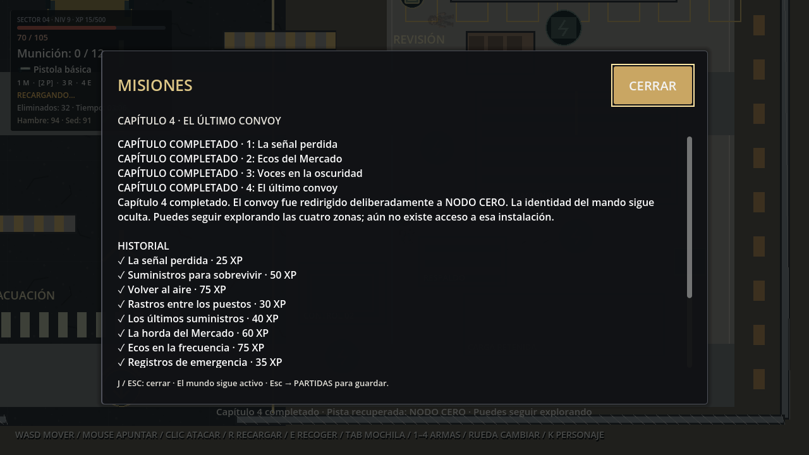

# Fase 17 — certificación de campaña y preparación Windows

Validación técnica local del 15 de noviembre de 2026, Godot 4.7.2 Stable,
Windows, GDScript, Compatibility, 1280 × 720. Se conservan cuatro capítulos,
quince misiones, cuatro zonas, tres arquetipos, cuatro armas y guardado v7.
No se añadió contenido, música, balance o interfaces.

**Antecedente del 15 de noviembre:** certificación técnica parcial del proyecto
y PCK, con exportación Windows bloqueada por plantillas ausentes. Las secciones
históricas conservan esos resultados sin presentarlos como pruebas nuevas.
**Actualización Windows del 21 de noviembre:** plantillas oficiales instaladas y
EXE debug/release generados y verificados. El alcance y las evidencias de esta continuación se
detallan en «Fase 17.2 — validación Windows autorizada», al final del informe.
La campaña automatizada no se presenta como una partida humana.

## Recorrido principal sin preparación artificial

`tests/campaign_certification_test.gd` parte de TitleMenu, elige una ranura
aislada y crea una partida normal. Usa Input/move_and_slide y E para navegar
y activar elementos físicos, sin reposicionar al jugador o enemigos, asignar
salud/XP, inyectar misiones, llenar mochilas ni desactivar IA/población.
Las transiciones utilizan las salidas existentes. Los checkpoints guardan/cargan
la misma posición y comparan exactamente sus seis secciones de estado.

Un bot defensivo llama las mismas APIs de Weapon, ItemUse y Equipment empleadas
por el juego: daño físico real, munición finita, cadencia, recarga, consumibles y
cambio de arma válidos. No simula apuntado manual humano ni decide por un jugador.
Puede disparar preventivamente desde el alcance real del arma; esto no certifica
que el balance sea cómodo o justo para una persona.

Recorrido completado:

1. Inicio, ranura 1 y Gualey: La señal perdida, recogidas y bajas reales.
2. Arsenal recuperado de sus contenedores: enfrentamientos con machete, revólver,
   escopeta y pistola. Habilidad comprada con XP ganada.
3. Mercado: Ecos del Mercado, corredor/resistente, suministros y transmisión.
4. Estación: Voces en la oscuridad, dos bajas locales, registros, energía y radio.
5. Perímetro: El último convoy y transmisión final completa.
6. Quince premios únicos, cuatro capítulos y cuatro mundos persistidos; guardar
   y cargar el resultado sin terminar la exploración.

El recorrido mide **35.419,96 píxeles**, con IA activa durante todo el trayecto.
La pasada en ventana registró **78 ataques**, **9 recargas** y **6 usos de objetos**;
recibió daño real (100 → 70 HP finales; 90 HP al entrar al Perímetro) sin alterar
estadísticas. Hambre y sed avanzaron
por el reloj normal. La duración de juego registrada fue 186,83 s. Se ejecutó
con fixed-fps para regresión: esas cifras no se usan como benchmark de FPS.

## Pruebas y cobertura reutilizadas

Todos los resultados de esta tabla proceden de la ejecución anterior. En esta
continuación se revisaron sus registros completos, sin ejecutar de nuevo esas
pruebas. Los nombres permiten localizar la evidencia en test-results/phase-seventeen/.

| Prueba ejecutada | Resultado |
| --- | --- |
| Línea base previa completa, 63 procesos/modos | 3.105 comprobaciones, 0 fallos |
| Campaña continua con IA activa, headless | 198 comprobaciones, 0 fallos |
| Misma campaña en ventana, doce capturas | 210 comprobaciones, 0 fallos |
| Contrato de exportación: radios, misiones, zonas, botín y geometría | 48 comparaciones exactas, 0 diferencias finales |
| PCK aislado: inicio, ranuras, guardado/carga y partida de campaña | 32 headless / 34 en ventana, 0 fallos |
| Música nativa, music-native.txt | 62 comprobaciones, 0 fallos, sin ERROR/WARNING |
| HUD/efectos nativos, hud-audio-native.txt | 99 comprobaciones, 0 fallos, HUD 256 × 172, sin ERROR/WARNING |
| Menú/ranuras/configuración, title-native.txt | 51 comprobaciones, 0 fallos, sin ERROR/WARNING |
| Dos pasadas de estabilidad, stability-{1,2}.txt/.json | 28 + 28 comprobaciones, 0 fallos |

Son **3.895 comprobaciones aprobadas en las ejecuciones previas seleccionadas**,
incluida la base de 3.105. No son 3.895 casos únicos ni pruebas ejecutadas de nuevo.
Los tres registros que quedaron por revisar (música, HUD/audio y menú) están
completos y no contienen errores de scripts, advertencias ni resultados truncados.

Se contrastaron 245 archivos de scripts, escenas, recursos, interfaces y música
con before-files.json: ninguno cambió ni faltó. La configuración conserva
convert_text_resources_to_binary=false. Por ello los resultados siguen siendo
aplicables; esta continuación no altera el preset, las fuentes ni las pruebas.

Las filas son ejecuciones separadas y sus alcances se solapan; no representan
usuarios o sesiones humanas independientes. Los intentos fallidos se conservan
para diagnóstico y no se suman como comprobaciones aprobadas.

La línea base anterior ejecutó los tests funcionales de las fases anteriores:
IA/persecución/rutas/ataques/colisiones, muerte/bajas/XP, límites 6/18/10 s y
apariciones fuera de cámara, cuatro armas, recarga/cambio, inventario, hambre/sed,
habilidades, Game Over y Reintentar. Incluye tres ranuras, confirmación de
reemplazo, respaldo, recuperación entre procesos, v1–v6 migrados a v7, v7 nativo,
enemigos/suministros, cuatro zonas, diálogos pendientes y premios únicos.

Las pruebas unitarias y fixtures históricas permanecen separadas del recorrido
principal. Algunas preparan capítulos o estados agotados, congelan enemigos o
simulan condiciones extremas; no se presentan como juego real. Ninguna prueba
escribe en `user://saves/` ni guarda las preferencias normales del jugador.
La campaña usa `user://tests/phase-seventeen-campaign-*`; el PCK usa su propio
directorio de pruebas y lee el checkpoint de campaña, sin modificarlo.

## Interfaces y audio

Se capturan presentación, ranuras, configuración, HUD, MOCHILA, PERSONAJE,
MISIONES, RADIO, PAUSA y finales de capítulo a 1280 × 720. Las transiciones
mantienen el mismo jugador y la música. Se conserva la revisión visual previa de
ocho capturas de presentación/interfaces y se revisaron nuevamente los cuatro
finales de capítulo en esta continuación. No se detectaron cortes de texto o
superposiciones importantes en esas imágenes. El diario utiliza su scroll
existente; un HUD atenuado detrás de un modal no constituye otro panel activo.
No se rehace el diseño ni se extrapola a otras resoluciones.

El audio conserva Music → Master, Effects, Ambience e Interface, dos composiciones
y una voz musical. El PCK emite señal real tanto en menú como en gameplay.
Los registros nativos existentes cubren volumen, silencio, fundidos, radio/pausa
y comprobaciones técnicas de clipping. **La calidad musical subjetiva
sigue pendiente de escucha humana**, independientemente de los resultados técnicos.

## Defectos reproducidos y corrección mínima

1. **Dependencias omitidas al seleccionar recursos para exportación.** El PCK
   aislado no encontraba SVG usados por scripts. El preset final exporta los
   recursos del proyecto, excluyendo tests, documentación, herramientas y material
   de referencia identificado; no se cambió ningún asset.
2. **Pérdida de datos en conversión textual → binaria.** En el PCK desaparecían
   cantidades de contenedores y mensajes de radio. También se observaron huellas
   de obstáculos instanciados distintas de las fuentes en Gualey/Mercado; eso
   impedía cargar enemigos situados correctamente en el proyecto original.
   El contrato de datos y geometría reprodujo las diferencias fuera del directorio
   fuente. La única corrección final de configuración es
   `editor/export/convert_text_resources_to_binary=false` en project.godot.
   No se modifican cantidades, colisiones, scripts de gameplay o historia.

El caso de los arrays coincide con la
[incidencia reportada para Packed*Array en Godot 4.7.2](https://github.com/godotengine/godot/issues/124452).
La diferencia de geometría es un resultado local del contrato, sin atribuirle
una causa interna adicional no demostrada. El formato de exportación se controla
mediante la [opción oficial de ProjectSettings](https://docs.godotengine.org/en/stable/classes/class_projectsettings.html#class-projectsettings-property-editor-export-convert-text-resources-to-binary).
Tras conservar textos, las 48 comparaciones coinciden y la partida fuente carga
en el PCK. Se descartaron los cambios experimentales a inicializadores: sus dos
scripts quedaron idénticos a los que había al comenzar la fase.

Los primeros probes también detectaron un error metodológico: ejecutar el PCK
con `--path .` permitía resolver archivos del proyecto fuente. La prueba final
usa `--path builds/windows`, sin proyecto fuente allí, y exige que los tests estén
ausentes del paquete. Los probes son scripts externos y no se distribuyen.

## Exportación Windows — antecedente del 15 de noviembre

Se creó `export_presets.cfg`, preset **Windows Desktop**, arquitectura x86_64,
sin firma, salida local `builds/windows/UltimaFrecuenciaGualey.exe`. Sin credenciales
ni cambios de VSync. Excluye `tests/`, `docs/`, `tools/`, `.tools/`, resultados,
plantillas y referencias gráficas no usadas. Los guardados permanecen en user://;
ninguna partida personal forma parte del paquete.

El intento previo de exportación debug se detuvo por plantillas ausentes.
En esta continuación se comprobó que ambas rutas siguen sin existir, sin repetir
la exportación:

```text
C:/Users/carlo/AppData/Roaming/Godot/export_templates/4.7.2.stable/windows_debug_x86_64.exe
C:/Users/carlo/AppData/Roaming/Godot/export_templates/4.7.2.stable/windows_release_x86_64.exe
```

El directorio local export_templates/ tampoco contenía archivos aprovechables.
No se descargó ni instaló ningún componente. Hace falta instalar, con autorización,
las plantillas correspondientes exactamente a 4.7.2.stable y repetir exportación
debug/release, arranque, nueva partida, carga y audio desde el ejecutable final.
**Esas pruebas de ejecutable no se declaran realizadas.**

Se generó `builds/windows/UltimaFrecuenciaGualey.pck` y se probó con el motor
ya instalado, sin recursos fuente de respaldo. Esto valida contenido y lógica
empaquetada, **no sustituye una compilación Windows independiente**. El PCK y
todos los resultados están ignorados por Git; no se publicaron ni distribuyeron.

Artefacto conservado: **164.733.488 bytes** (157,1 MiB). SHA-256 verificado en
esta continuación:

```text
e0f06a9411cc9d0004f52e1c637641e706efa8c7dae974d9c3a075231ff46a23
```

Los registros del contrato y arranque/carga aislados son posteriores a la creación
de ese PCK. Sus 48 grupos incluyen las cantidades originales, las quince misiones,
mensajes, entradas/población de zonas y huellas de colisión de los cuatro mapas.
La prueba empaquetada también cargó el checkpoint v7 de los cuatro capítulos y
comparó player/world/zones/missions/story/stats. No se regeneró el paquete aquí.

## Fase 17.2 — bloqueo inicial del 15 de noviembre (histórico)

Revisión del 15 de noviembre de 2026. Se comprobó nuevamente el motor instalado:
**4.7.2.stable.official.ed1daf0bf**. Continúan ausentes las dos plantillas exactas
windows_debug_x86_64.exe y windows_release_x86_64.exe en el directorio
`Godot/export_templates/4.7.2.stable` de AppData/Roaming. Tampoco se encontraron
plantillas aprovechables en export_templates/ del repositorio ni rutas de plantilla
personalizadas en el preset. Los ejecutables del editor en .tools/godot/ no se
consideran plantillas ni compilaciones del juego.

| Entrega solicitada | Estado real en fase 17.2 |
| --- | --- |
| EXE Windows debug | No generado: falta su plantilla |
| EXE Windows release | No generado: falta su plantilla |
| Ejecución independiente, nueva partida, carga y reapertura desde EXE | No realizada |
| FPS, media/p95, memoria y estabilidad del EXE | No medidos; no se sustituyen por cifras del editor o PCK |
| PCK previamente certificado | Conservado, sin regenerarlo ni repetir sus pruebas |

Comprobaciones nuevas de esta fase: disponibilidad local de plantillas, versión
del motor, preset, exportación textual, guardado v7 y catálogos de cuatro zonas y
cuatro capítulos. Las 245 fuentes de juego contrastadas siguen idénticas a la
instantánea de fase 17; el SHA-256 del PCK continúa siendo el registrado arriba.
Se reutilizan el contrato aprobado de 48 grupos y los probes aislados de 32/34
comprobaciones. **Esas pruebas no se ejecutaron nuevamente ni cuentan como pruebas
del EXE.** No se repite una exportación que ya tiene una dependencia ausente.

No se descargaron ni instalaron componentes, no se cambiaron gameplay, IA,
armas, misiones, música, paleta, VSync o esquema de guardado. No se generaron
artefactos Windows nuevos ni se sobrescribieron partidas. El artefacto local
existente sigue en `builds/windows/UltimaFrecuenciaGualey.pck`, ignorado por Git.
La comprobación nueva queda registrada en
`test-results/phase-seventeen-two/availability.json`, también ignorado.

El siguiente paso requiere autorización para obtener e instalar las plantillas
oficiales de **4.7.2.stable** o que se proporcionen sus rutas locales. Después
corresponde validar otra vez el contrato del paquete destinado a cada compilación,
exportar debug/release a carpetas separadas, registrar sus hashes y probar los
quince puntos de ejecución aislada de fase 17.2. La persistencia debe utilizar
datos de prueba separados de las partidas normales; no se debe certificar el EXE
solo por arrancar el PCK con el editor. La partida humana, escucha subjetiva,
sesiones prolongadas y validación Windows independiente continúan pendientes.

Se mantiene la **certificación técnica parcial** de fase 17; la fase 17.2 queda
**bloqueada por plantillas faltantes**, sin declarar exportación exitosa.

## Reproducción

```powershell
godot --headless --path . --editor --import
godot --headless --path . --fixed-fps 60 --script res://tests/campaign_certification_test.gd
godot --path . --fixed-fps 60 --script res://tests/campaign_certification_test.gd -- --capture
godot --headless --path . --script res://tests/export_contract_probe.gd -- --write
godot --headless --path . --export-pack "Windows Desktop" builds/windows/UltimaFrecuenciaGualey.pck
$pack = (Resolve-Path builds/windows/UltimaFrecuenciaGualey.pck).Path
$contract = (Resolve-Path tests/export_contract_probe.gd).Path
$probe = (Resolve-Path tests/pack_certification_probe.gd).Path
godot --headless --path builds/windows --main-pack $pack --script $contract
godot --path builds/windows --main-pack $pack --script $probe
```

Generar primero el informe de campaña y contrato fuente. Las rutas de los probes
se resuelven desde su propia ubicación. La suite base completa y modos usados
están registrados en `test-results/phase-seventeen/baseline.txt`.

## Estabilidad y rendimiento

Se reutilizan dos pasadas aprobadas de perimeter_performance.gd y
su instrumento de reloj monotónico, con doce transiciones por pasada: **24 viajes**
en total por las cuatro zonas. Esta
preparación de rendimiento usa fixtures narrativas y curación de prueba para
sostener la carga; es independiente del recorrido principal sin simulaciones.
Las métricas de física son lecturas de máximos publicados por segundo, no tiempos
medios por paso. No se modifica VSync ni se mide con fixed-fps o capturas.

Mismo entorno registrado en ambas: Godot Debug 4.7.2 ed1daf0bf, Ryzen 5 5600G,
Radeon RX 580, 1280 × 720, **VSync=1 / max_fps=0**.

| Escenario | Media ms, pasada 1 / 2 | p95 ms, pasada 1 / 2 |
| --- | --- | --- |
| Estación de control | 13,900 / 13,908 | 14,230 / 14,254 |
| Perímetro en reposo | 13,906 / 13,905 | 14,209 / 14,221 |
| Perímetro con seis enemigos | 13,906 / 13,905 | 14,288 / 14,241 |

Cadencia observada cercana a 71,9 FPS. Perímetro mantiene **460 nodos**, 562
recursos, 27 reproductores del mundo, 39 nodos procesando, 21 conexiones a died
del jugador, una región y cero huérfanos. La voz musical global es adicional y
única. El control de Estación tiene 476 nodos/33 voces/45 procesos/23 conexiones
por su preparación con cadáveres; no se compara como si fuera la misma población.
En las visitas equivalentes no se acumularon nodos, recursos, voces o señales.

Memoria estática del escenario de seis: **56,235 / 56,234 MiB** entre pasadas;
incluye arrays retenidos por el instrumento, no toda la memoria privada del proceso.
No demuestra ausencia de fugas durante horas. Los cierres verbose del arranque
corto y de las dos pasadas registran **38 / 38 / 38 StringName** sin reclamar.
Se confirma la observación histórica, sin incremento reproducible en estas
muestras ni informe de ObjectDB retenido. No se declara una fuga por ese contador.

## Capturas y revisión humana

Se conservaron doce PNG reales del recorrido continuo, todos de 1280 × 720.
Cuatro se incorporan a documentación, optimizados sin pérdida y comparados píxel
a píxel con sus originales; no se generan capturas ficticias ni se alteran assets.




[Procedencia y preparación de imágenes](images/README.md). Las otras ocho capturas
permanecen en test-results/phase-seventeen/ para evitar duplicar la galería.

Quedan pendientes una partida humana completa, balance bajo presión, comodidad
del apuntado y hotkeys, claridad narrativa sin coordenadas, otras resoluciones,
escucha musical/mezcla en distintos dispositivos, sesiones largas de memoria,
revisión interactiva del panel del depurador. El estado posterior del ejecutable
Windows se documenta en la actualización del 21 de noviembre al final.
El arte y varios sonidos/animaciones siguen siendo provisionales.

## Trabajo previo conservado y archivos de esta continuación

Se preservó íntegramente el trabajo anterior. La fase 17 ya incluía:
preset Windows nuevo, configuración de conversión de exportación, recorrido
integral, dos probes externos y sus UID, este informe, actualización mínima de
README/documentación y capturas seleccionadas. No hay commits ni push.

La continuación documental del 15 de noviembre modificó solamente **README.md**, **docs/campaign_certification.md**
y **docs/images/README.md**, y añade los cuatro PNG campaign-{character,inventory,
radio,complete} con sus cuatro `.import`. No cambia project.godot,
export_presets.cfg, los probes, gameplay o recursos originales.
La auditoría local queda en test-results/phase-seventeen/continuation-review.json;
ese archivo y los resultados siguen ignorados por Git.

## Qué se hizo en la continuación documental del 15 de noviembre

- Relectura y auditoría de los resultados finales anteriores: **ninguna repetición
  de campaña, combate, audio, menú, PCK o benchmark**.
- Comprobaciones nuevas estáticas: integridad de 245 fuentes, preset y flag de
  exportación, existencia/tamaño/hash y fechas del PCK, ausencia actual de plantillas,
  conteos/errores de logs, métricas y doce PNG. Revisión visual de los cuatro finales.
- Finalización de este informe, estado de README y selección de cuatro capturas
  con su índice. Se ejecutó una importación nueva únicamente al incorporar sus metadatos, sin
  errores ni advertencias (continuation-import.txt); no se contabiliza como repetición de las 3.895 comprobaciones anteriores.

Los nombres solicitados inicialmente pack_certification_test.gd y
export_contract_test.gd corresponden a **pack_certification_probe.gd** y
**export_contract_probe.gd**, renombrados antes de esta continuación para distinguir
probes externos de tests de juego. Se inspeccionaron los archivos existentes;
no se duplicaron ni renombraron otra vez.

## Fase 17.2 — validación Windows autorizada (21 de noviembre de 2026)

**Estado vigente: exportación y validación técnica Windows x86_64 completadas.**
Debug y release arrancan fuera del editor con sus PCK, conservando guardado v7,
cuatro zonas, cuatro capítulos y quince misiones. No se detectaron fallos
funcionales bloqueantes en el alcance automatizado. Quedan las pruebas humanas
y la observación de cierre forzado descrita abajo; no es certificación comercial.

### Plantillas oficiales e integridad

Con autorización expresa se descargó el paquete estándar de exportación, sin Mono,
desde [Godot 4.7.2 Stable](https://godotengine.org/download/archive/4.7.2-stable/)
y su [release oficial](https://github.com/godotengine/godot-builds/releases/tag/4.7.2-stable).
El archivo `Godot_v4.7.2-stable_export_templates.tpz` tiene **1.281.349.702 bytes**.
Se verificaron SHA-512 contra `SHA512-SUMS.txt` oficial y SHA-256 contra el digest
de la API oficial del release; ambos coinciden. SHA-256 del archivo descargado:

```text
f298490b8d44d934be425a5a65a51bf15f422428b229a06a6e11d9ffea248011
```

Se extrajeron únicamente `version.txt`, Windows x86_64 debug/release y sus dos
wrappers de consola a `%APPDATA%/Godot/export_templates/4.7.2.stable/`.
`version.txt` indica `4.7.2.stable`; las cuatro plantillas PE indican 4.7.2.
Los EXE ejecutados identifican **4.7.2.stable.official.ed1daf0bf**. Los hashes
individuales y la procedencia están en `test-results/phase-seventeen-two/templates-installation.json`.
No se instalaron plugins ni otras plataformas.

### Entregas locales y corrección mínima del preset

Se conserva `export/convert_text_resources_to_binary=false` en project.godot.
Antes de generar los EXE se ejecutó el contrato del nuevo PCK: **48 comparaciones,
0 diferencias**. Las exportaciones finales debug y release terminaron sin errores
ni advertencias y sus PCK son idénticos entre sí.

La única modificación de configuración es añadir `builds/*` a las exclusiones
del preset: la primera exportación recogía instrumentos guardados en esa carpeta.
Se regeneraron ambas entregas sin esos archivos. No se cambió ningún recurso
original, parámetro de gameplay, música, paleta, guardado o VSync.

| Artefacto relativo al repositorio | Bytes | SHA-256 |
| --- | ---: | --- |
| `builds/windows-phase17-2/debug/UltimaFrecuenciaGualey.exe` | 103.035.904 | `3fd4b3286fe97cf688badd972b0267a5a1d6c96ff5aec82df41e3162b9d01a32` |
| `builds/windows-phase17-2/release/UltimaFrecuenciaGualey.exe` | 109.127.680 | `e9739cfca2a1e937b21e0f3d00d36ed4f78ff8a4a9c5d416971bf36365e4bb15` |
| `UltimaFrecuenciaGualey.pck`, en ambas carpetas | 164.733.488 cada uno | `b44922314fdbf1759578e41a96575dba6b18ede3647300eec8d49d7b1bb4c0cb` |

Debug incluye además el wrapper `UltimaFrecuenciaGualey.console.exe` (50.176 bytes).
El manifiesto completo es `test-results/phase-seventeen-two/final-artifacts.json`.
Para jugar, conservar EXE y PCK juntos. Las carpetas no contienen project.godot
ni las fuentes del proyecto. Los binarios no están firmados, publicados ni
distribuidos; builds/, .tools/ y test-results/ siguen ignorados por Git.

### Método y pruebas nuevas del ejecutable

Se iniciaron ambos **EXE finales con sus PCK sin modificar**, desde sus propias
carpetas: menú visible, capturas reales y cierre mediante el botón **SALIR** usando
la interfaz de Windows. Release terminó con código 0; ambos cerraron su ventana
sin errores ni advertencias ObjectDB en ese cierre normal.

Las plantillas oficiales no admiten `--path` y no ofrecen `--script`. El primer
intento externo no cuenta como prueba aprobada. Para automatizar se prepararon
copias independientes en `instrumented-debug/` e `instrumented-release/`: el
**mismo EXE byte por byte**, todos los recursos del juego y un autoload de prueba.
No ejecutan el editor ni buscan recursos del proyecto fuente. Una comparación
de **5.948 entradas originales** entre paquete final e instrumentado solo difiere
en project.binary, que añade ese autoload; los scripts, escenas, recursos,
importaciones y datos originales son idénticos. Los instrumentos no forman parte
de las entregas debug/release.

| Prueba nueva seleccionada | Debug | Release |
| --- | ---: | ---: |
| Campaña continua en ventana, IA activa y doce capturas | 212 / 0 fallos | 212 / 0 fallos |
| Contrato de datos en el paquete final, EXE headless | 48 / 0 diferencias | 48 / 0 diferencias |
| Reapertura, tres ranuras, cinco volúmenes, pausa, continuar, seis viajes y carga | 67 / 0 fallos | 67 / 0 fallos |
| Música nativa y mezcla grabada | 64 / 0 fallos | 64 / 0 fallos |

Son **782 comprobaciones aprobadas del EXE**, con alcances solapados, más las
48 comparaciones previas a exportar ejecutadas con el motor de desarrollo.
Arranque/cierre nativo, hashes, auditorías y mediciones se registran aparte;
no se inventan aserciones para sumarlas a ese número. Los intentos de adaptación
del instrumento y los probes intermedios de 40 comprobaciones se conservan como
diagnóstico y no se suman a los resultados finales seleccionados.

Cada campaña recorrió **35.419,96 px**, realizó **78 ataques, 9 recargas y 6 usos
de objetos**, obtuvo armas y suministros finitos, compró una habilidad con XP
ganada, completó los quince premios y conservó los cuatro mapas. HP final 70;
hambre 93,77 y sed 90,66. No hubo teletransportes del bot, salud/XP artificiales
ni IA desactivada. Se usó fixed-fps 60 para regresión: sus 157,50 s debug y
261,02 s release de pared **no se comparan como rendimiento** (visibilidad distinta).
El juego simuló 186,83 s en ambas.

La reapertura usa otro proceso y compara exactamente player/world/zones/missions/
story/stats del checkpoint v7. Después prueba seis viajes mediante ZoneManager:
Perímetro → Estación → Mercado → Gualey → Mercado → Estación → Perímetro, sin
alterar desbloqueos, conservando el mismo Player y quince premios; vuelve a
guardar/cargar en su directorio separado. El recorrido físico principal sí usa
las salidas e interacción E. Los cinco sliders se contrastan con la ganancia real
de Master/Music/Effects/Ambience/Interface. Las capturas de audio prueban señal,
silencio/ganancias y mezcla, no una valoración auditiva humana. La suite musical
prepara viajes y silencia IA para aislar audio; no se presenta como otra campaña.

Campaña y música de esta sesión se reutilizan tras la exclusión de builds/:
los EXE finales mantienen exactamente sus hashes, y 5.948 entradas comparadas
entre contenido previo y final solo cambian en la caché UID del motor. Se
repitieron contrato, reapertura ampliada y rendimiento con el paquete final.
Las **3.895 comprobaciones históricas** de fase 17 se reutilizan aparte, sin
presentarlas como ejecuciones nuevas del EXE; incluyen migraciones v1–v6,
agotamiento de necesidades, Game Over y regresión de sistemas anteriores.

Los resultados nuevos están en `test-results/phase-seventeen-two/`: carpetas
debug/ y release/ para campaña/audio, `final/` para los probes y métricas finales,
`startup/` para capturas del paquete sin instrumentación y menu-exit*.txt para el
cierre por interfaz. `certification-summary.json` resume las evidencias.

### Rendimiento real del EXE

Dos procesos secuenciales, sin otro Godot midiendo al mismo tiempo: Ryzen 5 5600G,
Radeon RX 580, Compatibility, 1280 × 720, ventana visible/enfocada, **VSync=1,
max_fps=0**, sin fixed-fps ni capturas. Un segundo de calentamiento y cinco de
muestra por escena. Media/p95 provienen de intervalos process_frame medidos con
reloj monotónico; no son máximos del monitor de física ni tiempo de GPU.

| Muestra equivalente | Debug FPS / media ms / p95 ms | Release FPS / media ms / p95 ms |
| --- | --- | --- |
| Menú | 71,91 / 13,905 / 15,590 | 71,92 / 13,905 / 14,389 |
| Gualey nueva partida, seis enemigos | 71,93 / 13,903 / 14,382 | 71,92 / 13,905 / 14,303 |
| Perímetro, checkpoint completado y cuatro vivos | 71,92 / 13,905 / 14,260 | 71,91 / 13,906 / 14,260 |

Son 360 intervalos por muestra. Gualey mantiene 463 nodos/28 voces totales;
Perímetro 519/43, con cadáveres y estado reales del checkpoint. No se compara
Gualey con Perímetro como carga idéntica. La IA continúa activa y HP llega a 30
durante la muestra del Perímetro, sin curación de prueba ni muerte.
El autoload/instrumento añade nodos y coste: las cifras son de copias instrumentadas
con los EXE reales, no una medición libre de instrumentación.

Memoria del **proceso Windows**, muestreada cada 250 ms durante arranque, cargas
y las tres escenas: máximos de working set **255,86 / 244,11 MiB** y memoria
privada **317,60 / 311,42 MiB**, debug/release respectivamente, 79 muestras cada uno.
No se confunde con memoria estática de Godot ni se concluye ausencia de fugas.
Las primeras mediciones con ventana oculta se conservan en los directorios padre;
no se comparan con estas muestras visibles ni con los benchmarks históricos del editor.

### Observaciones, capturas y límites

- Exportaciones, campañas, audio, contrato y probes finales: sin errores de script,
  advertencias nuevas ni cierres anómalos en sus registros finales.
- La captura de arranque de **ocho fotogramas**, con Movie Maker y `--quit-after`,
  registra **2 ObjectDB instances leaked at exit** en cada versión. No se reprodujo
  al pulsar SALIR en ninguno de los EXE normales. Se conserva como observación del
  cierre forzado, sin afirmar su causa exacta ni cambiar música para silenciarla.
- El cierre verbose normal sigue mostrando **38 StringName** sin reclamar, igual
  que el antecedente histórico. No demuestra una fuga creciente; faltan sesiones largas.
- Se conservaron doce PNG 1280 × 720 por campaña y ocho de arranque por EXE final.
  Se revisaron menú nativo de ambos, mochila/misiones y final de campaña; el PNG
  de arranque release coincide por SHA-256 con la captura de menú de su campaña.
  No se rehace la galería ni se inventan imágenes; las capturas históricas del informe
  siguen vigentes y las nuevas permanecen en los resultados locales ignorados.
- Quedan una partida humana completa con teclado/mouse, escucha en otros equipos,
  comodidad/balance, otras resoluciones, sesiones largas de memoria/estabilidad,
  cierre forzado y pruebas en otros Windows. No se certificó instalación en otro PC.

### Protección de partidas y archivos modificados

Las pruebas solo escriben `user://tests/phase17-2-*` y directorios music/pack/perf
de esta fase. La prueba musical restaura las preferencias de su instancia.
Se contrastaron los hashes de settings.cfg y los dos archivos de la ranura
personal existente (partida y respaldo): **los tres permanecen idénticos**.
Las **245 fuentes funcionales** continúan idénticas a before-files.json.

Archivos versionables modificados en esta continuación: **export_presets.cfg**
(excluir builds/), **README.md** (estado y ejecución local) y este informe.
Instrumentos auxiliares nuevos solo en .tools/; paquetes y copias de prueba en
builds/windows-phase17-2/; resultados en test-results/phase-seventeen-two/.
No se modificaron project.godot, gameplay, guardado v7 ni assets originales.
No se hicieron commits, push, publicación o distribución.
