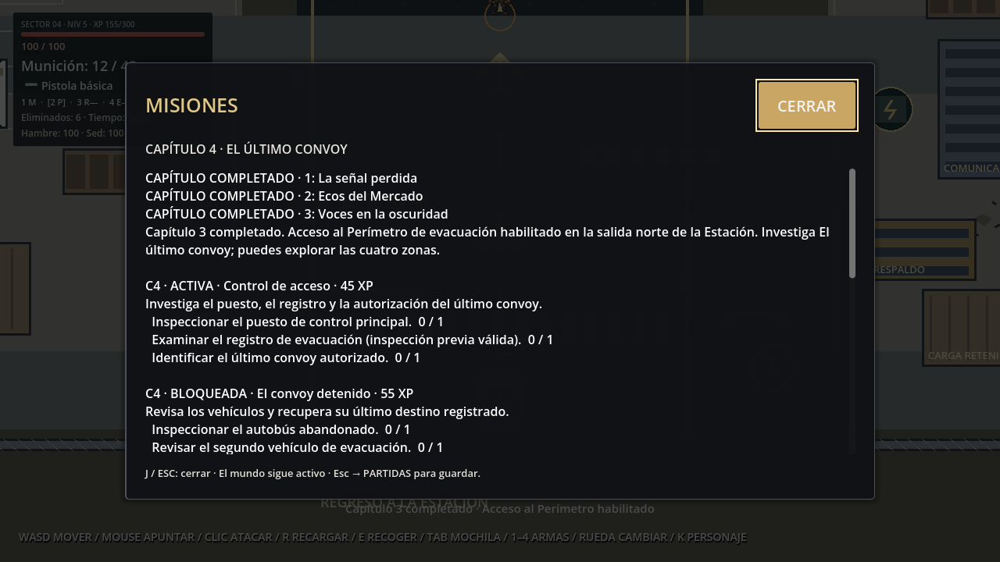
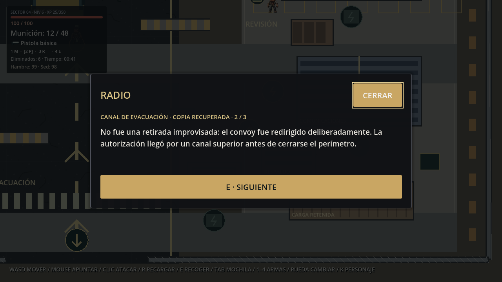
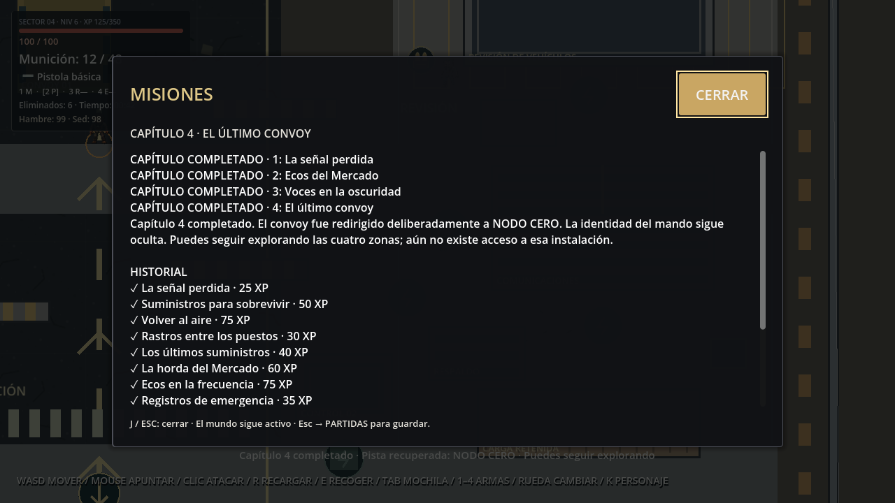
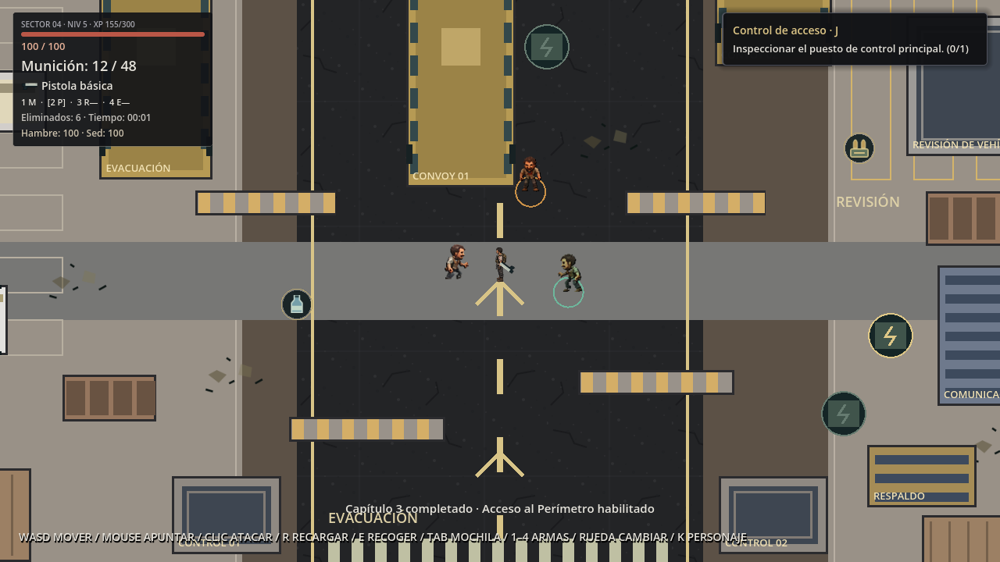

# Fase 16 — El último convoy

Capítulo 4 integrado en el **Perímetro de evacuación existente**, Godot 4.7.2
Stable, GDScript, Windows, Compatibility, 1280 × 720. Validación del 15 de
noviembre de 2026. Cuatro capítulos, quince misiones y cuatro zonas; **sin quinta
zona**. Arte y música siguen siendo provisionales. No sustituye una partida humana.

## Arquitectura y activación

ChapterCatalog registra `last_convoy`. El MissionTracker, ChapterController,
MissionRewards y RadioController existentes mantienen un único estado narrativo
por partida. Entrar al Perímetro después de `station_call` inicia este capítulo
una sola vez. Viajar a otros mapas conserva investigación, recibos y premios.
No hay otro gestor de misiones ni inventario narrativo paralelo.

La introducción `perimeter_intro` de fase 15 se conserva: no se reproduce otra
vez si ya está registrada. Las inspecciones previas de Registro y Médica son
evidencia histórica para objetivos concretos, sin XP ni objetos nuevos. Todavía
deben cumplirse los demás objetivos de cada misión. No se repiten premios antiguos.

## Misiones y recompensas

| Misión / ID | Objetivos | XP |
| --- | --- | ---: |
| Control de acceso / convoy_access | Puesto de control, registro de evacuación y autorización del convoy 07 | 45 |
| El convoy detenido / convoy_stopped | Autobús, segundo vehículo y último destino registrado | 55 |
| Protocolo de cuarentena / convoy_quarantine | Área médica, registros de cuarentena y verificación de seguridad | 70 |
| Ruta sin retorno / convoy_route | Comunicaciones → última orden → enlace → transmisión completa | 100 |

Total **270 XP**, reservados por MissionRewards antes de notificar. Las misiones
se desbloquean en orden. En las tres primeras se permite investigar sus puntos
en cualquier orden; la última es secuencial. La fórmula, habilidades, XP por
arquetipo y descarte de excedente al llegar a nivel 10 se conservan.

`convoy_kills` observa cadáveres reales del Perímetro, incluidos los anteriores.
Dos bajas verifican seguridad; alternativamente se puede inspeccionar el cordón
sin matar a nadie. No se inventan bajas, XP o enemigos para resolver el objetivo.
Un v6 con 18 cadáveres y presupuesto agotado también puede completar el capítulo.
Se mantienen seis vivos, presupuesto 18, intervalo 10 s y pesos 30/40/30
(primeros seis 2/2/2; reparto total 6/7/5). No se modificó la IA ni el combate.

## Interacciones y recorrido

Se conservan Registro (1900,550), Médica (700,420) y Comunicaciones (1700,1020).
Nueve MissionPoint transitables se colocan junto a los elementos ya dibujados:

| Nodo | Evento persistente | Posición |
| --- | --- | --- |
| Checkpoint | convoy_checkpoint | 1550,1350 |
| Authorization | convoy_authorized | 1320,380 |
| BusInspection | convoy_bus | 1260,650 |
| EvacuationVehicle | convoy_vehicle | 1660,500 |
| DestinationLog | convoy_destination | 1900,830 |
| QuarantineLog | convoy_quarantine_record | 460,560 |
| SafetyInspection | convoy_security | 850,400 |
| TransferOrder | convoy_orders | 1920,1160 |
| RadioLink | convoy_link | 1640,1120 |

Son Areas en capa 8/máscara 0, con la forma existente. E conserva alcance 56 px
y visibilidad World. No se cambian sólidos, geometría, paleta, malla, límites,
apariciones, cámara o suministros. Los registros se persisten en totales/recibos
de MissionSaveState; no ocupan mochila. WorldSaveState conserva sus cuatro
interacciones históricas. Los nuevos marcadores son técnicos, no arte definitivo.

## Transmisiones y música

Cinco RadioTransmission originales textuales: ConvoyAccess, ConvoyDestination,
ConvoyQuarantine, ConvoyOrders y ConvoyFinal. Revelan autorizaciones contradictorias,
un desvío compartido por los vehículos, cuarentena previa al diagnóstico y una
orden superior de traslado deliberado a **NODO CERO**. La identidad del mando
queda sin resolver; no se añade salida, mapa ni capítulo 5.

Cerrar una radio conserva su índice. Su punto reabre el mismo registro; el enlace
o Comunicaciones reabren el final. Otros puntos no sobrescriben mensajes pendientes,
incluidos los de fase 15. Un registro del convoy pendiente también bloquea otras
radios al viajar a mapas anteriores, conservando sus salidas para regresar.
Guardar/cargar desde otra zona conserva ese mensaje. Cargar restaura datos con
ventana cerrada; no abre ni
termina mensajes automáticamente. Mostrar el último mensaje aún no recompensa:
debe finalizar mediante E/SIGUIENTE. Cerrar, morir o viajar no concede los 100 XP.

El final registra `facility_hint`, muestra «Capítulo 4 completado» y permite seguir
explorando las cuatro zonas. J conserva el historial; ObjectiveHUD sigue compacto.
MOCHILA, PERSONAJE, PAUSA, ranuras y menú inicial mantienen sus flujos.

MusicDirector y los dos WAV no cambian. RadioUI/InterfaceCoordinator reutilizan
la atenuación −12 dB y su recuperación. Viajar y cargar no reinician el tema de
gameplay ni crean una voz adicional. El aviso de misión usa el efecto existente,
sin audio generado ni bancos nuevos.

## Guardado v7 y compatibilidad

v7 diferencia quince misiones, cuatro capítulos y `story.facility_hint`. Se guardan
estados/progreso, evidencia, recibos únicos, premios y radio/índice. Salud, armas,
inventario y formato del mundo conservan sus adaptadores. Solo se utilizan IDs
de catálogos confiables; no se aceptan rutas del JSON.

Cada **v1–v6 se valida con su formato histórico antes de migrar**. v6 → v7 agrega
las cuatro misiones bloqueadas si el Perímetro no fue visitado. Si está activo
o guardado como mundo inactivo, inicia Control de acceso y reconoce su historial
de bajas/inspecciones, sin refrescar misiones que entreguen premios. No reescribe
archivos al leer, repite introducciones, cura, repone botín o entrega XP.

Se comprueba coherencia entre mundo visitado, capítulo previo completo, progreso,
recibos, bajas reales, recompensa final, pista y diálogo pendiente. Un v6 no puede
contener misiones/radios del convoy. También se rechazan registros en un mapa
nunca visitado, seguridad inventada, orden secuencial inválido y pistas anticipadas.
El candidato completo se valida antes de sustituir Main, como en fases anteriores.

## Pruebas

La suite base se ejecutó **antes de editar**: 2.826 comprobaciones en 56 procesos,
sin fallos. Las pruebas escriben solo en `user://tests/phase-sixteen-*` y directorios
aislados de las suites anteriores, nunca en partidas/preferencias reales.

| Ejecución realizada | Resultado |
| --- | --- |
| Suite funcional completa final: todos los `*_test.gd`, 63 procesos/modos | **3.105 comprobaciones, 0 fallos** |
| Recorrido capítulo 4 | 73 headless / 76 en ventana, 0 fallos; **9.011,95 px** caminados |
| Estado, compatibilidad e IA del capítulo 4 | 140 headless / 141 en ventana, 0 fallos |
| Reapertura en cuatro procesos independientes | 2 + 12 + 12 + 12 comprobaciones, 0 fallos |
| Preparación de menú con navegación retenida ocho frames | 6 headless / 6 en ventana, 0 fallos |
| Menú/ranuras/configuración en ventana | 51 comprobaciones, 0 fallos |
| Música con driver y capturas reales | 62 comprobaciones, 0 fallos |
| Rendimiento equivalente antes/después | 8 + 8 comprobaciones, 0 fallos |
| Importación final y arranque normal desde TitleMenu | Sin ERROR/WARNING |

Los 3.105 incluyen las pruebas específicas headless; las cifras de las filas no
se suman de nuevo a esa suite. Todos los tests funcionales existentes se ejecutaron
nuevamente; no se reutilizaron como aprobados números históricos. Se conservaron
sus aserciones de daño, armas, inventario, supervivencia, habilidades, población,
guardado, cuatro conexiones y Game Over. El caso nuevo prueba datos v1–v6, mapa
activo/inactivo, introducción antigua pendiente, mochila llena, premios exactos,
18 cadáveres anteriores, seguridad sin bajas, último mensaje sin completar, muerte,
reintento, cargas repetidas y nivel máximo. Las nuevas capturas no sustituyen IA:
la prueba de estado observó movimiento y ataques de común, corredor y resistente.

La música siguió usando una voz y sus dos fuentes originales. Se verificaron
señal real, silencio al 0 %, ganancia Music/Master, bucles, continuidad entre mapas
y recuperación tras radio. Los 44 archivos protegidos (música, protagonistas,
componentes, enemigos, armas, visuales y project.godot) conservaron sus hashes.
La prueba adicional de recursos musicales aprobó 33 verificaciones de fuentes,
hashes y capturas; la mezcla de muestra alcanzó −17,74 dBFS de pico, sin recorte.

```powershell
godot --headless --path . --editor --import
godot --headless --path . --fixed-fps 60 --script res://tests/evacuation_chapter_test.gd
godot --headless --path . --fixed-fps 60 --script res://tests/evacuation_chapter_state_test.gd
godot --path . --fixed-fps 60 --script res://tests/evacuation_chapter_test.gd -- --capture
godot --path . --fixed-fps 60 --script res://tests/evacuation_chapter_state_test.gd -- --capture
godot --headless --path . --fixed-fps 60 --script res://tests/evacuation_chapter_restart_test.gd -- --write
godot --headless --path . --fixed-fps 60 --script res://tests/evacuation_chapter_restart_test.gd -- --read
godot --headless --path . --fixed-fps 60 --script res://tests/evacuation_chapter_restart_test.gd -- --final
godot --headless --path . --fixed-fps 60 --script res://tests/evacuation_chapter_restart_test.gd -- --complete
godot --path . --script res://tests/evacuation_performance.gd
```

El driver reutiliza el movimiento del recorrido anterior: camina con Input,
move_and_slide y E por la malla de producción. Prepara capítulos 1–3 mediante
fixtures y aísla IA durante la investigación; no se presenta como sesión humana.
La prueba de estado separada activa tres arquetipos y verifica persecución y daño
antes de aislarlos para los casos de persistencia. El watchdog del recorrido
rechaza etapas detenidas en vez de considerar válido un cierre sin resultado.

## Rendimiento

Mismo instrumento y preparación antes/después, Godot Debug ed1daf0bf, Ryzen 5
5600G, Radeon RX 580, 1280 × 720, **VSync=1 / max_fps=0**. Sin fixed-fps, capturas
ni otro proceso de prueba simultáneo al medir. Cada escenario se calienta y se
mide con reloj monotónico entre process_frame; no es rendimiento de exportación.

| Escenario | Media ms antes/después | p95 ms antes/después | Física* ms antes/después |
| --- | --- | --- | --- |
| Perímetro en reposo | 13,905 / 13,902 | 14,280 / 14,680 | 0,365 / 0,456 |
| Perímetro con seis enemigos | 13,906 / 13,907 | 14,285 / 14,691 | 0,628 / 0,790 |

Física* es la media de lecturas del monitor de máximos por segundo, **no el tiempo
medio por paso**. Render CPU del caso de seis: 0,490 → 0,673 ms; GPU 0,810 →
0,883 ms. La cadencia observada se mantiene cercana a 71,9 FPS bajo este entorno.
No se afirma una mejora de rendimiento ni equivalencia con otra instrumentación.

Los nueve puntos añaden **18 nodos** (442 → 460 en Perímetro); recursos 540 → 562
por definiciones, objetivos y radios precargadas. En seis viajes se mantienen
estables nodos, recursos, 27 voces del mundo, 21 conexiones died del jugador,
una región y cero huérfanos. La voz musical global es adicional y única, no una
de esas 27. Las dos pasadas aprobaron ocho comprobaciones cada una.
Memoria estática del escenario con seis: 55,84 → 56,20 MiB; incluye muestras
retenidas por el instrumento y no representa memoria privada total ni sesiones
de horas. Logs/JSON/capturas locales: `test-results/phase-sixteen/`, ignorado.

## Capturas reales









Capturas 1280 × 720 reales, seleccionadas y optimizadas sin pérdida; no imágenes
conceptuales ni arte nuevo. [Fuentes y preparación](images/README.md).

## Archivos y límites

**29 archivos modificados y 30 nuevos**, incluidos UID e importaciones. Inventario
exacto local: `test-results/phase-sixteen/delivery-files.json`.

Nuevos: cuatro Convoy*.tres de misiones, cinco de radio; fixture, recorrido,
pruebas de estado/reapertura/rendimiento y preparación tardía del menú con sus UID; este informe y cuatro PNG
de documentación con metadatos de importación. Modificados: catálogo/controlador
de capítulos, MissionTracker, recursos de Main y puntos de PerimeterWorld;
adaptadores/catálogo/esquema/migración/mensaje de carga; diario/ObjectiveHUD y
aviso sonoro de nuevas misiones. TitleMenu espera hasta 60 frames por la publicación
de navegación/población (antes cuatro), sin simular gameplay ni alterar apariciones.
Una prueba retiene la región ocho frames y verifica que no se guarda a medias.
Las pruebas históricas solo adaptan el tamaño
del catálogo y separan sus once misiones originales para conservar la cobertura.
README, AGENTS e informes históricos reciben punteros de estado vigente.

Incidencias corregidas: tipado explícito requerido por GDScript; posición inicial
del enlace demasiado cerca de carga retenida, reubicada sin tocar sólidos; protección
de un registro médico pendiente al activarse la siguiente misión. Una ejecución
gráfica terminó sin resumen: no se contó como aprobada; la repetición instrumentada
completó el recorrido. No se atribuye ese cierre a una causa no verificada.
La suite final reprodujo además el fallo intermitente de preparación del menú
documentado antes de esta fase: save_slot rechazaba guardar porque Population aún
no estaba inicializada tras cuatro frames. Se corrigió la espera acotada, sin
cambiar las reglas de población ni la simulación. La prueba de retraso aprobó
seis comprobaciones tanto headless como en ventana; el menú nativo aprobó 51.

Pendientes humanos: partida completa con IA y recursos limitados, descubrimiento
de registros sin conocer coordenadas, claridad del orden de misiones y del cordón,
lectura/scroll en otras resoluciones, escucha de música/radio/efectos, panel gráfico
del depurador, sesiones largas de guardado/memoria y exportación Windows. No se
declaran realizadas. Sin plugins, quinta zona, cambios de balance, VSync, commits
o push.

Inventario de archivos modificados (rutas agrupadas):

```text
AGENTS.md, README.md
scenes/Main.tscn, scenes/world/PerimeterWorld.tscn
scripts/audio/game_audio.gd
scripts/missions/{chapter_catalog,chapter_controller,mission_tracker}.gd
scripts/save/{mission_save_state,save_catalog,save_coordinator,save_migration,save_schema}.gd
scripts/ui/{mission_ui,objective_hud,title_menu}.gd
tests/{legacy_save_fixture,market_chapter_test,perimeter_route,perimeter_test}.gd
tests/{station_chapter_state_test,station_chapter_test,station_route,station_test}.gd
docs/{evacuation_perimeter,save_load,start_menu_settings,station_chapter}.md
docs/images/README.md
```
