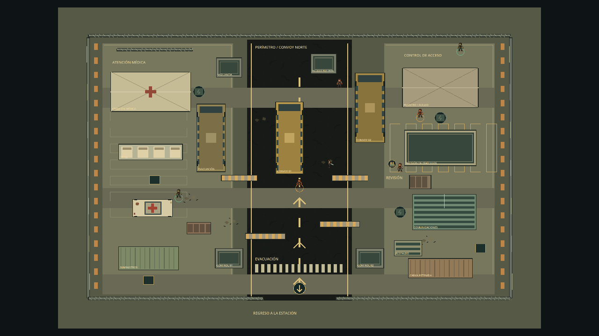
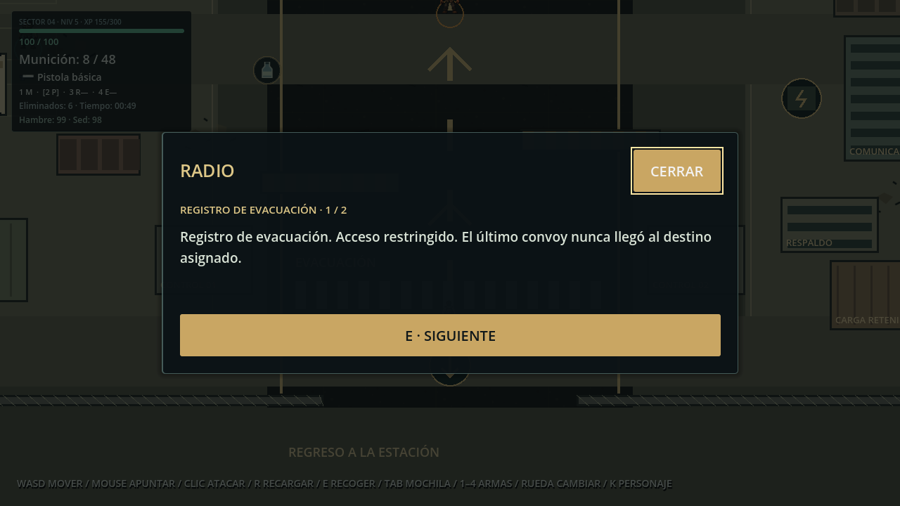
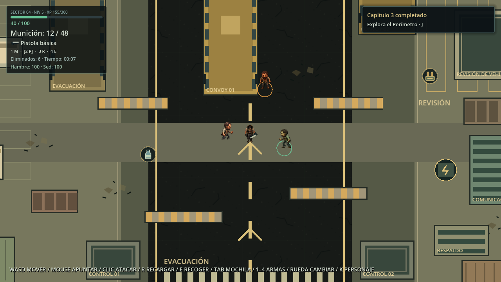

# Fase 15 — Perímetro de evacuación

Cuarta zona técnicamente integrada en Godot 4.7.2 Stable, GDScript, Windows,
Compatibility y 1280 × 720. Validación: 14 de noviembre de 2026.
Se conservó la fase 14, que estaba sin commit al comenzar; no se reinició su
implementación. Hay **cuatro mapas, tres capítulos y once misiones**. No se
implementan capítulo 4, quinta zona, armas, tipos de enemigos o gestores nuevos.

## Composición y rutas

PerimeterWorld.tscn es independiente. Su ID estable es evacuation_perimeter,
definido en resources/zones/Perimeter.tres y registrado en ZoneCatalog.
Conserva las dimensiones 2400 × 1600 y reutiliza ZoneManager, Population,
world_navigation, WorldSaveState, interacción, inventario y radio existentes.

La identidad es un recinto de control de evacuación con carretera **norte/sur**,
carriles y flechas de convoy, pasos de revisión y patios laterales. Tiene tres
autobuses abandonados, ambulancia, tienda médica y camillas de triaje, cabinas,
registro de acceso, revisión de vehículos, comunicaciones, generador, carga,
equipajes y vallas con acceso sur. La franja naranja y los tonos arena/oliva
separan su aspecto del barrio, los puestos del Mercado y la Estación azul/gris.

Hay **28 sólidos** con RectangleShape2D serializada bajo Obstacles. La navegación
se deriva de esas huellas con el margen de 20 px existente. Los scripts visuales
solo dibujan; no crean colisiones tardías o una segunda malla. perimeter_ground.gd
pinta carretera, carriles, patios, manchas y
señales transitables; perimeter_structure.gd extiende UrbanObstacle y utiliza
la misma huella física. No hay interiores complejos o geometría oculta añadida.

La ruta principal une la entrada sur con el convoy norte. Se puede rodear cada
autobús, explorar triaje al oeste y registro/comunicaciones al este. Barricadas
escalonadas dejan pasos; las entradas, suministros e inspecciones tienen rutas
conectadas verificadas en la malla y recorridas físicamente por el driver.

## Desbloqueo y conexiones

| Trayecto | Interacción con E | Entrada destino |
| --- | --- | --- |
| Gualey → Mercado | 2120,800 | from_gualey: 320,800 |
| Mercado → Gualey | 240,800 | from_market: 2020,800 |
| Mercado → Estación | 2280,800 | from_market: 320,800 |
| Estación → Mercado | 240,800 | from_station: 2180,800 |
| Estación → Perímetro | **800,230**, aproximarse por 800,260 | from_station: **1200,1350** |
| Perímetro → Estación | **1200,1400**, aproximarse por 1200,1370 | from_perimeter: **800,300** |

ZoneDefinition declara conexiones/entradas permitidas. El desbloqueo del Perímetro
depende de **station_call completada**, después de avanzar más allá del último
mensaje de La última llamada. Cerrar temprano, entrar en Estación o terminar
otras misiones no autoriza acceso. No hay viaje directo desde Gualey/Mercado.

ZoneManager reutiliza su conexión a mission_completed; no hay otro gestor de
autorización. Añade el texto de bloqueo correcto y conserva fundidos/pausa,
rechazo de viajes concurrentes y guardado/carga bloqueados durante transición.
Las flechas de los dos puntos nuevos señalan norte/sur mediante una propiedad
visual opcional; las salidas antiguas mantienen su orientación predeterminada.

El mismo Player, HUD, audio global y componentes viajan sin reconstruirse.
Salud, necesidades, nivel/XP, habilidades, inventario, equipada, armas y balas
se comparan antes/después **dentro de la pausa de transición**. Después de volver
a física avanzan legítimamente hambre/sed/cooldowns: no se confunde eso con una
pérdida de estado. Las escenas viejas se liberan y solo queda una región activa.

## Enemigos y suministros

Pesos configurables **30 % comunes / 40 % corredores / 30 % resistentes**.
El reparto determinista por ordinal existente produce **2/2/2** en los primeros
seis y **6/7/5** en las 18 apariciones. No se fuerza una mezcla idéntica por grupo.
Se mantienen seis vivos, presupuesto 18, reposición de diez segundos y los tres
arquetipos con su IA, salud, velocidad, daño, XP, cooldown, visual y audio actuales.

Semillas: 1200,900; 1700,820; 600,950, a más de 400 px de la entrada inicial.
Los 24 candidatos de reposición pasan por las mismas reglas existentes: fuera
de cámara con margen, lejos del jugador/actores/objetivos, espacio físico y ruta
navegable. Las pruebas consumen todo el presupuesto, comprueban posiciones
seguras y no amplían detección para justificar movimiento. La IA se probó
rodeando el extremo de un autobús dentro de su radio original de 250 px.

| Recurso | ID | Posición | Contenido inicial |
| --- | --- | --- | --- |
| Caja médica | perimeter_medical_case | 480,860 | 2 botiquines, 2 aguas |
| Raciones | perimeter_rations | 450,1360 | 2 comidas, 2 aguas |
| Equipo | perimeter_equipment | 2100,1200 | 24 balas de pistola, 4 cartuchos |
| Agua recogible | perimeter_water | 940,980 | 1 agua |
| Munición recogible | perimeter_ammo | 1660,780 | 12 balas de pistola |

LootContainer/WorldPickup conservan apertura, pilas y recogidas por ID, sin
duplicarlos al viajar o cargar. No hay objetos de misión sin uso. Se conservan
premios existentes: 795 XP potenciales de enemigos y 60 de primeras aperturas;
las inspecciones/transmisiones no dan XP. El contenido actual de cuatro mapas y
tres capítulos suma 3.650 XP configurados; el tope sigue en nivel 10/nueve puntos,
sin acumular excedente ni cambiar la fórmula. Los presupuestos históricos de
fase 14 se prueban sobre sus tres mapas para conservar sus expectativas originales.

## Introducción e inspecciones

La primera entrada reserva perimeter_intro y abre PerimeterIntro **después del
fundido**, utilizando RadioController/RadioUI y sonidos existentes:
«Registro de evacuación. Acceso restringido. El último convoy nunca llegó al
destino asignado.» El segundo mensaje orienta hacia los tres puntos de interés.
No se entregan recompensas ni se inicia un capítulo nuevo.

| Inspección | ID persistente | Posición | Contenido |
| --- | --- | --- | --- |
| Médica | perimeter_medical | 700,420 | Triaje abandonado y pacientes sin destino |
| Registro | perimeter_register | 1900,550 | Último convoy sin confirmación de llegada |
| Comunicaciones | perimeter_comms | 1700,1020 | Material/frecuencia para una investigación futura |

WorldSaveState.interactions conserva esos tres eventos y perimeter_intro.
Se reservan antes de emitir mensajes. Los puntos usan MissionPoint existente,
capa 8/máscara 0, alcance 56 y visibilidad World. Quedan disponibles para ampliar
historia después; no son nuevas misiones ni entregan objetos inútiles.

Cerrar radio conserva el índice. Comms reabre la introducción pendiente; cada
inspección reabre su propia transmisión si quedó interrumpida. Otro diálogo
pendiente no se sobrescribe: la introducción se difiere hasta que quede libre
el canal o puede solicitarse desde Comms. Tras terminar no se repite al regresar.
Al cargar se conserva el diálogo con ventana cerrada, sin reproducción automática.
La exclusión de interfaces y el requisito de soltar shoot siguen en el mismo
InterfaceCoordinator. HUD compacto, inventario, personaje, pausa y Game Over
conservan su estructura. ObjectiveHUD adapta el texto al mapa visitado.

## Guardado v6 y compatibilidad

Se amplía el esquema de v5 a **v6** porque ahora acepta cuatro zonas, hasta tres
mundos inactivos, 72 bajas globales coherentes y tres desbloqueos. No cambia la
estructura de PlayerSaveState ni WorldSaveState, ni se reescribe el guardado.

Cada v1–v5 se valida primero con sus límites históricos; después migra en memoria
hasta v6. El paso v5 → v6 solo añade el desbloqueo del Perímetro si station_call
ya está completa. No crea un mundo visitado, altera misiones, repite XP, cura o
reescribe el archivo al leer. Las versiones anteriores no aceptan IDs/radios del
Perímetro. La escena candidata se valida antes de reemplazar la partida actual.

Se persisten mapa, posición segura, contenedores, recogibles, cuatro interacciones,
radio/índice, enemigos por ID/tipo/HP/cooldown, cadáveres, presupuesto y recompensas.
Se rechazan acceso sin autorización, padres ausentes, mapa activo duplicado,
interacciones repetidas/desconocidas, más de 72 bajas y radio incoherente.
Solo se cargan escenas/recursos del catálogo confiable; nunca rutas del JSON.
Las pruebas escriben en user://tests/phase-fifteen-* y carpetas aisladas de las
suites anteriores. **No se modificaron las partidas reales del usuario.**

## Pruebas ejecutadas

Base previa: **2.441 comprobaciones**, cero fallos, ejecutadas nuevamente antes
de editar. Regresión final: **2.736 headless**, cero fallos, incluida toda la
suite anterior. Las tres comprobaciones adicionales de station_test provienen
de verificar las entradas nuevas del catálogo, sin eliminar cobertura previa.

| Prueba nueva / ampliada | Resultado | Alcance |
| --- | ---: | --- |
| perimeter_test.gd | 123 headless / 124 en ventana | Bloqueo/final de radio, migración v5, cuatro armas y estados, entradas/rutas, autobús, IA tres tipos, daño, colisión, botín, cuatro inspecciones, save/load, corrupción, diez viajes, presupuesto 18, Game Over/reinicio |
| station_chapter_test.gd -- --perimeter | 145 headless / 152 en ventana | Locomoción real, E, capítulo 3 completo, introducción interrumpida/cargada, inspecciones, cuatro mapas y retorno a Gualey |
| perimeter_restart_test.gd | 3 escritura + 21 lectura | Procesos independientes; comparación exacta de ocho secciones, cuatro mundos, cuatro armas, agua/botiquines, resistente con 87,5 HP, corredor muerto y radio índice 1 |

El recorrido ampliado camina **23.407,96 píxeles** con Input y move_and_slide.
Los capítulos 1/2 y el acceso inicial a Estación se preparan con fixtures; después
camina el capítulo 3, Perímetro, retorno a Estación/Mercado y Gualey hasta el
inicio. Aísla IA para narrativa/rutas; no es partida humana. La prueba de IA
separada mide persecución, desvío, tres atacantes, animación y colisiones con
física activa; solo después aísla actores para preparar estados de persistencia.
La vista de plano reduce zoom/oculta HUD únicamente en la captura y restaura todo.

La regresión conserva pruebas de v1–v4 y añade carga explícita v5 completada,
conservando XP y bytes originales. Se comprueban inventario, munición, recarga,
habilidades, necesidades, muerte, radio y reinicio de fases anteriores. Las
salidas exitosas y registros de rendimiento se conservan en test-results/phase-fifteen/,
ignorado por Git. Se ejecutaron las pruebas: no se sustituyeron por cifras previas.

Problemas corregidos durante validación: anotaciones WeakRef de la prueba;
comparar supervivencia después de reanudar física daba diferencias legítimas;
el primer ensayo de desvío colocaba al jugador fuera del radio original al
rodear el centro del autobús; se eligió su extremo, sin cambiar IA. El reparto
determinista real es 6/7/5. La revisión visual corrigió texto contextual y flechas.
Las pasadas finales no conservan esos fallos.

```text
godot --headless --path . --editor --import
godot --headless --path . --fixed-fps 60 --script res://tests/perimeter_test.gd
godot --headless --path . --fixed-fps 60 --script res://tests/station_chapter_test.gd -- --perimeter
godot --headless --path . --fixed-fps 60 --script res://tests/perimeter_restart_test.gd -- --write
godot --headless --path . --fixed-fps 60 --script res://tests/perimeter_restart_test.gd -- --read
godot --path . --fixed-fps 60 --script res://tests/station_chapter_test.gd -- --perimeter --capture
godot --path . --fixed-fps 60 --script res://tests/perimeter_test.gd -- --capture
godot --path . --script res://tests/station_performance.gd
godot --path . --script res://tests/perimeter_performance.gd
```

## Rendimiento y estabilidad

Se repite station_performance.gd antes/después con la misma preparación. La
pasada nueva perimeter_performance usa el mismo instrumento: reloj monotónico
entre process_frame, calentamiento, muestras crudas, tiempos de viewport CPU/GPU,
monitores de física/navegación, nodos/recursos/voces/huérfanos/conexiones y memoria
estática. No hay fixed-fps, capturas u otra prueba Godot paralela al medir.
VSync y configuración predeterminada se conservan. El editor del usuario sigue
abierto; no es rendimiento de exportación Windows.

Entorno registrado: Godot oficial ed1daf0bf, Debug, Ryzen 5 5600G, Radeon RX 580, 1280 × 720, **VSync=1 / max_fps=0**.

| Comparación equivalente de estación | Media antes/después ms | p95 antes/después ms |
| --- | ---: | ---: |
| market_control | 13.90 / 13.90 | 14.23 / 14.61 |
| station_idle | 13.91 / 13.91 | 14.28 / 14.57 |
| station_six | 13.90 / 13.90 | 14.27 / 14.41 |

| Pasada específica | Media ms | p95 ms | Física* ms | Render CPU/GPU ms | Nodos / voces / conexiones died |
| --- | ---: | ---: | ---: | ---: | --- |
| station_control | 13.91 | 14.58 | 0.385 | 0.371 / 0.212 | 472 / 33 / 23 |
| perimeter_idle | 13.90 | 14.48 | 0.491 | 0.551 / 0.807 | 438 / 27 / 21 |
| perimeter_six | 13.91 | 14.50 | 0.654 | 0.544 / 0.863 | 438 / 27 / 21 |

Estación equivalente añade dos nodos para su salida (448 → 450); Mercado de control mantiene 456. Recursos precargados 498 → 537 por el nuevo mapa, formas y radios; permanecen constantes dentro de cada pasada. La pasada específica usa 538 recursos (otra instrumentación), constantes en doce viajes. Una región y cero huérfanos en todas sus muestras.

Perímetro estable: **438 nodos, 27 voces, 21 conexiones died**. Memoria estática registrada 49.35 → 49.87 MiB, incluyendo muestras retenidas; cadencia observada 71.9 FPS. Benchmarks: 12 comprobaciones antes, 12 después y 28 específicas, cero fallos.


La física es media de lecturas de máximos publicados por segundo, **no coste
medio por paso**. FPS son del bucle observado; no se comparan con invocaciones
históricas distintas. El control específico de Estación en la pasada del
Perímetro conserva seis vivos y dos cadáveres de preparación; no equivale a la
Estación con seis actores del benchmark anterior. Cada mapa se compara consigo
mismo tras calentarse. Se miden doce transiciones por los cuatro mapas además
de seis enemigos activos en el Perímetro; las pruebas funcionales añaden diez
viajes sin acumulación de nodos, recursos, voces, timers o señales.

La memoria estática incluye arrays retenidos por el instrumento. No es memoria
privada total, ni prueba de ausencia de fugas en sesiones de horas. Se registran
los StringName del cierre verbose previo y de dos arranques posteriores: **38 / 38 / 38**. No hubo aumento reproducible en estas pasadas; no se atribuye automáticamente una fuga a esa cifra. Importación final y arranque normal aprobados, sin ERROR/WARNING ni informe de instancias ObjectDB retenidas.

## Capturas y recursos provisionales







Se revisan plano, accesos, composición, rutas laterales, vehículos, HUD/modal,
actores y señales. Tres PNG seleccionados de cuatro del Perímetro, 1280 × 720,
optimizados sin pérdida y comparados píxel a píxel. La vista de carretera queda
solo en resultados para evitar duplicados en documentación. [Fuentes](images/README.md).
Arte geométrico técnico, recursos SVG existentes y audio sintético original;
sin descargas, plugins o arte final nuevo. Quedan pendientes texturas, animaciones
y retoque artístico definitivo. No se presenta la geometría como arte terminado.

## Archivos de esta fase

Comparados con la instantánea tomada antes de editar: **24 modificados y 27
nuevos**, incluyendo .uid/.import. El registro local delivery-files.json separa
estos cambios de los que ya estaban pendientes de fase 14.

Nuevos: PerimeterWorld.tscn, Perimeter.tres; perimeter_ground.gd y
perimeter_structure.gd con sus .uid; cuatro Perimeter*.tres en resources/radio/;
perimeter_fixture.gd, perimeter_route.gd, perimeter_test.gd,
perimeter_restart_test.gd, perimeter_performance.gd y sus .uid; este informe;
tres PNG perimeter-{plan,intro,active-ai}.png y sus metadatos .import.

Modificados sobre la fase 14: ZoneCatalog/ZoneManager/ZoneExit, Station.tres y
StationWorld.tscn; ChapterController; SaveCatalog/SaveSchema/SaveMigration/
SaveCoordinator; MissionUI/ObjectiveHUD; texto de StationFinal; fixture histórica
y expectativas de catálogo/versión en pruebas, más la opción --perimeter del
driver existente; AGENTS.md, README, índice de imágenes y punteros de estado en
station_chapter.md, zones_transitions.md y save_load.md. Se conservan los cambios
previos sin commit. No se modifican Player, IA, armas, salud, supervivencia,
fórmula RPG, HUD principal, navegación o project.godot. Sin commits ni push.

## Pendientes manuales

Partida humana completa entre cuatro zonas, balance de corredores/resistentes
y suministros, descubrimiento de la salida norte, rutas secundarias bajo presión,
mezcla de audio, otros tamaños de ventana, revisión del panel del depurador,
sesiones largas de memoria/guardado y exportación Windows. No se declaran
aprobadas. El capítulo 4 y una quinta zona siguen fuera de esta fase.
