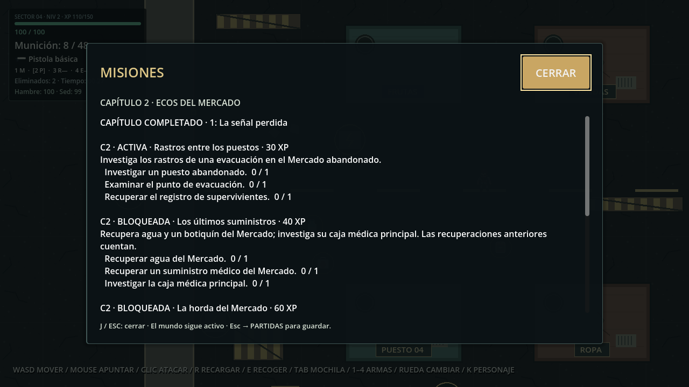
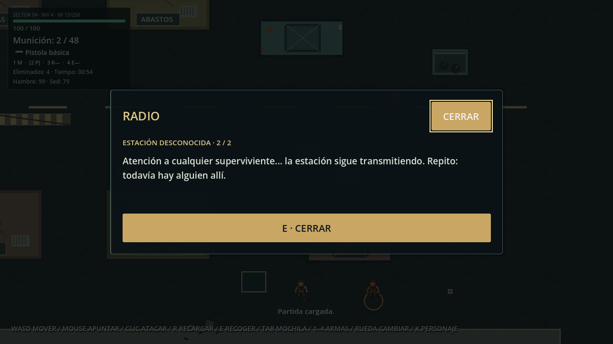
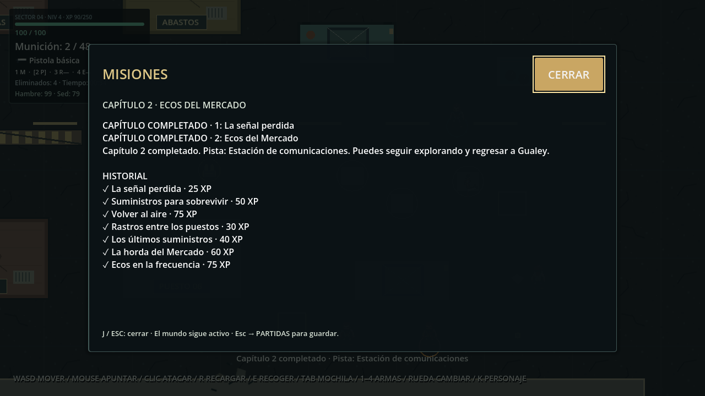

# Fase 12 — Ecos del Mercado

Segundo capítulo jugable en Mercado abandonado. Godot 4.7.2 Stable, Windows,
GDScript, Compatibility, 1280 × 720. Arte técnico existente; sin mapa nuevo,
armas, cambios de estadísticas, VSync, plugins ni commits.

## Registro de capítulos y misiones

| Capítulo | ID estable | Inicio | Misiones |
| --- | --- | --- | --- |
| 1 · La señal perdida | signal_lost | Partida nueva | signal, supplies, broadcast |
| 2 · Ecos del Mercado | market_echoes | Primera entrada al Mercado tras completar broadcast | market_traces, market_supplies, market_horde, market_frequency |

ChapterCatalog registra identidades/títulos y los IDs de cada capítulo.
MissionDefinition añade chapter_id; MissionTracker conserva siete definiciones,
capítulos iniciados y capítulo actual. La finalización se deriva de sus misiones.
No se crea otro tracker, radio o gestor de XP. Se conserva el capítulo 2 actual
al regresar a Gualey; J muestra progreso e historial de ambos capítulos.

| Misión | Objetivos | XP |
| --- | --- | ---: |
| Rastros entre los puestos | Investigar puesto, evacuación y registro de supervivientes | 30 |
| Los últimos suministros | Recuperar agua y botiquín del Mercado; investigar su caja médica | 40 |
| La horda del Mercado | Identificar corredores; eliminar un corredor y un resistente del Mercado | 60 |
| Ecos en la frecuencia | Localizar comunicaciones, alimentar, restablecer repetidor y terminar la transmisión | 75 |

Se encadenan en ese orden. Rastros permite investigar sus tres puntos en cualquier
orden; comunicaciones exige el orden indicado. Las cuatro recompensas suman
**205 XP**, reservadas por MissionRewards antes de otorgarlas. No se alteran XP
de enemigos/contenedores, fórmula de niveles ni habilidades.

En partida nueva con los presupuestos completos actuales: 540 XP de comunes en
Gualey + 100 de contenedores + 150 del capítulo 1; Mercado 675 por mezcla 11/5/2
más 60 de contenedores + 205 del capítulo 2 = **1.730 XP**, nivel 7, 380/400 y seis
puntos. Es una suma del contenido/configuración actual, no una constante del
sistema; las partidas antiguas conservan sus tipos y pueden tener otro total.

## Interacciones y radio

Areas transitables en World/ChapterPoints, capa 8 y máscara 0. Reutilizan
MissionPoint y PlayerInteraction: E, radio de 56 px y visibilidad World. No se
cambian sólidos, malla, dimensiones ni puntos de aparición. La población sigue
rechazando apariciones demasiado próximas a puntos de misión.

| Punto nuevo | ID/evento | Posición |
| --- | --- | --- |
| Puesto abandonado | market_stall | 650,700 |
| Evacuación improvisada | market_evacuation | 400,1040 |
| Registro de supervivientes | market_record | 830,1180 |
| Equipo de comunicaciones | market_comms | 1760,890 |
| Alimentación | market_power | 1850,940 |
| Repetidor | market_repeater | 1970,900 |

Se reutilizan agua market_water, botiquín market_medkit y caja market_medical,
sin duplicar objetos o introducir otro botín. Abrir la caja registra su
investigación; recuperar exige recogida o transferencia válida. El inventario
inicial, añadir objetos por API, abrir otros contenedores o fallar por capacidad
no acreditan agua/botiquín. Consumir después no revoca el registro histórico.

La alimentación es una interacción narrativa con el equipo fijo: no requiere
un objeto ni un hueco de mochila. Funciona incluso con los doce espacios llenos.

Cuatro RadioTransmission nuevos reutilizan RadioController/RadioUI:
MarketRecord (huida y evacuación), MarketComms (falta alimentación), MarketPower
(repetidor preparado) y MarketFinal (respuesta de la estación). La última contiene
«Atención a cualquier superviviente... la estación sigue transmitiendo. Repito:
todavía hay alguien allí.»

RadioController añade transmission_completed solo al avanzar más allá del último
mensaje; cerrar ventana o morir no la emite. El repetidor vuelve a abrir una
transmisión pendiente desde el índice guardado. Activarlo no concede los 75 XP
hasta terminar la lectura. El capítulo 1 conserva su criterio de interacción
anterior. La muerte bloquea tracker/radio y nuevas recompensas.

Se mantienen aviso electrónico ui_select por mensaje y sonidos originales de
interacción. Alimentación/repetidor usan item_use; las misiones nuevas usan
pickup_supply, evitando repetirlo si esa misma operación produjo subida de nivel.
No hay nueva música, voces o WAV de interferencia: la interferencia está indicada
en el texto y se acompaña del aviso electrónico provisional existente.

Al finalizar se muestran «Capítulo 2 completado» y la pista **Estación de
comunicaciones**. El mundo sigue activo y la salida a Gualey funciona. station_hint
solo registra esa pista; no añade una zona al catálogo ni una salida inexistente.

## Historial y partidas anteriores

El mismo ChapterController observa supply_recovered y container_opened, y cada
eliminated después del contador existente. Los eventos del Mercado tienen claves
propias; el botiquín de Gualey no cuenta como suministro del Mercado.
Los recibos estables impiden duplicados; las bajas tipadas se contrastan con
WorldSaveState, que conserva ID, tipo y salud/cadáver en cada zona.

La presencia del corredor se reconoce cuando su IA persigue/ataca (observación
cada 0,25 s mientras falta identificarlo) o al registrar una baja de corredor.
No se modifica la IA, detección, navegación o daño para provocar el objetivo.
Recuperaciones y bajas anteriores a las misiones 2/3 se aplican cuando estas se
activan, evitando perder recursos/variantes finitos por el orden de exploración.

**Caso legado sin variantes disponibles:** un v2 anterior a fase 11 puede tener
solo comunes y agotar el presupuesto. MarketHistory comprueba cuerpos guardados
y todos los ordinales futuros de la configuración finita. Si no existe ningún
ejemplar de una variante, vivo o muerto, ni puede aparecer otro dentro del
presupuesto, la migración registra una excepción explícita en legacy_waivers.
Se reconoce el requisito narrativo de amenaza despejada; no se inventan bajas
tipadas, XP de enemigos, cadáveres o apariciones. El diario explica la excepción.
La misión sigue su orden y concede únicamente su recompensa nueva una vez.
Si aún puede aparecer una variante, no se aplica la excepción.

## Guardado v3

Se valida v1/v2 con sus estructuras anteriores antes de migrar en memoria:
v1 → zonas v2 → narrativa v3. El archivo del jugador no se reescribe al leer.
Las pruebas usan exclusivamente user://tests/phase-twelve-*.

- chapter: capítulo narrativo actual.
- story.started/completed: IDs iniciados/completados, coherentes con las misiones.
- story.legacy_waivers: excepciones limitadas a variantes realmente no disponibles.
- story.station_hint: pista final, coherente con la finalización del capítulo 2.
- missions: estados/progreso de siete misiones, totales históricos, recibos,
  recompensas reservadas, transmisión/índice y desbloqueo del Mercado existente.

Interacciones/equipos activados se representan por eventos/progreso/recibos,
sin duplicar booleanos de estado en nodos del mapa. Solo se restauran valores
validados desde catálogos locales; no se cargan rutas o scripts del JSON.

Un v2 que ya visitó el Mercado inicia Rastros con progreso nuevo a cero, conserva
todos sus estados anteriores y reconstruye recuperaciones desde recogibles
reclamados o pilas transferidas de contenedores, y bajas desde cadáveres tipados.
No premia misiones nuevas durante la migración/restauración. Un v1 sin visitar
el Mercado mantiene bloqueado el capítulo 2 hasta viajar. Los v3 restauran
exactamente el progreso nuevo; no reinician equipos ni repiten premios.

Se rechazan capítulos desconocidos, incoherencias de orden/recompensas,
listas duplicadas, pistas anticipadas, bajas tipadas incompatibles con el mundo
y transmisiones del Mercado sin su interacción correspondiente. Las builds
anteriores no conocen v3; la compatibilidad es del juego actual leyendo v1/v2.

## Validación y evidencias

**1.934 comprobaciones headless, cero fallos**, frente a las 1.764 previas.
Se mantienen las regresiones de todos los sistemas: cuatro comprobaciones
adicionales de fase 8 abarcan los nuevos recursos, más 108 de recorrido, 52 de
estado/IA/migración y seis de reapertura del capítulo en procesos separados.

- El recorrido completa ambos capítulos mediante entrada, navegación y física del
  jugador, E, recogidas, consumo y disparos reales: **13.411,99 px caminados**.
  No añade XP ni marca misiones por API. Aísla física de enemigos en esta fixture
  para comprobar narrativa; respawn, mundo e inventario conservan sus sistemas.
- Prueba adicional con los tres tipos y su IA activa: persecución/desplazamiento,
  identificación de corredor, ataques que reducen salud, intervalos y voces.
  También cubre v1, v2 del Mercado, mercado legado agotado, datos inválidos,
  equipo/diálogo parcial, viajes repetidos y muerte antes del último mensaje.
- Reapertura real: escritor PID **2660**, lector **18628**, con dos rastros
  investigados, un tercero pendiente, agua recuperada y corredor eliminado.
  Se comparan story, misiones/recibos/premios/radio, mundos, jugador y XP.
- En ventana: **112 comprobaciones** de recorrido (incluye cuatro capturas),
  **52 de estado con IA activa**, y **44 del benchmark** con VSync original.
  Todas aprobadas, sin ERROR/WARNING. Las capturas finales fueron inspeccionadas
  y se seleccionaron tres para documentación, optimizadas sin pérdida y cotejadas
  píxel a píxel. Se corrigió el rótulo superior de zona que tapaba diario/radio.

Los errores iniciales de desarrollo fueron una declaración de recurso colocada
después de subrecursos en la escena y el slot incorrecto de un fixture histórico.
Se corrigieron y repitieron las pruebas. La suite previa solo cambia expectativas
afectadas por los nuevos capítulos/formato; no rebaja comprobaciones de gameplay.

Resultados locales (ignorados): `test-results/phase-twelve/baseline.txt`,
`regression-final.txt`, `graphical-final.txt`, `state-window.txt`, registros de
reapertura, `import-final.txt` y `startup-final.txt`.

### Comparación de rendimiento

La medición con VSync conserva el cuello de presentación observado en fase 11.1.
Para no atribuir su variación al capítulo nuevo, se comparó contra el commit
`64c678d8804ec6b7e8a7e5557f8831605d6d2aa3` (anterior a fase 12), extraído en una
copia temporal. Solo se excluyó del escaneo de esa copia un paquete gráfico
no referenciado por escenas/scripts/Resources; el contenido ejecutado es el del
commit. Se usó el mismo Godot 4.7.2, Ryzen 5600G/RX 580, editor del usuario abierto,
1280 × 720, VSync=1 y max_fps=0. Las pasadas fueron secuenciales, sin capturas
ni --fixed-fps. La copia temporal fue retirada después de conservar métricas.

| Escenario | Media previa ms | Media fase 12 ms | p95 previo ms | p95 fase 12 ms |
| --- | ---: | ---: | ---: | ---: |
| Gualey, lejos | 31.57 | 31.55 | 32.06 | 32.23 |
| Gualey, seis cercanos | 31.58 | 31.62 | 32.25 | 32.36 |
| Mercado 3/2/1 | 31.66 | 31.71 | 32.42 | 32.50 |
| Combate | 31.72 | 31.73 | 32.62 | 32.43 |
| Mochila | 31.67 | 31.67 | 32.52 | 32.15 |
| Personaje | 31.60 | 31.61 | 32.14 | 32.26 |
| Mercado estable | 31.54 | 31.56 | 32.21 | 32.24 |
| Después de cargar | 31.50 | 31.52 | 32.05 | 32.12 |

Ambas pasadas rondan **31,5–31,8 FPS**. En estas muestras no se observa una
regresión importante del intervalo entre frames por el capítulo nuevo. No es
evidencia de 60 FPS ni un benchmark de exportación; se mantiene la limitación
de VSync/presentación ya documentada.

Física (media de lecturas del monitor de máximos por segundo): Mercado
0,510 → 0,534 ms; combate 0,862 → 1,085 ms. No son tiempos medios exclusivos
por paso físico. En fase 12, render CPU normal ronda 0,46–0,73 ms y GPU
0,74–1,07 ms. La diferencia pequeña de monitores no prueba causalidad por
función ni justifica reescribir IA. Referencia metodológica:
[fase 11.1](performance_phase_11_1.md).

Guardar (una operación por pasada): **11.93 → 13.96 ms**; cargar: **31.89 → 34.34 ms**.
Es un incremento de unos 2–2,5 ms al validar/serializar estado adicional, no una
medición estadística de p95 de carga. La fila poscarga excluye esas operaciones.

Después de seis transiciones: Home **457 nodos**, Mercado **438** (antes 426:
seis Areas + seis CollisionShape2D nuevos). Recursos **441**, voces **27**,
conexiones died del jugador **21**, huérfanos **0**, una región: constantes
al comparar cada zona consigo misma. World/actores anteriores se liberan.
No hay un segundo tracker/radio ni nodos persistentes de mapas descargados.

Métricas crudas: `test-results/performance/phase12-vsync/metrics.json` y
`process-memory.csv`; control conservado en
`test-results/phase-twelve/control-metrics.json` y `control-window.txt`.
Los límites de pruebas cortas y advertencia intermitente de cierre de fase 11.1
siguen pendientes de una sesión manual larga/exportada.

## Archivos

Nuevos: scripts/missions/chapter_catalog.gd y market_history.gd; cuatro misiones
Market*.tres y cuatro transmisiones Market*.tres; tests/market_chapter_test.gd,
market_chapter_state_test.gd, market_chapter_restart_test.gd y legacy_save_fixture.gd;
UID correspondientes; este informe y capturas reales seleccionadas en docs/images/.

Modificados: Main.tscn (misiones), MarketWorld.tscn (seis puntos transitables),
MissionDefinition/Tracker/ChapterController, RadioController, GameAudio,
MissionSaveState/SaveCatalog/SaveCoordinator/SaveMigration/SaveSchema,
MissionUI/ObjectiveHUD/PauseUI e InterfaceCoordinator (ocultar rótulo superpuesto); AGENTS, README, referencias técnicas e índice de imágenes.
Tres pruebas anteriores ajustan solo expectativas afectadas por la ampliación:
phase_eight cuenta las tres misiones del primer capítulo; zones comprueba que
capítulo 1/radio se conservan y capítulo 2 inicia al entrar; archetypes_persistence
y zones construyen formatos históricos exactos sin los campos v3 actuales.
Se mantienen sus aserciones de física, armas, IA, daños y compatibilidad.

## Pendientes manuales

Partida humana completa en ambas zonas con IA, balance de rutas y suministros,
lectura del diario con scroll, mezcla en altavoces y continuidad del arte técnico.
El recorrido narrativo principal aísla IA para medir objetivos; no demuestra por
sí solo supervivencia o balance. La prueba adicional mantiene IA activa.
No se declara arte definitivo, rendimiento de exportación Windows o ausencia de
la advertencia intermitente de cierre investigada en fase 11.1.
No se creó tercera zona, capítulo 3, NPC, cinemática, plugin, commit o push.
