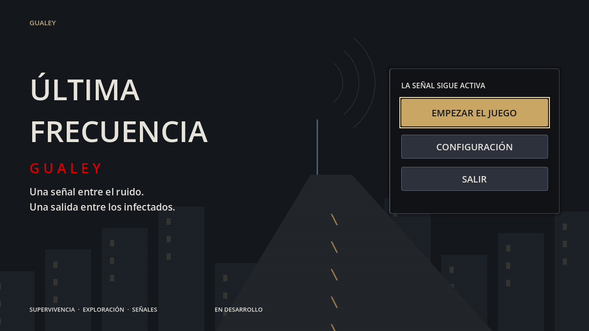
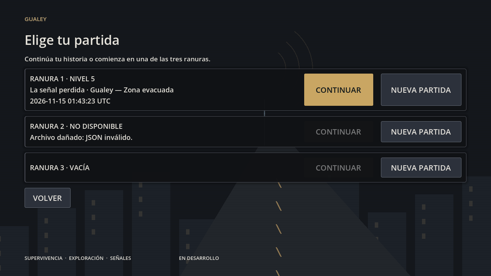
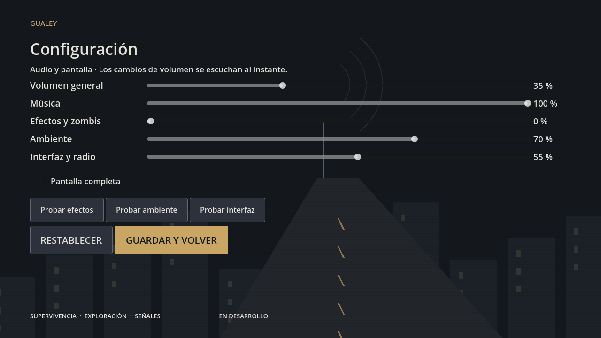
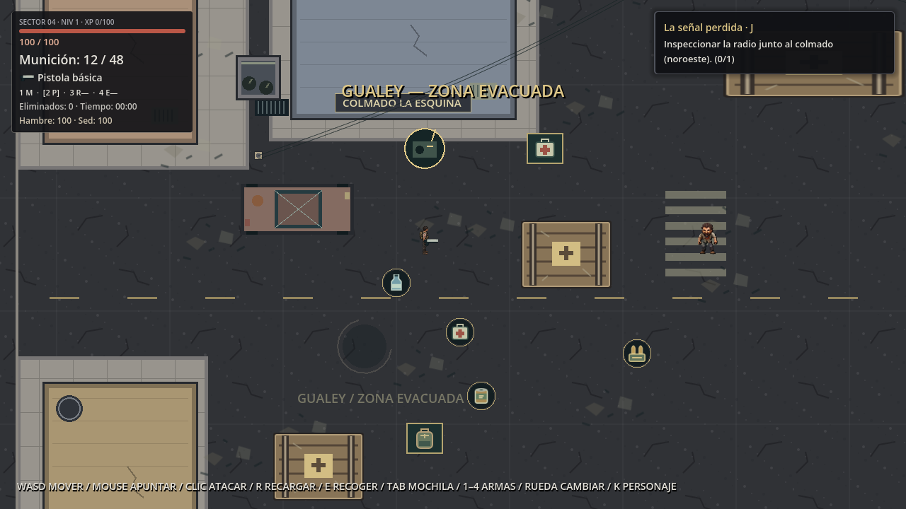
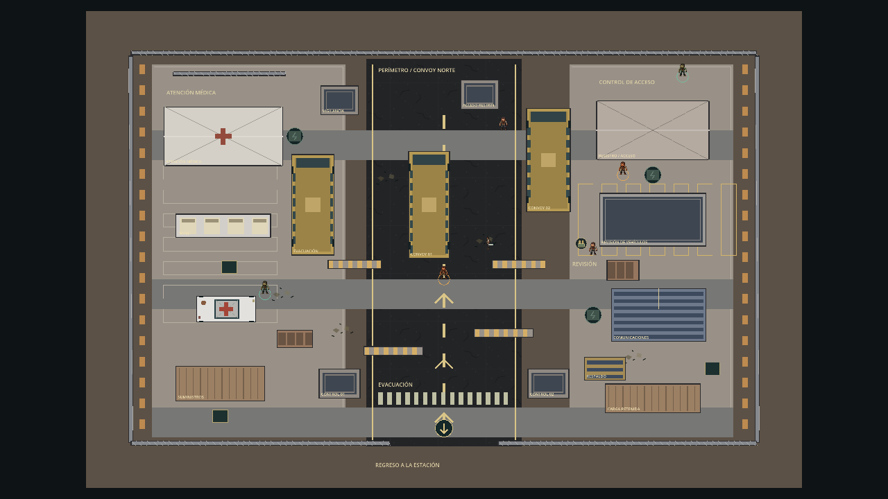

# Presentación inicial, configuración y paleta

El proyecto arranca con **TitleMenu.tscn** antes de crear un mundo. **F5** abre
la portada; **Empezar el juego** muestra tres ranuras, con nivel, capítulo, zona
y fecha del guardado. Se conservan las cuatro zonas, once misiones, mecánicas
y partidas v6. No se incrementa el esquema de guardado por ajustes de interfaz.

## Flujo de partida

- **Continuar** aparece habilitado para una partida válida, incluyendo respaldo
  recuperable y migraciones v1–v5 ya soportadas. Una ranura vacía o dañada no se
  carga. El error se muestra sin cerrar el menú ni sustituir una partida activa.
- **Nueva partida** permite elegir cualquiera de las tres ranuras. Si está
  ocupada, exige confirmar el reemplazo; cancelar no escribe. La creación espera
  la inicialización del mundo/población y guarda mediante el coordinador existente.
  Se conserva un respaldo del archivo válido anterior.
- La escena de preparación está oculta y sin procesamiento de gameplay. No se
  inicia IA, ambiente o tiempo de partida detrás de la portada. Se retira el
  menú únicamente después de guardar/cargar con éxito; los candidatos fallidos
  se liberan. Al entrar se exige soltar disparo para evitar el clic accidental.
- La pausa identifica la ranura **EN USO** y añade **Volver al inicio**, con
  confirmación de pérdida de cambios no guardados. No guarda automáticamente al
  salir. Reintentar conserva la selección de ranura de la sesión, manteniendo
  el reinicio de gameplay anterior. Esa selección no forma parte del JSON.

SaveFileStore sigue siendo la única lectura/validación de archivos y
SaveCoordinator mantiene la restauración transaccional por escena candidata.
No se añade un segundo sistema de partidas ni se cargan rutas del JSON.
F6 sobre Main.tscn permite entrar directamente para depuración.





## Preferencias

La fase 15.1 añade dos temas instrumentales provisionales, fundidos y reducción
de música durante pausa/radio, con una sola voz persistente entre zonas.
[Música, procedencia y validación de señal real](menu_gameplay_music.md).

Configuración contiene volumen **general**, **música**, **efectos y zombis**, **ambiente** e
**interfaz y radio**, además de **pantalla completa**. Los botones de prueba
permiten escuchar cada canal y Restablecer recupera los valores iniciales.
Guardar y volver conserva las preferencias en **user://settings.cfg**, separado
de las partidas. Un error de escritura deja la pantalla de ajustes abierta.

AppPreferences es un único autoload ligero, sin nodos de gameplay, actualización
por frame ni estado del personaje. Crea buses Music, Effects, Ambience e Interface
enviados al Master existente. SoundEmitter conserva su pool/ganancia por instancia
y solo dirige sus voces al bus correspondiente; los zombis y armas usan Effects.
GameAudio conserva bancos, duraciones y eventos; interfaz/radio usa Interface
y el bucle ambiental usa Ambience. No se crea música o voz nueva.

Los porcentajes 0–100 se convierten a ganancia lineal; 0 silencia el canal.
Los cuatro valores predeterminados son 100 %, conservando las ganancias base
de cada sonido. Se ignoran tipos inválidos y se limitan números fuera de rango.
Pantalla completa está desactivada por defecto. No se cambia VSync, renderizador,
resolución base, daño, IA, estadísticas ni tiempos para aplicar estos ajustes.



## Paleta por material

Se elimina el tinte ambiental verde de los cuatro mapas. El asfalto pasa a gris
carbón con grietas y marcas; las aceras a concreto gris/cálido, techos a grises,
azules apagados y tonos de obra; cajas a madera envejecida; estructuras metálicas
a acero. El Perímetro mantiene autobuses ocres, ambulancia blanca con cruz roja,
patios de concreto y suelo terroso; la Estación conserva su identidad industrial.

También se neutralizan fondos/bordes de interfaz y se reserva ámbar para acciones
principales. La barra de salud usa rojo apagado. No se recolorean los fotogramas
de personajes o arquetipos: sus tonos identificativos permanecen. Son recursos
técnicos sustituibles, no arte final. El fondo de portada y sus iconos están
dibujados en Godot/SVG, sin descargas o imágenes ficticias del juego.

Se modifican colores de los SVG existentes, scripts de dibujo, surface_color y
CanvasModulate; no tamaños, posiciones, capas, máscaras, navegación ni apariciones.
El generador de arte técnico se actualiza para no recuperar los colores antiguos
de asfalto/cajas al volver a ejecutarlo.





## Validación

- Suite previa ejecutada antes de modificar: **2.736 comprobaciones** aprobadas.
- Suite final: **2.791 comprobaciones headless**, cero fallos. Conserva todas
  las anteriores y añade **47** de menú/configuración y **1 + 7** de preferencias
  entre procesos. Las ranuras de prueba y los ajustes usan user://tests/*.
- En ventana: **51 comprobaciones** de menú, clic real en Empezar, tres ranuras,
  cancelación/reemplazo con respaldo, carga dañada/geométricamente inválida,
  conservación de datos, regreso al inicio, Reintentar y pantalla completa/ventana.
  Cuatro capturas reales de portada, ajustes, ranuras y partida nueva.
- Recorrido gráfico de cuatro zonas: **152 comprobaciones** aprobadas y
  23.407,96 px. La fixture prepara capítulos previos y aísla IA para narrativa;
  la regresión incluye las pruebas separadas de IA activa. Se inspecciona la
  paleta actual, composición, texto y controles, sin presentarlo como partida humana.
- En headless se activan señales de botones; el clic de GUI se comprueba en
  ventana. Las preferencias se guardan/leen en procesos independientes y se
  comprueban ganancias reales, silencio, límites y tipos inválidos.
- HUD/audio en ventana: **99 comprobaciones**, incluida captura de mezcla real
  del Master con los nuevos buses. El HUD mantiene 256 × 172. Importación final
  y arranque de portada aprobados sin ERROR/WARNING. El cierre verbose conserva
  el registro de 38 StringName sin reclamar; no se interpreta como fuga confirmada.

Durante la intervención se detectó una reserialización de recursos del editor
que había quitado chapter_id de ocho misiones y cantidades/escalas del arsenal.
Se recuperaron exclusivamente esos datos funcionales, conservando UID/formato
del editor. También se corrigieron una anotación de prueba, el estado de la
escena de apoyo al cargar y la reutilización de carpetas de test por PID en
Windows. Las carpetas aisladas que dependían solo del PID incorporan fecha de
alta precisión para evitar colisiones; los directorios compartidos entre escritor
y lector se mantienen. La pasada final no conserva esos errores.

Registros locales ignorados: test-results/start-menu/{baseline,regression,
graphical,four-zones-visual,preferences-write,preferences-read}.txt. No se
tocaron las ranuras normales o el archivo normal de preferencias durante pruebas.

```text
godot --headless --path . --editor --import
godot --path .
godot --headless --path . --fixed-fps 60 --script res://tests/title_menu_test.gd
godot --path . --fixed-fps 60 --script res://tests/title_menu_test.gd -- --capture
godot --headless --path . --script res://tests/preferences_restart_test.gd -- --write
godot --headless --path . --script res://tests/preferences_restart_test.gd -- --read
```

## Archivos y límites

Nuevos: scenes/TitleMenu.tscn; scripts/ui/{title_menu,title_background,
app_preferences}.gd y sus .uid; tests/title_menu_test.gd y
preferences_restart_test.gd con .uid; este informe; cinco capturas seleccionadas
en docs/images/ y sus .import.

Modificados: arranque/autoload en project.godot; audio/sound_emitter.gd y
game_audio.gd; save/save_coordinator.gd; ui/pause_ui.gd; tema y HUD; cuatro escenas
de mundo y siete scripts visuales de suelo/estructuras; SVG de asfalto/caja y
generador; cantidades/escalas de ArsenalSupplies y chapter_id de Mercado/Estación
restaurados; aislamiento de carpetas de pruebas de guardado/rendimiento; README, AGENTS e índice
de imágenes. No hay commits o push.

Pendientes humanos: recorrido prolongado con audio real, balance/lectura de la
nueva paleta en distintas pantallas, otros tamaños de ventana y varios monitores,
escucha subjetiva de mezclas y exportación Windows. La prueba verifica modo
pantalla completa en esta máquina, no compatibilidad de todos los equipos.
Si el proyecto estaba abierto antes de estos cambios, volver a abrirlo para
recargar configuración y recursos; F5 debe mostrar la portada.
