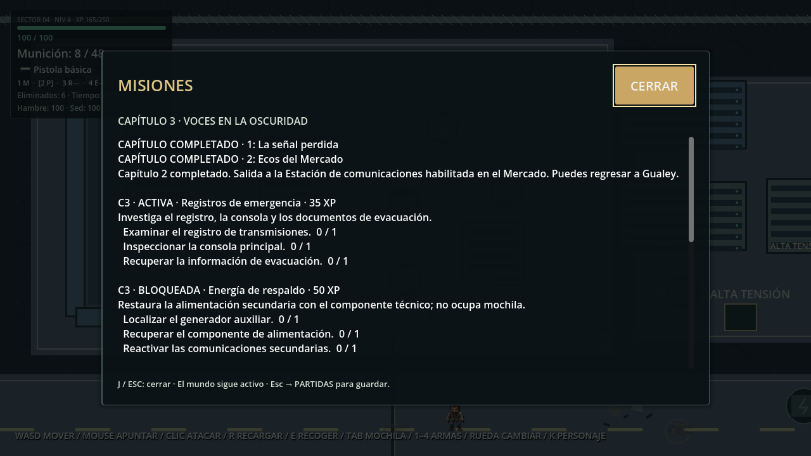
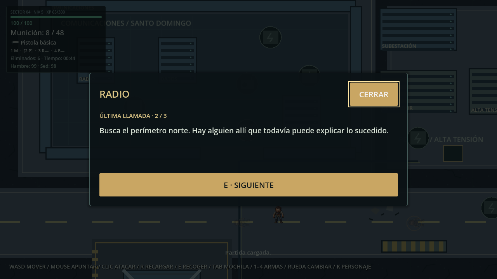
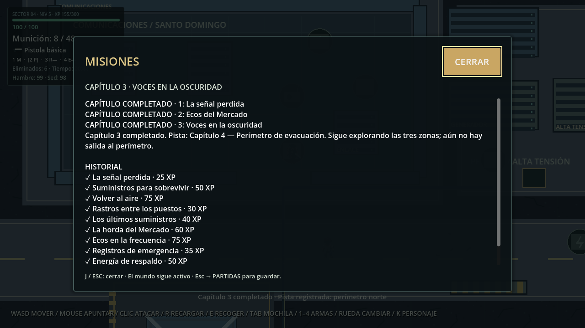

# Fase 14 — Voces en la oscuridad

**Estado vigente — Fase 16:** [El último convoy](evacuation_chapter.md), cuatro
capítulos, cuatro zonas y guardado v7 compatible con v1–v6. Este informe conserva
sus resultados históricos.

**Estado vigente — Fase 15:** [Perímetro de evacuación](evacuation_perimeter.md), cuatro zonas, tres capítulos y guardado v6 compatible con v1–v5. Se conservan abajo los resultados históricos.

Integración técnica del capítulo 3 en la Estación de comunicaciones existente.
Godot 4.7.2 Stable, GDScript, Windows, Compatibility, 1280 × 720.
Validación: 14 de noviembre de 2026. Arte provisional; partida humana pendiente.
No se añaden zonas, gestores paralelos, plugins, enemigos, armas o cinematográficas.

## Registro de capítulos y misiones

| Capítulo | ID | Inicio | Misiones |
| --- | --- | --- | --- |
| 1 · La señal perdida | signal_lost | Partida nueva | signal, supplies, broadcast |
| 2 · Ecos del Mercado | market_echoes | Mercado después de broadcast | market_traces, market_supplies, market_horde, market_frequency |
| 3 · Voces en la oscuridad | station_voices | Estación después de market_frequency | station_records, station_power, station_frequency, station_call |

MissionTracker mantiene once definiciones inmutables, estados por partida y un
solo MissionRewards. ChapterController observa interacciones, bajas y final de
radio; no produce daño ni cambia IA. Comenzar de nuevo un capítulo ya iniciado
se rechaza. Volver a otras zonas conserva el capítulo actual y los tres historiales.

| Misión | Objetivos en la estación | XP |
| --- | --- | ---: |
| Registros de emergencia | Registro de transmisiones, consola principal, información de evacuación; en cualquier orden | 35 |
| Energía de respaldo | Generador → componente → sistema secundario | 50 |
| Frecuencia interrumpida | Antena → enlace → terminar transmisión oculta | 65 |
| La última llamada | Dos bajas locales históricas → activar transmisor → terminar mensaje final | 90 |

Las cuatro misiones se encadenan y reservan su premio individual antes de
notificar XP: **240 XP configurados**. No se premia entrada, inspección
introductoria, relectura, carga ni retorno a la zona. El límite existente sigue
siendo nivel 10: el contenido finito completo actual ofrece 2.795 XP configurados
(1.980 enemigos, 220 contenedores, 595 misiones), pero al alcanzar nivel 10 no
almacena excedente. Permite nueve puntos en total; no cambia fórmula ni balance.

## Interacciones y comunicaciones

Se añaden nueve MissionPoint a World/ChapterPoints, con su forma circular
transitable, capa 8 y máscara 0. Reutilizan E, alcance 56 px y visibilidad World.
Se conservan los 26 sólidos, navegación, dimensiones, cámara y apariciones.

| Nodo | ID / evento persistente | Posición |
| --- | --- | --- |
| StationRadio (existente) | station_radio, en WorldSaveState.interactions | 1420,440 |
| Log | station_log | 1130,500 |
| Console | station_console | 1480,320 |
| Evacuation | station_evacuation | 900,1300 |
| Generator | station_generator | 1860,580 |
| Component | station_component | 1460,1020 |
| Secondary | station_secondary | 2050,760 |
| Antenna | station_antenna | 1050,1020 |
| Link | station_link | 1580,420 |
| Broadcast | station_broadcast | 1420,560 |

Los puntos representan equipos/documentos existentes; son marcadores técnicos,
no props finales nuevos. El componente es evidencia narrativa reservada en
totales/recibos de la misión. No ocupa espacio ni crea un segundo inventario;
funciona con doce espacios llenos, conserva su recuperación y no se duplica.

StationIntro.tres conserva su texto e inspección única de fase 13, sin XP.
Se añaden cuatro recursos al catálogo confiable de RadioTransmission:

- StationRecords: Registro 041, evacuación suspendida y actividad posterior.
- StationPower: alimentación secundaria restaurada; dirige hacia la antena.
- StationHidden: operador reciente y enlace oculto al norte, dos mensajes.
- StationFinal: advertencia contra señales oficiales, perímetro norte y pista
  «Capítulo 4 — Perímetro de evacuación», tres mensajes.

Al cerrar temprano, el equipo correspondiente reabre el mismo índice.
Otra interacción narrativa de la estación no sobrescribe una transmisión
pendiente, incluida la introducción. Guardar/cargar mantiene índice y deja la
ventana cerrada; la reanudación requiere E. Terminar exige avanzar más allá del
último mensaje mediante el botón inferior/E. Cerrar con Esc/CERRAR o morir no
emite transmission_completed ni concede los 65/90 XP pendientes.

InterfaceCoordinator sigue siendo la única fuente de bloqueo: radio/diario no
pausan el mundo, impiden controles del jugador y exigen soltar shoot al volver.
HUD mantiene tamaño y datos; ObjectiveHUD y J muestran misión/historial/pista.
Se reutilizan avisos y sonidos existentes, sin bancos WAV ni voces nuevas.

## Historia local y población finita

station_kills se deriva de los cadáveres del mapa, después de eliminated y del
contador global existente. También se reconstruye desde la estación guardada,
activa o inactiva, al migrar. Solo cuentan bajas de esta zona; no se añaden XP,
bajas, enemigos artificiales o premios de arquetipo desde la narrativa.

La misión final acepta **dos bajas anteriores**, aunque ocurrieran antes de
iniciar el capítulo o activar esa misión. La alternativa narrativa para una
estación histórica ya despejada es reconocer esas bajas como área asegurada.
No exige nuevos enemigos: un presupuesto agotado sin supervivientes conserva
18 cadáveres y satisface el objetivo automáticamente al llegar a la misión 4.
El esquema exige que bajas, cadáveres y presupuesto coincidan; no hace falta
inventar excepciones ni reiniciar el presupuesto. Se probó explícitamente v4
con 18 cadáveres y cero vivos, completando el capítulo sin generar una baja nueva.

Permanecen 6 vivos / 18 totales / 10 s y pesos 40/40/20 (7/7/4 por presupuesto),
con estadísticas, IA y navegación originales. Las nuevas Areas quedan sujetas
a la exclusión de apariciones cerca de objetivos ya existente. station_test
comprueba que se sigue consumiendo legítimamente el presupuesto completo.

## Persistencia v5 y compatibilidad

El esquema cambia: once misiones, tercer capítulo, nuevos eventos y
story.perimeter_hint. Por ello se incrementa a **v5**. No cambian player,
inventario, armas, WorldSaveState, catálogos de mapas o configuración de zonas.

- Estados, objetivos, componentes y equipos: missions.states/progress/totals,
  con recibos irrepetibles. El esquema contrasta eventos nuevos con objetivos
  y recibos; station_kills debe coincidir con cadáveres locales.
- Transmisiones inspeccionadas/terminadas: eventos de activación y escucha;
  radio guarda ID permitido e índice pendiente. La introducción conserva el
  recibo station_radio existente. No se aceptan rutas de recursos del JSON.
- Recompensas: missions.awarded, contrastadas con misiones completas.
- Capítulos: started/completed/chapter; perimeter_hint se deriva del capítulo
  3 terminado, sin otra fuente mutable. Solo es una pista, sin cuarto mapa/salida.

Cada formato v1/v2/v3/v4 se valida con sus campos históricos antes de migrar
v1 → v2 → v3 → v4 → v5, en memoria. El paso v4 → v5 añade cuatro misiones bloqueadas; si
Estación ya fue visitada y capítulo 2 está completo, inicia Registros de emergencia
y conserva sus bajas históricas, incluso estando el mapa inactivo. No interpreta
la introducción como investigación completa ni entrega premios al migrar.
No reescribe el archivo original al leer. La restauración sigue usando una
escena candidata validada antes de reemplazar la partida actual.

Las pruebas escriben exclusivamente en user://tests/phase-fourteen-* y las
carpetas aisladas de suites anteriores. No se tocan partidas normales.

## Pruebas y resultados

Base previa ejecutada: **2.204 comprobaciones**, cero fallos. Regresión final:
**2.441 comprobaciones headless**, cero fallos. Incluye toda la lista anterior,
cuatro comprobaciones adicionales de exclusión por muerte en fase 8 al añadir
definiciones, y los casos nuevos siguientes:

| Ejecución | Comprobaciones | Alcance |
| --- | ---: | --- |
| station_chapter_test.gd | 109 | Recorrido físico, E, tiros, historia local, mochila llena, orden, lecturas, dos cargas parciales, final, retorno a Gualey y reinicio |
| station_chapter_state_test.gd | 82 | IA real de los tres tipos, ataques, v1–v4, corrupción narrativa, introducción pendiente, población agotada, tope de nivel y seis viajes sin acumulación |
| station_chapter_restart_test.gd | 3 + 13 + 13 + 13 | Cuatro procesos: enlace pendiente → llamada pendiente → final → carga completada; comparación exacta de ocho secciones de guardado |
| Recorrido gráfico | 113 | Mismo recorrido y cuatro capturas reales |
| Estado/IA en ventana | 82 | IA, migraciones, protección de introducción, tope de nivel y seis viajes sin acumulación |
| station_performance.gd | 12 antes / 12 después | Seis transiciones, nodos/voces/señales y muestras de rendimiento |

El recorrido del capítulo 3 camina **12.531,99 píxeles** mediante Input, navegación
y move_and_slide, sin teletransportar al jugador en ese capítulo. Accede usando
una fixture semántica de capítulos previos; aísla física de enemigos únicamente
para comprobar narrativa/rutas. Usa dos bajas con disparos reales antes de la
misión final. No se presenta como partida humana ni prueba de dificultad.
La suite conserva además el recorrido de capítulos 1/2 y las tres zonas
(18.587,97 px), navegación/colisiones, supervivencia, arsenal, habilidades,
Game Over, reinicio y persistencia originales. La prueba de estado mantiene IA
activa para medir persecución/ataques; después la aísla para preparar migraciones.

Registros locales: test-results/phase-fourteen/{baseline,regression,graphical,
ai-window,performance-before,performance-after}.txt y metrics-{before,after}.json.
Los resultados son locales/ignorados; no se versionan.

Problemas encontrados y corregidos: una expectativa histórica fijaba versión 4;
la fixture de conversión necesitaba aceptar snapshots parciales solo de misiones;
el caso agotado tenía un slot de fixture incorrecto. Se protegieron y probaron
todos los diálogos pendientes frente a otras interacciones. No se cambió gameplay
para solucionar las fixtures. La pasada final no conserva esos errores.

```text
godot --headless --path . --editor --import
godot --headless --path . --fixed-fps 60 --script res://tests/station_chapter_test.gd
godot --headless --path . --fixed-fps 60 --script res://tests/station_chapter_state_test.gd
godot --headless --path . --fixed-fps 60 --script res://tests/station_chapter_restart_test.gd -- --write
godot --headless --path . --fixed-fps 60 --script res://tests/station_chapter_restart_test.gd -- --read
godot --headless --path . --fixed-fps 60 --script res://tests/station_chapter_restart_test.gd -- --final
godot --headless --path . --fixed-fps 60 --script res://tests/station_chapter_restart_test.gd -- --complete
godot --path . --fixed-fps 60 --script res://tests/station_chapter_test.gd -- --capture
godot --path . --script res://tests/station_performance.gd
```

## Rendimiento y cierre

Mismo instrumento específico de estación, ventana Debug autónoma, Godot oficial
ed1daf0bf, Ryzen 5 5600G, Radeon RX 580, VSync=1, max_fps=0, 1280 × 720.
Sin capturas o fixed-fps durante las muestras. No se modifica project.godot.
La media/p95 son intervalos monotónicos entre process_frame; los monitores de
física publican máximos por segundo, cuya media de lecturas **no es** el coste
medio por paso. No se comparan estos FPS con otras invocaciones históricas.

| Escenario | Media antes/después ms | p95 antes/después ms | Física* antes/después ms | Render CPU/GPU después ms |
| --- | ---: | ---: | ---: | ---: |
| market_control | 13.90 / 13.91 | 14.23 / 14.51 | 0.477 / 0.459 | 0.488 / 0.765 |
| station_idle | 13.90 / 13.90 | 14.22 / 14.25 | 0.362 / 0.352 | 0.445 / 0.814 |
| station_six | 13.91 / 13.90 | 14.30 / 14.24 | 0.539 / 0.561 | 0.447 / 0.786 |

Cadencia observada cercana a 71.9 FPS. Memoria estática registrada de estación: 49.13 → 49.43 MiB durante la pasada.


Las nueve interacciones añaden 18 nodos (Area + Shape): Estación 430 → 448.
Voces 27, conexiones died 21, una región y cero huérfanos; Mercado de control
mantiene 456 nodos/33 voces/23 conexiones (seis vivos y dos cadáveres de fixture).
Recursos 478 → 498 por las cuatro misiones con objetivos y cuatro radios nuevas;
permanecen constantes en cada pasada y en los seis viajes. La memoria estática
incluye arrays retenidos por el instrumento; no es memoria privada del proceso.
No se deduce ausencia de fugas durante horas ni rendimiento de exportación.

Importación final y arranque normal aprobados, sin ERROR/WARNING ni informe de
instancias ObjectDB retenidas. Los tres cierres verbose (uno previo y dos
posteriores) registraron **38 / 38 / 38 StringName** sin reclamar: no hubo aumento
reproducible en estas pasadas y no se interpreta esa cifra como fuga confirmada.
Logs: final-import.txt, verbose-before.txt y verbose-after-{1,2}.txt.

## Capturas reales y recursos provisionales







Cuatro capturas generadas e inspeccionadas; tres seleccionadas para docs/images,
PNG 1280 × 720 optimizados sin pérdida y comprobados píxel a píxel. La cuarta
(canal oculto) permanece solo en resultados. Textos legibles, un modal visible,
HUD compacto y rótulo de zona oculto durante modales. No hay arte generado,
sprites nuevos, portada ficticia ni recursos externos. Entorno, iconos y audio
continúan siendo técnicos/provisionales. [Fuentes de la galería](images/README.md).

## Archivos de esta fase

Nuevos: resources/missions/Station{Records,Power,Frequency,Call}.tres;
resources/radio/Station{Records,Power,Hidden,Final}.tres; tres tests
station_chapter{,_state,_restart}_test.gd y sus .uid; este informe; tres PNG
station-{chapter-journal,last-call,chapter-complete} con sus .import.

Modificados: scenes/Main.tscn (definiciones), scenes/world/StationWorld.tscn
(nueve Areas); chapter_catalog.gd, chapter_controller.gd, mission_tracker.gd;
mission_save_state.gd, save_catalog.gd, save_coordinator.gd, save_migration.gd,
save_schema.gd; mission_ui.gd, objective_hud.gd, game_audio.gd (sonidos existentes
de misión); legacy_save_fixture.gd y tres expectativas de tests históricos;
AGENTS.md, README.md, índice de imágenes y punteros de estado vigente en cinco
informes históricos. No se modifican jugador, salud, armas, IA, navegación,
supervivencia, HUD principal, configuración o catálogos de zonas. Sin commits/push.

## Validaciones humanas pendientes

Partida humana de los tres capítulos con IA y recursos reales, balance de las
dos bajas previas bajo presión, descubrimiento de equipos sin conocer coordenadas,
lectura/scroll del diario a otras resoluciones, escucha de mezcla, panel gráfico
del depurador, sesiones largas de viajes/guardados/memoria y exportación Windows.
Las pruebas y capturas no sustituyen estas revisiones. El cuarto capítulo/mapa
no está implementado; solo queda su pista narrativa persistente.
