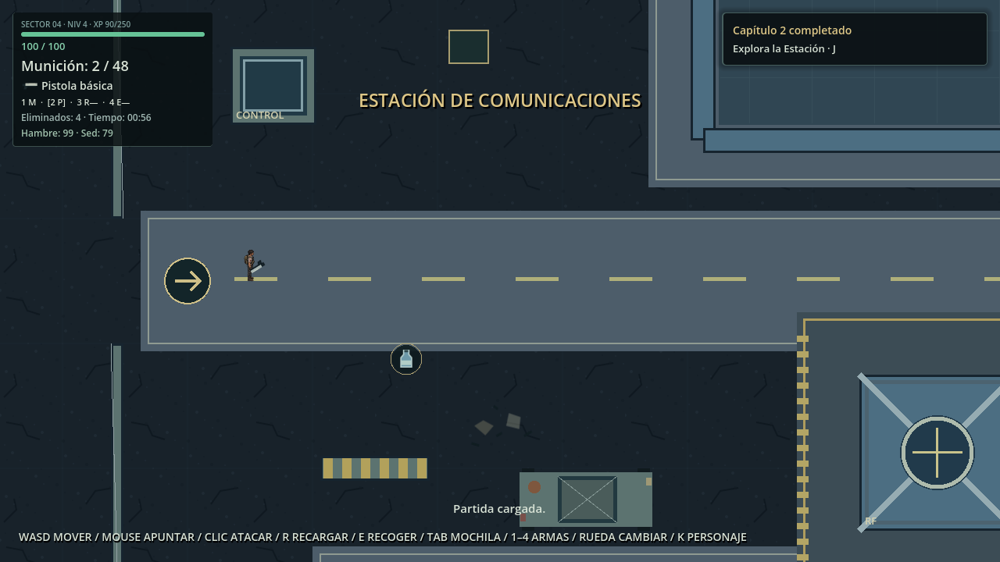
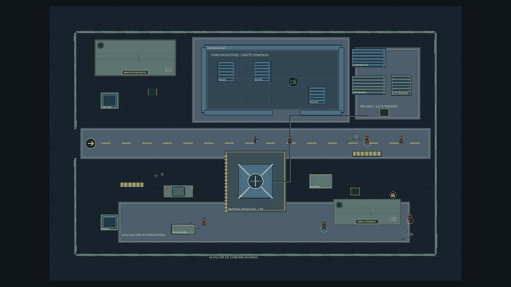
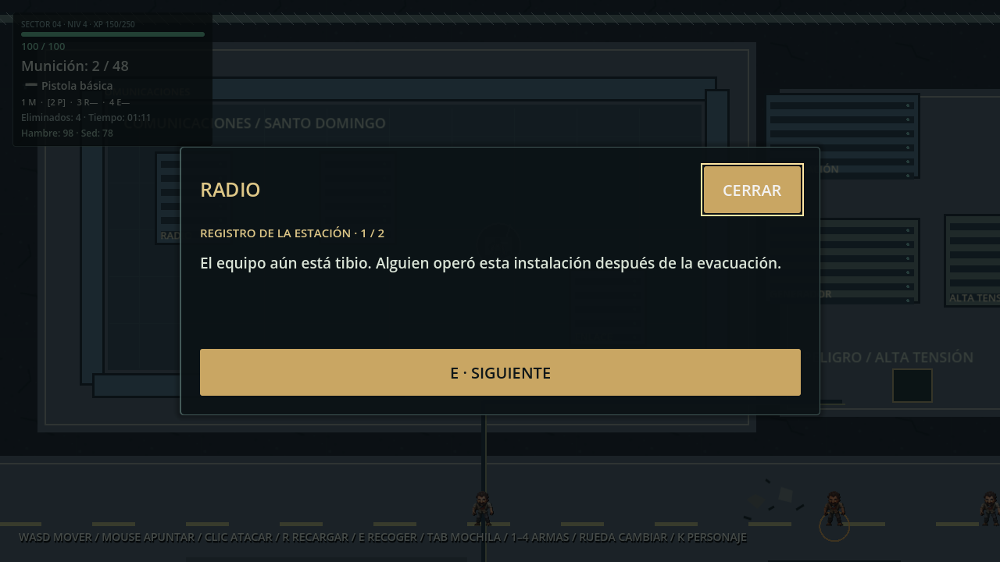

# Fase 13 — Estación de comunicaciones

**Estado vigente — Fase 14:** [Voces en la oscuridad](station_chapter.md): tres capítulos, once misiones y guardado v5 compatible con v1–v4. Este informe conserva sus resultados históricos.

**Estado: integración técnica y documentación cerradas**, con arte provisional y
validaciones humanas pendientes. Revisión final: 14 de noviembre de 2026.
Esta continuación conserva la implementación del commit `c475def`: no añade
componentes ni modifica gameplay, IA, armas, balance o VSync.

## Arquitectura y escenario

La tercera zona es `communications_station`, definida en
resources/zones/Station.tres y scenes/world/StationWorld.tscn. Conserva las
dimensiones 2400 × 1600 y utiliza los mismos ZoneCatalog, ZoneDefinition,
ZoneManager, WorldSaveState, población, jugador, HUD y radio de las otras zonas.
No hay otro gestor de mapas ni cambios paralelos en Main.gd.

El mapa contiene **26 estructuras sólidas**: edificio de comunicaciones con
acceso a su sala de radio, racks, antena central, generador, transformador,
subestación eléctrica, vallas con entrada oeste, dos puestos de vigilancia,
vehículo de mantenimiento, anexo técnico, barricadas y restos de evacuación.
Hay recorridos exteriores por ambos lados de la antena y un acceso transitable
a la sala principal. El generador es decorativo; no inicia otra misión.

- station_ground.gd dibuja pavimento, pasillos, cableado y señalización estáticos.
- station_structure.gd extiende el visual UrbanObstacle; dibuja desde la misma
  huella rectangular serializada que usa CollisionShape2D.
- world_navigation.gd genera la malla desde Obstacles, con el margen existente
  de 20 px. No duplica geometría ni cambia el algoritmo de persecución.
- CanvasModulate suave conserva contraste; no se añaden luces dinámicas costosas.
- Supplies contiene tres contenedores y dos recogibles transitables, reutilizando
  LootContainer y WorldPickup, fuera de los sólidos de navegación.

| Recurso | Posición | Contenido original |
| --- | --- | --- |
| station_medical | 1950,620 | 2 botiquines y 1 agua |
| station_parts | 1780,1080 | 24 balas de pistola y 6 de revólver |
| station_canteen | 600,500 | 2 comidas y 2 aguas |
| station_water | 520,900 | 1 agua |
| station_ammo | 2000,1100 | 12 balas de pistola |
| station_radio | 1420,440 | Inspección narrativa única, sin XP |

## Conexiones y desbloqueo

| Zona | ID estable | Definición |
| --- | --- | --- |
| Gualey — Zona evacuada | gualey_sector_04 | resources/zones/Evacuated.tres |
| Mercado abandonado | market_abandoned | resources/zones/Market.tres |
| Estación de comunicaciones | communications_station | resources/zones/Station.tres |

La estación se habilita únicamente al completar `market_frequency`, después de
avanzar más allá del último mensaje de la transmisión final del capítulo 2.
Cerrar la radio anticipadamente no desbloquea la salida. ZoneManager reutiliza
mission_completed y actualiza los indicadores; no se añade un capítulo 3.

| Trayecto | Salida / aproximación sugerida | Entrada de destino |
| --- | --- | --- |
| Gualey → Mercado | E en 2120,800; acercarse a 2090,800 | from_gualey: 320,800 |
| Mercado → Gualey | E en 240,800; acercarse a 270,800 | from_market: 2020,800 |
| Mercado → Estación | E en 2280,800; acercarse a 2250,800 | from_market: 320,800 |
| Estación → Mercado | E en 240,800; acercarse a 270,800 | from_station: 2180,800 |

ZoneDefinition.connections declara destino y entrada autorizados. Se rechaza
Gualey → Estación directo, una entrada incorrecta y viajes simultáneos.
Se mantienen alcance de 56 px, rayo World, fundidos y nombre de zona existentes.
Durante el fundido se congelan relojes/daño; se conserva el mismo Player y HUD.
Los mapas descargados son datos, no nodos que siguen procesando.

## Enemigos y exploración

Pesos configurables **40 % comunes / 40 % corredores / 20 % resistentes**,
seis vivos como máximo, presupuesto de 18 y reposición cada diez segundos.
La selección usa el reparto determinista por ordinal existente, no tiradas
independientes: los primeros seis son 3/2/1; el total resulta en **7/7/4**.
No se cambian salud, velocidad, daño, animaciones, cooldown o premios por tipo.

Las tres semillas se sitúan en 1400,800; 1850,800 y 1600,1300, alejadas de la
entrada. Las reposiciones validan cámara con margen, separación del jugador y
enemigos, huella física, conectividad y distancia a puntos de interacción.
El presupuesto de cada mapa sigue siendo independiente.

La estación añade hasta 765 XP de enemigos y 60 de primeras aperturas de
contenedores. La entrada y la radio no conceden XP. Son recompensas de los
sistemas existentes; no hay misiones nuevas, premios de capítulo 3 o respawn infinito.

## Radio y persistencia v4

StationIntro.tres usa RadioController/RadioUI existentes y su aviso electrónico.
La inspección revela que alguien operó el equipo tras la evacuación y menciona
el área técnica, sin activar objetivos inexistentes. Se reserva `station_radio`
en ZoneManager.interactions antes de emitir el primer mensaje. Si se cierra
temprano, se puede reabrir desde el índice pendiente; tras terminar no se repite.

WorldSaveState captura/restaura `interactions` junto con recogibles, contenedores,
enemigos, heridas/cadáveres, recibos de recompensas y presupuesto de población.
Al descargar un mapa, esa lista pasa a su snapshot; el mapa activo no se duplica
en la caché de zonas. Se conservan salud, necesidades, inventario, cuatro armas,
munición, nivel/habilidades, misiones y capítulos del jugador.

**Formato actual: v4.** Admite mapa activo y hasta dos mapas inactivos, hasta
54 bajas globales coherentes con sus mundos, IDs de interacción por definición
y el desbloqueo de Estación ligado a market_frequency completada.
Se rechazan interacciones duplicadas/desconocidas, estados de zona ausentes y
visitas a la estación sin desbloqueo. Las rutas del JSON no cargan escenas.

La lectura valida cada formato anterior antes de migrar en memoria:
v1 → v2 → v3 → v4. El paso v3 → v4 añade listas de interacciones vacías a los
mundos existentes y habilita Estación si ya se completó el capítulo 2. No cura,
repone botín ni vuelve a conceder XP. No reescribe el archivo anterior al leer.
La compatibilidad es del juego actual leyendo v1/v2/v3; builds anteriores no
conocen v4. Las pruebas escriben solo en user://tests/phase-thirteen-* y las
rutas aisladas de las suites previas, nunca en las partidas normales.

## Evidencias reutilizadas

Los registros ya estaban completos y sin ERROR/WARNING. Se contrastaron con
los scripts/escenas actuales; el repositorio estaba limpio en `c475def` al
comenzar esta continuación. No se repitió la suite ni se regeneraron mediciones.

| Registro existente | Resultado y alcance |
| --- | --- |
| phase-thirteen/baseline.txt | 1.934 comprobaciones previas, cero fallos |
| phase-thirteen/regression.txt | **2.204 comprobaciones**, cero fallos |
| phase-thirteen/graphical.txt | **136 comprobaciones en ventana**, recorrido de los tres mapas y capturas |
| phase-thirteen/ai-window.txt | **132 comprobaciones en ventana**, IA/estado de estación |
| performance/phase13-before | 44 comprobaciones, cero fallos |
| performance/phase13-after | 44 comprobaciones, cero fallos |
| phase-thirteen/performance-station.txt | 12 comprobaciones del benchmark específico, cero fallos |

Todas las rutas anteriores están bajo test-results/ (ignorado). Las 2.204
comprobaciones incluyen las 1.934 previas, una comprobación adicional de entrada
del Mercado, 132 de estación, ocho de reapertura y 129 del recorrido ampliado.

El recorrido automatizado completa ambos capítulos y camina **18.587,97 px**
con entrada/física, E y disparos reales, viaja Gualey → Mercado → Estación y
regresa Estación → Mercado → Gualey. Aísla la física de enemigos para comprobar
narrativa/rutas; conserva mundo y recursos. Llega a Estación con la mochila llena
por una fixture del capítulo 2; las recuperaciones se verifican por separado.
No es una partida humana ni una prueba de balance.

station_test.gd mantiene IA activa: tres variantes caminan y atacan, un común
rodea un rack real y el rayo World queda bloqueado por él. Comprueba entradas y
rutas a radio/suministros, conservación del jugador/arsenal/habilidades, límite
6/18, generación completa 7/7/4, ausencia de colisiones en apariciones, cámara,
radio pendiente/completada, heridas, cadáveres, viajes repetidos, Game Over y
Reintentar. La fixture prepara el acceso y adelanta el reloj de reposición para
agotar el presupuesto; no modifica la IA o los tiempos de producción.

station_restart_test.gd escribió y leyó en procesos separados (PID **7656** y
**18508**): tres mundos, agua recogida, radio pendiente en índice 1, resistente
herido con 87,5 HP y corredor muerto, sin duplicación de XP o actores.
La suite incluye migraciones v1/v2 y el test de estación verifica v3 → v4 con
capítulo ya completado, manteniendo XP y bytes del archivo original.

## Métricas revisadas

Se reutilizan los tres JSON solicitados en test-results/performance/.
Windows, Godot 4.7.2 oficial ed1daf0bf, Debug autónomo, Ryzen 5 5600G,
Radeon RX 580, Compatibility y ventana 1280 × 720. Los tres registran VSync=1
y max_fps=0. No se cambió la configuración predeterminada.

Media/p95 siguientes proceden de intervalos de reloj monotónico entre
process_frame; FPS = 1000 / media. No son promedios de TIME_PROCESS.
Los monitores de física publican máximos por segundo: la media de sus lecturas
no es tiempo medio exclusivo por paso físico. Render CPU/GPU se mide por viewport.
Se conserva la metodología y sus límites de [fase 11.1](performance_phase_11_1.md).

| Escenario general | Media antes ms | Media después ms | p95 antes ms | p95 después ms |
| --- | ---: | ---: | ---: | ---: |
| Gualey, lejos | 29.39 | 29.00 | 32.31 | 32.06 |
| Gualey, seis cercanos | 29.13 | 29.11 | 32.27 | 32.19 |
| Mercado 3/2/1 | 28.79 | 26.79 | 32.07 | 32.25 |
| Combate | 29.35 | 29.62 | 32.62 | 32.58 |
| Mochila | 28.81 | 26.54 | 32.10 | 32.15 |
| Personaje | 28.78 | 26.77 | 32.03 | 32.09 |
| Mercado estable | 27.77 | 25.05 | 31.95 | 32.11 |
| Después de cargar | 30.91 | 24.68 | 32.15 | 31.94 |

Guardar: 12.55 → 12.49 ms; cargar: 33.73 → 33.65 ms.
Una operación por pasada; no son percentiles de carga. La fila poscarga mide
el estado estabilizado y excluye esas operaciones. P95 general se mantiene
cerca de 32 ms; las variaciones de media no demuestran una optimización causal.

La pasada específica de estación usa otra preparación/script e invocación que
la comparación general. Aunque ambas registran VSync=1, su cadencia observada
fue distinta. No se presenta 71,9 FPS como una mejora frente a los 32–41 FPS del
runner general. La comparación interna válida es Mercado de control frente a
Estación dentro de la misma ejecución.

| Escenario en pasada específica | FPS observados | Media ms | p95 ms | Física* ms | Render CPU / GPU ms |
| --- | ---: | ---: | ---: | ---: | ---: |
| market_control | 71.9 | 13.90 | 14.21 | 0.457 | 0.456 / 0.761 |
| station_idle | 71.9 | 13.90 | 14.24 | 0.332 | 0.435 / 0.798 |
| station_six | 71.9 | 13.90 | 14.24 | 0.550 | 0.386 / 0.532 |

*Física: media de lecturas de máximos publicados por segundo, no coste medio
por paso. En seis transiciones de esta pasada: Estación mantiene **430 nodos,
27 voces, 21 conexiones died, una región y cero huérfanos**; Mercado de control
456 nodos, 33 voces y 23 conexiones. El control repone dos enemigos eliminados
durante la preparación: seis vivos más dos cadáveres explican la diferencia.
Los 478 recursos permanecen constantes; cada mapa se compara consigo mismo.
La memoria estática registrada de Estación pasa de 49,01 a 49,16 MiB,
incluyendo arrays de muestras retenidos por el instrumento. No es memoria
privada total del proceso ni una demostración de ausencia de fugas prolongadas.

Las muestras no muestran un cuello de botella nuevo dominante ni acumulación
de regiones, voces o señales. No prueban rendimiento de una exportación Windows,
ausencia de fugas durante horas ni 60 FPS estables en todas las modalidades.

## Capturas revisadas

Se inspeccionaron las tres imágenes existentes de test-results/phase-thirteen/:
composición, entrada oeste y salida, sala accesible, obstáculos, antena,
suministros, actores visibles y HUD/radio legibles, sin superposiciones importantes.
No se detectó un defecto visual que justificara cambiar el juego.







El plano usa zoom 0,43 y HUD oculto solo en la fixture; después se restauran.
Las capturas narrativas aíslan IA y no prueban por sí mismas posiciones de
aparición válidas: estas se comprueban con geometría y física en station_test.
Se copiaron a docs/images/ con optimización PNG sin pérdida y comparación de
píxeles. Fuentes, cámara y recursos del juego se conservan.

## Recursos provisionales

Se reutilizan asfalto, escombros, suministros, personajes, tema y banco de audio.
Las estructuras nuevas son dibujos geométricos estáticos y sustituibles,
derivados de sus colisiones, con colores técnicos y modulación suave. No son
arte definitivo, una reconstrucción real de Santo Domingo ni texturas nuevas
descargadas. No se añadieron plugins, música, arquetipos, armas o misiones.

## Comprobaciones de esta continuación

Se reutilizaron las pruebas y métricas anteriores. Se revisaron capturas,
coherencia de los JSON, totales de aserciones, códigos/rutas de transiciones y
migraciones. Se verifican enlaces locales, PNG idénticos a sus fuentes y que el
diff solo contenga documentación/imágenes. No se crearon pruebas de gameplay.

Ejecutadas nuevamente solo para el cierre:

- `godot --headless --path . --editor --import`: aprobado; genera únicamente
  caché ignorada y metadatos de las imágenes de documentación.
- `godot --path . --verbose --quit-after 180`: arranque normal aprobado,
  salida 0, sin ERROR/WARNING ni informe de instancias ObjectDB retenidas.
  El modo verbose enumera 38 StringName sin reclamar al cerrar; se conserva el
  registro y no se utiliza para afirmar ausencia de fugas del motor.
- Enlaces Markdown, dimensiones/identidad de píxeles y `git diff --check`:
  verificados. Los únicos cambios de esta continuación son los indicados abajo.

Los dos logs nuevos son closing-import.txt y closing-startup.txt bajo
test-results/phase-thirteen/. No se ejecutaron otra vez la regresión completa,
la prueba de 132, la reapertura, el recorrido gráfico ni los benchmarks.

Archivos nuevos de esta continuación: este informe, tres PNG de docs/images/
y sus metadatos .import de Godot. Modificados: README.md e índice de imágenes.
No se reimplementó ningún sistema ni se modificaron scripts, escenas, Resources,
AGENTS.md o project.godot. No se hicieron commits ni push.

## Pendientes manuales

Partida humana completa con IA en las tres zonas; dificultad y recursos en las
entradas, rutas alternativas bajo presión, escucha prolongada de audio, otros
tamaños de ventana, sesiones largas de guardado/carga y memoria, y exportación
Windows. La advertencia intermitente de cierre de fase 11.1 no se declara resuelta
por estos registros. El capítulo 3 y una cuarta zona siguen fuera de alcance.

Para repetir únicamente cuando haya un cambio funcional o una duda nueva:

```text
godot --headless --path . --fixed-fps 60 --script res://tests/station_test.gd
godot --headless --path . --fixed-fps 60 --script res://tests/station_restart_test.gd -- --write
godot --headless --path . --fixed-fps 60 --script res://tests/station_restart_test.gd -- --read
godot --path . --fixed-fps 60 --script res://tests/market_chapter_test.gd -- --station --capture
godot --path . --script res://tests/station_performance.gd
```
