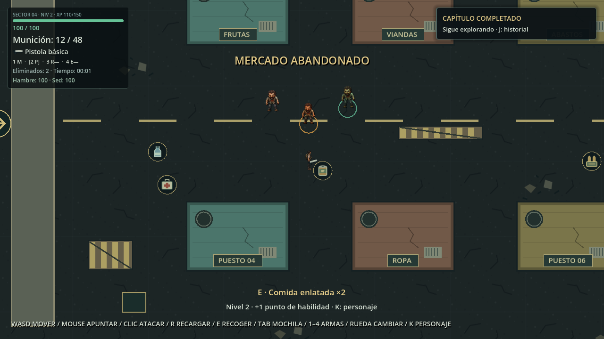

# Fase 11 — variantes de zombis y dificultad por zona

Validado el 14 de noviembre de 2026 con Godot 4.7.2 Stable, Windows,
Compatibility y Radeon RX 580. Integración técnica con arte provisional.

## Configuración y comportamiento

| Tipo | Salud | Velocidad px/s | Daño | Intervalo de ataque | XP |
| --- | ---: | ---: | ---: | ---: | ---: |
| Común (`base`) | 50 | 105 | 10 | 1,5 s | 30 |
| Corredor (`runner`) | 37,5 | 147 | 10 | 1,5 s | 45 |
| Resistente (`resistant`) | 100 | 78,75 | 12,5 | 1,5 s | 60 |

`resources/enemies/Common.tres`, `Runner.tres` y `Resistant.tres` son
ZombieArchetype inmutables. Las variantes referencian al común y multiplican
salud, velocidad y daño. Comparten detección de 250 px y alcance de 35 px.
Para ajustar enemigos en el inspector, editar su Resource; los valores del actor
son copias por instancia aplicadas en `_enter_tree`, antes del ready de sus hijos.

Se reutilizan Zombie.tscn, la misma máquina IDLE/CHASE/ATTACK/DEAD, navegación,
HealthComponent y flujo de eliminación. No se cambiaron algoritmos de IA,
armas, jugador, colisiones, cámara, HUD ni Game Over. Cada ataque aplica daño
por la ruta anterior; visual y audio solo observan. La muerte concede una sola
recompensa según el tipo y mantiene el desvanecimiento de 0,45 s.

## Distribución finita

ZoneDefinition expone `enemy_weights`. Zona evacuada conserva 100 % comunes:
seis iniciales y hasta 18 totales. Mercado usa 60/30/10, con los mismos límites
de seis vivos, 18 apariciones y reposición cada diez segundos.

ZombieArchetypes elige por déficit de cuota acumulado, con desempate estable,
desde el ordinal de aparición. No introduce otro generador ni estado aleatorio.
Los primeros seis son común/corredor/común/resistente/común/corredor; el
presupuesto completo resulta en **11 comunes, 5 corredores y 2 resistentes**.
No son probabilidades independientes; la mezcla es reproducible y configurable.

En partida nueva, las bajas del mercado ofrecen 675 XP y sus contenedores 60:
**735 XP**. Con los 790 de la zona inicial, el máximo del contenido es
**1.525 XP: nivel 7, 175/400 XP y seis puntos de habilidad**.
Las partidas antiguas conservan sus enemigos guardados y pueden tener otro total;
no se conceden recompensas retroactivas ni se transforma un común ya existente.

## Presentación provisional y audio

Los tres tipos reutilizan los 96 PNG técnicos y cuatro direcciones existentes.
El común conserva su aspecto; corredor usa tono cálido y aro naranja, resistente
tono verdoso y aro verde. Escala 0,85, offset (0, −46) y colisión no cambian.
Walk ajusta la reproducción a velocidad real / 105; Attack sigue el intervalo
existente, Death se reproduce una vez. No se declara arte definitivo.

[Comunes en la zona inicial](images/zombie-common.png). Las posiciones se preparan
en la prueba; la física, navegación, persecución y ataques permanecen activos.

Se reutiliza TechnicalAudio y el pool de tres voces por enemigo. Pitch común /
corredor / resistente: 1 / 1,12 / 0,88; ganancia efectiva −18 / −20 / −19 dB.
Los gemidos posteriores conservan el escalonado y multiplican su intervalo por
1 / 1,2 / 1,3. No se añaden WAV ni voces por evento. Los límites son sonoros,
sin alterar cooldown, daño ni invulnerabilidad. Falta evaluar la mezcla subjetiva
en una sesión prolongada con varias variantes próximas.

## Persistencia

Se mantiene JSON **v2**: el campo `type` existente admite únicamente `base`,
`runner` o `resistant`, mediante catálogo local. No se cargan rutas de recursos
desde JSON. Se valida salud máxima y cooldown según el tipo antes de restaurar.
Se conservan ID, salud restante, cadáver, presupuesto y estado de ambas zonas.

Los v2 antiguos con `base` siguen siendo comunes: cargar no los reemplaza,
no cura heridas y no vuelve a conceder XP. Las apariciones futuras usan la
configuración de zona y el ordinal conservado. La migración v1 → v2 se mantiene;
v1 solo admite el común original. Tipos desconocidos se rechazan sin restaurar
parcialmente. La compatibilidad comprobada es del juego nuevo leyendo archivos
anteriores; las versiones antiguas del juego no conocen las nuevas variantes.

## Validación ejecutada

**1.764 comprobaciones headless, cero fallos:** 1.512 anteriores más 150 de
arquetipos, 76 de persistencia, 20 visuales/estados y 6 de reapertura entre
procesos. Ninguna prueba anterior fue modificada para aceptar las variantes.

- IA activa de cada tipo: cuatro direcciones, persecución, ruta alrededor del
  colmado, colisiones y ataque bloqueado por World. En 30 frames recorren
  52,5 / 73,500366 / 39,375 px, respectivamente.
- Daño y cooldown reales; hit flash, muerte única, baja/XP únicos, Death final.
  Las cuatro armas existentes se prueban contra los tres tipos, sin cambiar sus
  parámetros. Los doce enemigos eliminados conceden 540 XP en esa fixture.
- Mercado real: mezcla inicial, generación finita completa, límites, puntos
  válidos y ausencia de mutaciones en Resources compartidos. Para agotar el
  presupuesto se avanza el reloj del generador en la fixture; no cambia en juego.
- Viaje de ida/vuelta, tipos y heridas, cadáver sin recompensa repetida,
  guardados v1/v2 antiguos, tipo desconocido y límites de salud incorrectos.
- Escritura y lectura en procesos separados: escritor PID 19340 y lector 14000.
  Se compara estado de ambas zonas, jugador, estadísticas y misiones; resistente
  herido en 87,5 HP y corredor muerto siguen iguales, con cinco de seis vivos.
- En ventana: 150 de arquetipos, 76 de persistencia, 23 de visuales con tres
  capturas y 94 de regresión HUD/audio, todas aprobadas. También se comprueban
  Game Over, detención de enemigos y Reintentar con seis comunes.

Las fixtures preparan posiciones y algunos eventos de misiones para llegar al
mercado. El ensayo de armas aísla sus impactos; el recorrido visual conserva IA
activa. Las pruebas no sustituyen una partida manual completa.

Resultados y capturas están en `test-results/archetypes/` (ignorado):
`regression-final.txt`, `window-*.txt`, `graphical.txt` y `performance.txt`.
No aparecieron ERROR/WARNING en las ejecuciones completas. La importación final
con `--headless --editor --import` y el arranque normal de Main durante
180 frames también terminaron sin errores. README y enlaces locales verificados;
las dos capturas optimizadas coinciden píxel a píxel con sus fuentes.

## Rendimiento y pendientes

**Aclaración Fase 11.1:** 32,18 ms es la media de lecturas de un monitor que
publica máximos por segundo, no la media real del intervalo entre frames.
La prueba histórica usaba `--fixed-fps`; no permite deducir FPS de partida.
[Medición con reloj real y diagnóstico de presentación](performance_phase_11_1.md).
El párrafo siguiente conserva el registro histórico con esta corrección.

Muestra gráfica de 120 frames, seis vivos y tres perseguidores: TIME_PROCESS
medio **32,18 ms**, máximo 121 draw calls y 426 nodos, ventana con foco.
El editor del usuario permanecía abierto; otra ejecución con capturas dio
31,97 ms y el diagnóstico sin VSync, 89,64 ms. No son un benchmark controlado
ni permiten afirmar 60 FPS o ausencia de regresión. El pool no crece durante
ataques. Quedan medición de build exportada, comparación controlada y sesión
larga para valorar rendimiento, balance y mezcla audible. No se optimizaron
otros sistemas ni se cerró el editor del usuario para mejorar la cifra.

Revisados sprites, dirección, escala, pivote y feedback en capturas reales.
El paquete conserva poses repetidas y apariencia provisional; falta arte propio
de variantes y evaluación manual prolongada de continuidad y legibilidad.

## Archivos de esta fase

Nuevos: ZombieArchetype y ZombieArchetypes, tres Resources de enemigos,
`tests/archetype_fixture.gd`, cuatro pruebas `archetypes_*_test.gd` con sus UID,
este informe y dos capturas optimizadas en docs/images/.

Modificados: zombie.gd (inicialización), zombie_population.gd, ZoneDefinition,
Market.tres, ZoneManager, progression_rewards.gd, zombie_visual.gd,
zombie_audio.gd, sound_emitter.gd, save_schema.gd y world_save_state.gd;
README, AGENTS y referencias de documentación. Se conservaron los cambios
preexistentes de fase 10. Sin commits, publicación, plugins ni arte generado.
